# Guildwise HQ: User Guide

*Many hands. One master.*

Guildwise HQ is a place where you run a team of AI agents the way you would run a small company. You write down what you want. The agents do the work. They stop and ask you whenever a decision is really yours to make.

This guide is for people who have never worked with AI agents before. You do not need to be a programmer to read it. Where a technical word is unavoidable, it is explained the first time it appears and again in the glossary in chapter 2.

**How to use this guide**

- New here? Read chapters 1 to 3. They take about half an hour, and chapter 3 gets you from an invitation to your first working card in about 15 minutes.
- Then read the chapter for your role: chapter 4 for Owners and Admins, chapter 5 for Members, chapter 6 for Guests, chapter 7 for the platform administrator (the person who runs the Guildwise HQ service itself).
- Chapter 8 shows four everyday workflows from start to finish. Chapter 9 helps when something goes wrong. Chapters 10 and 11 cover Contact us and frequently asked questions.
- Inside the app, the **Help** page has short articles on every topic. This guide points to them like this: *In the app: Help, "Budgets and costs"*. The same articles open from the small **?** hints next to many headings.

<!-- toc -->
**Contents**

- [1. What Guildwise HQ is](#1-what-guildwise-hq-is)
  - [1.1 The idea in one minute](#11-the-idea-in-one-minute)
  - [1.2 What you do and what the agents do](#12-what-you-do-and-what-the-agents-do)
  - [1.3 Where the agents run](#13-where-the-agents-run)
- [2. Key ideas](#2-key-ideas)
  - [2.1 The words you will meet](#21-the-words-you-will-meet)
  - [2.2 How a card travels](#22-how-a-card-travels)
  - [2.3 Who is allowed to do what](#23-who-is-allowed-to-do-what)
- [3. Getting started in 15 minutes](#3-getting-started-in-15-minutes)
  - [3.1 Accept the invitation and sign in (2 minutes)](#31-accept-the-invitation-and-sign-in-2-minutes)
  - [3.2 Turn on two-factor login (3 minutes)](#32-turn-on-two-factor-login-3-minutes)
  - [3.3 Take the tour (1 minute)](#33-take-the-tour-1-minute)
  - [3.4 Add a workstation (5 minutes)](#34-add-a-workstation-5-minutes)
  - [3.5 Hire your first agents (2 minutes)](#35-hire-your-first-agents-2-minutes)
  - [3.6 Create your first project (1 minute)](#36-create-your-first-project-1-minute)
  - [3.7 Create your first card (2 minutes)](#37-create-your-first-card-2-minutes)
  - [3.8 Watch it happen](#38-watch-it-happen)
- [4. For Owners and Admins](#4-for-owners-and-admins)
  - [4.1 Your organization](#41-your-organization)
  - [4.2 Members, invitations and guests](#42-members-invitations-and-guests)
  - [4.3 Projects](#43-projects)
  - [4.4 Agents, hiring and allow-lists](#44-agents-hiring-and-allow-lists)
  - [4.5 The desk, the ledger and standing orders](#45-the-desk-the-ledger-and-standing-orders)
  - [4.6 Budgets and costs](#46-budgets-and-costs)
  - [4.7 The org chart, roles and workflows](#47-the-org-chart-roles-and-workflows)
  - [4.8 Schedules and integrations](#48-schedules-and-integrations)
  - [4.9 Interests](#49-interests)
  - [4.10 Phases and follow-ups](#410-phases-and-follow-ups)
  - [4.11 Your BA reports to you](#411-your-ba-reports-to-you)
  - [4.12 Testing, finalizing and risk](#412-testing-finalizing-and-risk)
  - [4.13 Conversion, the Research tab and research cards](#413-conversion-the-research-tab-and-research-cards)
  - [4.14 Archive and delete](#414-archive-and-delete)
  - [4.15 Security and two-factor login](#415-security-and-two-factor-login)
  - [4.16 Plan and limits](#416-plan-and-limits)
  - [4.17 Billing](#417-billing)
  - [4.18 Chatting with agents](#418-chatting-with-agents)
  - [4.19 Cloud workstations: a VPS or a Codespace](#419-cloud-workstations-a-vps-or-a-codespace)
- [5. For Members](#5-for-members)
  - [5.1 What you can do](#51-what-you-can-do)
  - [5.2 Your first day](#52-your-first-day)
  - [5.3 Good habits](#53-good-habits)
- [6. For Guests](#6-for-guests)
  - [6.1 Accepting the invitation](#61-accepting-the-invitation)
  - [6.2 What you can do as a Guest](#62-what-you-can-do-as-a-guest)
  - [6.3 What you cannot do](#63-what-you-cannot-do)
- [7. For the platform administrator](#7-for-the-platform-administrator)
  - [7.1 First sign-in and two-factor login](#71-first-sign-in-and-two-factor-login)
  - [7.2 Organizations](#72-organizations)
  - [7.3 Invitations: starting a new organization](#73-invitations-starting-a-new-organization)
  - [7.4 Accounts](#74-accounts)
  - [7.5 The Support inbox](#75-the-support-inbox)
  - [7.6 The audit log](#76-the-audit-log)
  - [7.7 The blog, API keys and social sharing](#77-the-blog-api-keys-and-social-sharing)
- [8. Everyday workflows](#8-everyday-workflows)
  - [8.1 A feature, from intake to deploy](#81-a-feature-from-intake-to-deploy)
  - [8.2 From research to a project](#82-from-research-to-a-project)
  - [8.3 Setting up interests without being flooded](#83-setting-up-interests-without-being-flooded)
  - [8.4 Controlling spend](#84-controlling-spend)
- [9. Troubleshooting](#9-troubleshooting)
  - [9.1 The installer](#91-the-installer)
  - [9.2 The runner is offline](#92-the-runner-is-offline)
  - [9.3 A card is backing off](#93-a-card-is-backing-off)
  - [9.4 A budget pause](#94-a-budget-pause)
  - [9.5 A missing working branch](#95-a-missing-working-branch)
  - [9.6 Two-factor recovery](#96-two-factor-recovery)
  - [9.7 Other things you may see](#97-other-things-you-may-see)
- [10. Contact us](#10-contact-us)
- [11. Frequently asked questions](#11-frequently-asked-questions)
- [Appendix A. Where to find things](#appendix-a-where-to-find-things)
- [Appendix B. More documentation](#appendix-b-more-documentation)

<!-- /toc -->

## 1. What Guildwise HQ is

### 1.1 The idea in one minute

Imagine you hire a small team: someone who builds, someone who checks the work, someone who tests it, and an assistant who keeps notes and reports to you. Each of them can work on several things, but they cannot read your mind. When they are unsure, they ask. When something is risky, they wait for your go-ahead.

Guildwise HQ is that team, made of AI agents. It gives you:

- a **board** that shows every piece of work and where it stands, from left to right;
- a **desk**, which is your inbox of decisions: questions, approvals and go-aheads that only you can give;
- **agents** with names, faces and roles, who do the actual work on one of your own computers;
- a **memory** (the ledger) that remembers every decision, so nobody asks you the same thing twice;
- **reports and limits**: a daily summary from your business analyst, monthly spending budgets, and loop protection, so the team cannot run away with your money or your patience.

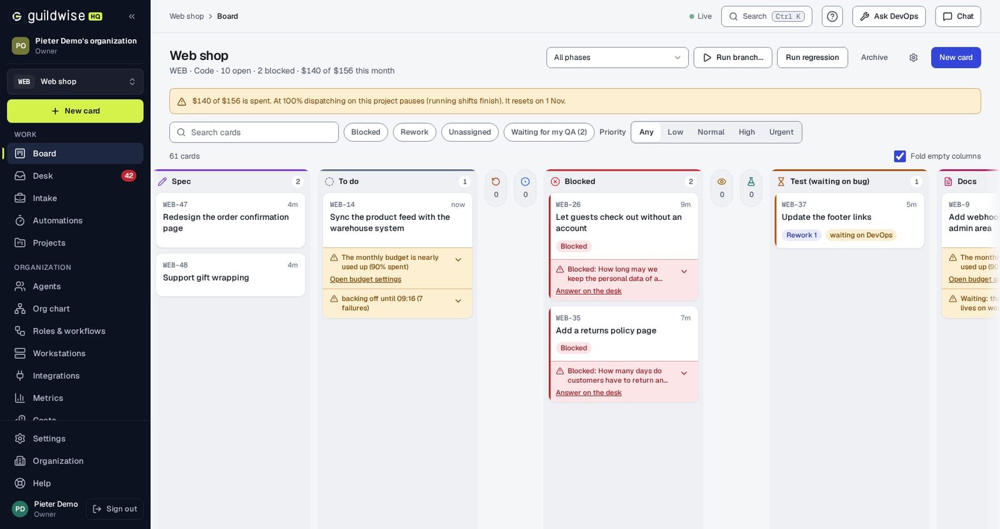

### 1.2 What you do and what the agents do

| You | The agents |
| --- | --- |
| Say what you want, in plain words, as a card | Turn it into a proper specification, build it, review it, test it |
| Answer questions on the desk | Ask when they cannot decide, and carry on once you answer |
| Approve risky steps (merging big changes, posting to a ticket, spending beyond a budget) | Wait for your approval and never go around it |
| Choose the team, the budgets and the rules | Follow them, and report if something does not fit |

### 1.3 Where the agents run

Guildwise HQ itself is a website you sign up for. The agents do their work on a machine you choose, called a **workstation**: your own PC, a Mac or a Linux machine, a server you rent (a VPS), or a GitHub Codespace (4.19). Your code, your passwords and your files stay on that machine and in your own repositories. The Guildwise HQ website only holds the board, the desk and the records. A small helper program called the **runner** (installed in the next chapters with a guided installer) connects the workstation to the website.

> **Good to know:** the AI itself is Claude. You sign in to Claude once on your workstation, either with your own Claude subscription or with an API key. The agents' work is billed by Claude to you (a subscription uses your plan, an API key is pay-as-you-go). Guildwise HQ estimates and limits that spend for you (see chapter 4.6).

## 2. Key ideas

Read this chapter once. Everything else builds on these words.

### 2.1 The words you will meet

| Word | What it means |
| --- | --- |
| **Organization** | Your company's space in Guildwise HQ. It holds the people, projects, agents, workstations and records. You can belong to more than one. |
| **Owner, Admin, Member, Guest** | The four roles a person can have. The Owner runs the organization, Admins help manage it, Members work in the projects they are added to, Guests are visitors from another organization who can work in one shared project. |
| **Project** | A body of work with its own board, for example "Web shop". A *code* project builds software. A *research* project looks things up and writes notes. |
| **Card** | One piece of work with its requirements and acceptance criteria ("what done looks like"). A card moves across the board until it is done. |
| **Board** | The columns of a project. Each column is a stage of the work. |
| **Agent** | One AI team member: a **role** (such as builder or reviewer), a **seniority** (junior or senior), a face, a name and a track record. |
| **Allow-list** | The projects an agent may work on. An agent only ever gets cards from projects on its list. |
| **Workstation** | A computer of yours where agents run. |
| **Runner** | The small program on a workstation that does the agents' work and talks to the website. |
| **Shift** | One stretch of work by one agent on one card. You will see the word in logs and reports. |
| **Desk** | Your inbox of decisions. |
| **Ledger** | The shared memory: decisions, standing orders and requirements, searchable. |
| **Standing order** | A rule every agent reads at the start of every shift, such as "write a unit test for every change". |
| **BA** | The business analyst agent. It drafts cards from your requests and tickets, answers what it can from the ledger, and writes your daily floor report. |
| **DevOps engineer** | A free agent that looks after one workstation: installs tools, keeps your repositories tidy, starts and stops things. |
| **Vault** | A folder of notes (a git repository) that is synced to your workstations: your organization's knowledge base, or one project's own notes. |
| **Priority order** | The order of your projects on the Projects page, most important first. Agents serve the project higher up first. |
| **Schedule** | A trigger plus one action, for example "every Monday at 07:00, create a card". |
| **Interest** | A topic you follow, such as "AI news". Agents look for new items on a schedule and deliver them to your desk. |
| **Phase** | A named slice of a project ("Phase 2: autosave") that you ship and check together, followed by steps such as deploy and regression run. |
| **Budget** | A monthly spending limit on a project (or an interest). |

The in-app glossary is at **Help, Glossary**.

### 2.2 How a card travels

A card in a code project goes through the same stages every time. You do not have to push it along. The agents do.

1. **Spec**: the card is written down: context, requirements, acceptance criteria. You (or the BA) write it. Until it is specified it is a draft.
2. **To do and Build**: a builder takes the card and works on a branch of your repository.
3. **Review**: a reviewer reads the change and either approves or sends it back (rework).
4. **Test**: a tester runs the tests in the test plan. A failure creates a bug card, and the original waits for the fix.
5. **Finalize**: the BA completes the card the way the project says: straight into your main line, or as a pull request for you to approve (4.4, *How finished work lands*).
6. **Done**.

If anyone gets stuck or needs a decision, the card turns to **Blocked** and a question appears on your desk.

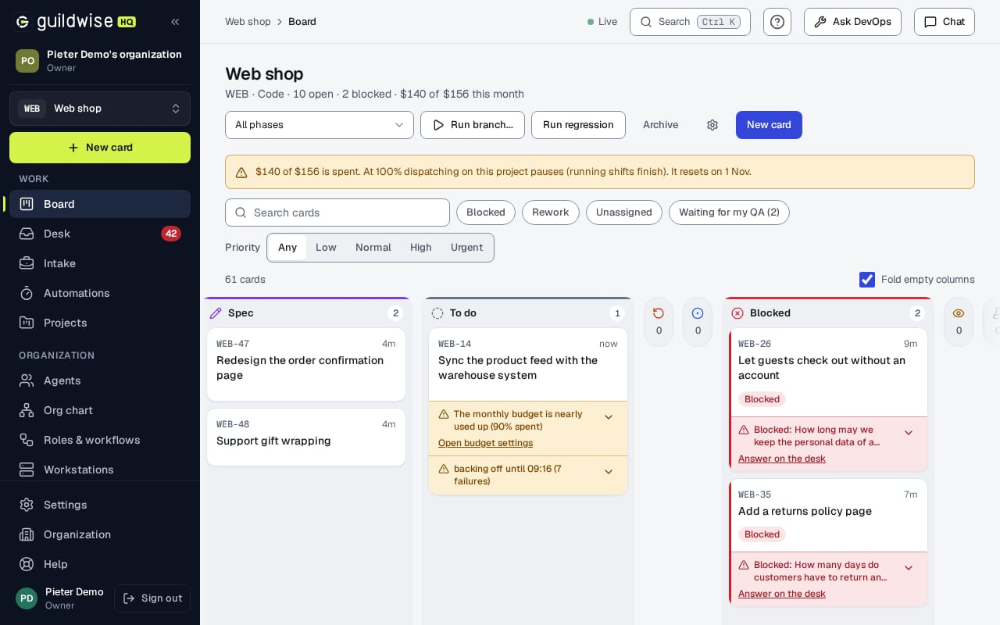

> **In the app:** Help, "Board and cards" (`/help/board-and-cards`) and "Testing and finalization" (`/help/testing-and-finalization`).

### 2.3 Who is allowed to do what

In short: **Owners and Admins manage**, **Members work** in the projects they were added to, **Guests work** in the one project that was shared with them, and the **platform administrator** only runs the service and never sees your work. Chapter 4 to 7 have the details for each role.

> **In the app:** Help, "Organizations and roles" (`/help/organizations-and-roles`).

## 3. Getting started in 15 minutes

By the end of this chapter you have: a working login with two-factor protection, a workstation connected, a small team hired, a project and your first card moving across the board.

> **Before you start:** you need an invitation email or your own sign-up (below), a computer to use as a workstation (it can be the one you are on now; a VPS or a GitHub Codespace works too), and a Claude account. A Claude subscription (Pro, Max, Team or Enterprise) is the easiest. An API key works too.

### 3.1 Accept the invitation and sign in (2 minutes)

1. Open the invitation email. It comes from either the **platform administrator** ("start your organization": you become its Owner) or from the **Owner or an Admin** of an existing organization ("join Acme": you become a Member or Admin). Invitations work for 7 days.
2. Click the link. Type your name and choose a password of at least 12 characters, then confirm it.
3. You land inside the app. If you already had an account, sign in instead and confirm.

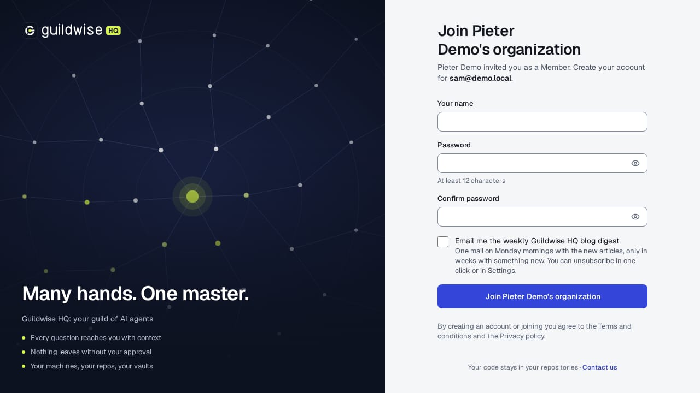

If the link says the invitation is no longer valid, it has expired, was used already, or was withdrawn. Ask the person who invited you to send a new one.

**No invitation? Sign up yourself.** On the website click **Start free trial** (or a plan's button under **Pricing**), choose a plan and enter your organization name, your name, email and a password. Open the link in the confirmation email: you are signed in and see one page, **Start your 7-day free trial**, with your plan, its price (US dollars, VAT included, and the rand amount at today's rate) and the trial's start and end dates. Add a card there: your **7-day free trial** starts and the app opens, with the tour and the Get started checklist; nothing is charged until the trial ends (4.17). Until the card is saved nothing else in the app opens, and coming back later shows the same page. A sign-up that never adds a card is removed after 14 days. You are the Owner of the new organization.

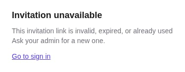

**Forgot your password?** On the sign-in page click **Forgot your password?**, type your email and we send a link (it works once and expires after an hour). We answer the same way whether or not the email has an account, so nobody can find out who is registered. Choose a new password (at least 12 characters); every other place you were signed in is signed out. Then sign in as usual: if you use two-factor login you still enter your code. A platform administrator can also send you this link (7.4). Platform administrators may use it too (their two-factor code is still asked at the next sign-in). If the email never reaches you, your organization's Owner or an Admin can give you a temporary password instead (4.15).

Visitors who are not signed in see the landing page, with **Log in** and **Start free trial** buttons, the plans and prices, a link to the blog, and a small **Ask Guildwise** chat that answers questions about the product.

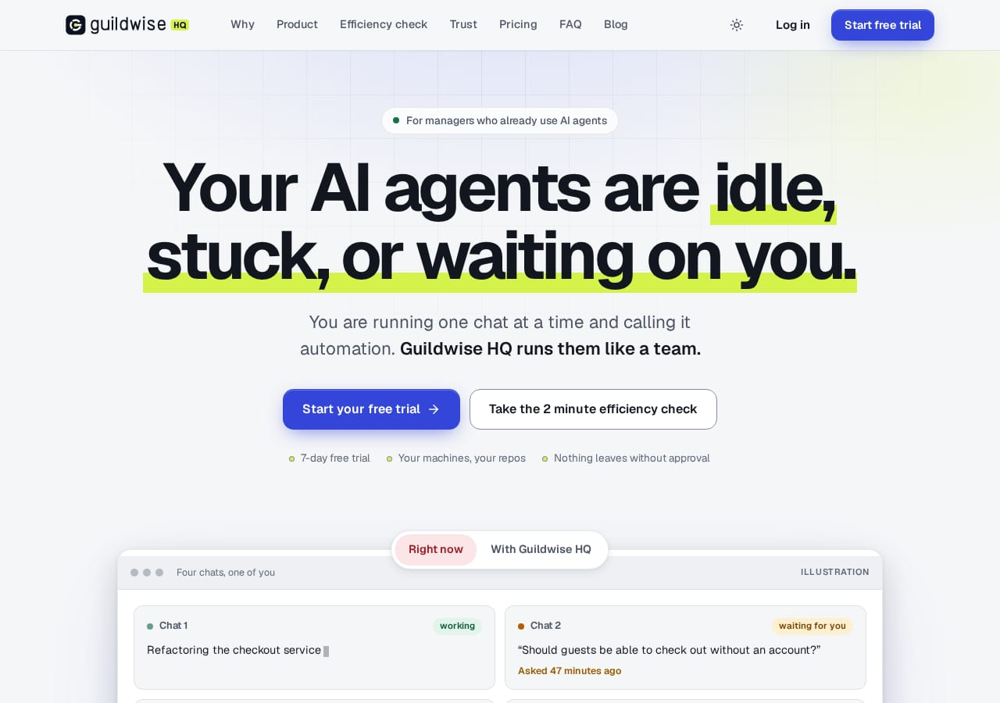

The footer links the **Privacy policy** and the **Terms and conditions**. The sign-in and invitation pages remind you that signing in or creating an account means you accept them.

To sign in later, go to the sign-in page, type your email and password, and press **Sign in**.

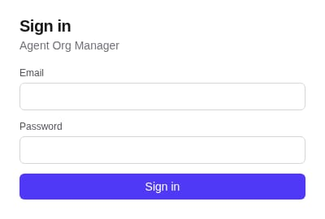

A wrong email or password always gives the same message, so nobody can use the page to find out who has an account.

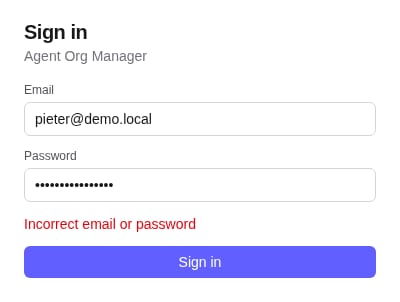

### 3.2 Turn on two-factor login (3 minutes)

Two-factor login means that after your password you also type a six-digit code from an app on your phone. Even if somebody learns your password, they cannot get in. It is strongly recommended for everybody, and your Owner may require it.

1. Open your avatar menu at the bottom of the sidebar and choose **Your settings**.
2. On that page, in the **Two-factor login** panel, choose **Turn on two-factor login**. Type your password, scan the QR code with an authenticator app (any one will do, for example Google Authenticator, Microsoft Authenticator or 1Password) and type the first six-digit code.
3. You are shown **ten recovery codes, once**. Save them in a password manager or print them. Each code works one time, if you lose your phone.

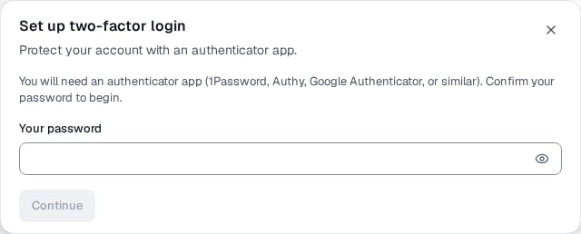

> **Watch out:** the recovery codes are the only way back in if you lose your phone, apart from asking your Owner to reset your two-factor login. Save them now.

> **In the app:** Help, "Two-factor login" (`/help/two-factor`).

### 3.3 Take the tour (1 minute)

The first time you sign in, a short guided tour highlights the main areas and tells you what each is for. The tour is different for each role. You can skip it and replay it any time from **Help**; a tour you closed half way does not come back by itself, but **Help** offers to resume it.

The tour starts with the training video: its first step is **Watch the 3-minute getting-started video**, with the player (captions and chapter buttons) in the tour card; press **Next: take the tour** to carry on (the video pauses). The same video is on the **Help** page as **Getting started in five steps**, a spoken tutorial of about three minutes: create a project, hire your agents, create cards, talk to the business analyst, and test the result. If the video file is missing, the first step shows a short text instead.

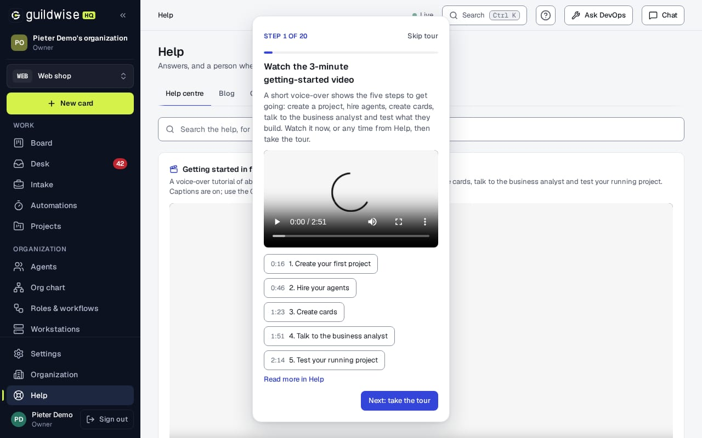

After an update, a window called **What's new in Guildwise HQ** opens the next time you sign in and lists the changes meant for your role, newest first. Click **Got it** to close it; it is remembered for your account, so it does not come back on another device. It never opens on top of the tour, and a brand-new account does not see changes from before it existed. To read the list again, open **Help** and choose **See what's new**.

Three things worth knowing from the start:

- **Search and jump anywhere:** press **Ctrl+K** (on a Mac **Cmd+K**) to open the command palette. Type a project, card, page or action ("contact", "new card") and press Enter.
- **The ? hints:** small question-mark buttons next to headings open the matching help article in a side panel, without leaving your page.
- **On a phone:** the whole app works on a phone. Open the menu with the button at the top left.

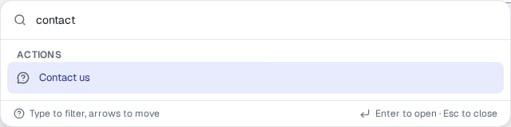

> **Your checklist.** The **Get started** button at the bottom of the sidebar lists the five things this chapter walks through (project, repository, workstation, team, talking to the business analyst) and ticks each one by itself as it becomes true. Each step opens the right page. Hide it with **Hide this checklist**; bring it back from **Help**.

### 3.4 Add a workstation (5 minutes)

A workstation is the computer where your agents will work. The guided installer sets everything up for you.

1. Open **Workstations** in the sidebar and click **Add a workstation**.
2. **Choose where your agents run**: **My computer** (the rest of this section), **A VPS (SSH)** or **GitHub Codespaces** (section 4.19). For your own computer, **pick the system**. The page guesses from your browser (Windows, Linux or macOS). Change it if the machine that will run the agents is a different one. Windows runs the agents inside WSL2, Microsoft's built-in Linux, and the installer turns it on for you. You may also type a name for it ("Office PC").
3. **Copy the command** with the copy button, or choose **Download the script** if you would like to read it first. The command contains a link that is valid for 30 minutes and a one-time pairing code. It never contains a password.
4. **Run it on that computer.** Open a terminal (on Windows, PowerShell), paste the command and press Enter. Say yes when it asks for permission. Windows may ask to restart once. The installer carries on by itself when you sign in again.
5. **Watch the page.** It shows the installer starting, the computer pairing, and then health checks one by one (Node, git, Claude, the sandbox, Docker, yt-dlp, your repositories, the server), ending with **Ready**.

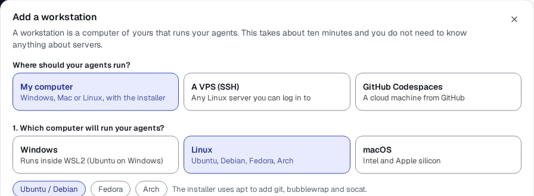

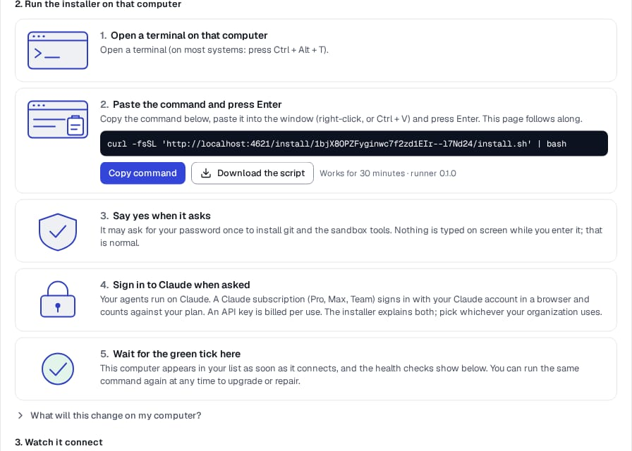

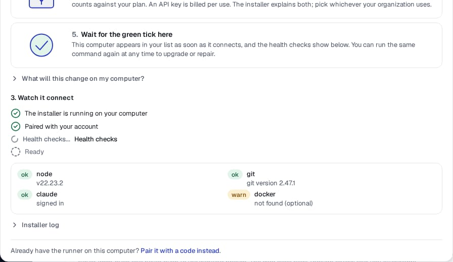

The installer asks only what it must: your password once to install system tools, whether you want the optional extras (yt-dlp for transcripts of videos and podcasts; Docker only if your tests run containers), and how Claude should sign in. Your code lives in `~/src`; the installer asks about the folder only in expert mode (Settings) or with `--choose-folders`. It explains the two ways in plain words. Choose **Claude subscription** if you have one: you sign in with your Claude account in a browser. Choose **API key** if you would rather pay for exactly what the agents use.

> **Good to know:** you can run the same command again at any time. It upgrades the runner, repairs a broken installation and keeps your existing pairing.

If something goes wrong, the installer says what happened and links to the install help and to **Contact us**. Chapter 9.1 covers the usual problems.

> **In the app:** Help, "Workstations and the installer" (`/help/workstations-and-installer`) and "Installing a workstation: if something goes wrong" (`/help/install-troubleshooting`).

### 3.5 Hire your first agents (2 minutes)

You need at least a builder, a reviewer and a tester to get a card from idea to done. The BA is also strongly recommended.

1. Open **Agents** and click **Hire agent**.
2. Choose a **Role**: *Builder* writes the change, *Reviewer* checks it, *Tester* runs the tests, *BA* writes cards and reports, *Writer* documents. Choose **Seniority**: seniors take larger and riskier work and may review large changes. Pick the **Workstation** where the agent runs.
3. Choose where the agent may work: **Any project**, or **Selected projects** (the allow-list). For now keep the project you will create next, or any project.
4. Choose the **Model** (a bigger model is smarter and costs more; a smaller one is fast and cheap). A good start is a stronger model for builders and BAs and a lighter one for reviewers and testers. Give the agent a **Name**. The name generator suggests unused names; pick a theme or type your own.
5. Click **Hire**. Repeat for each role.

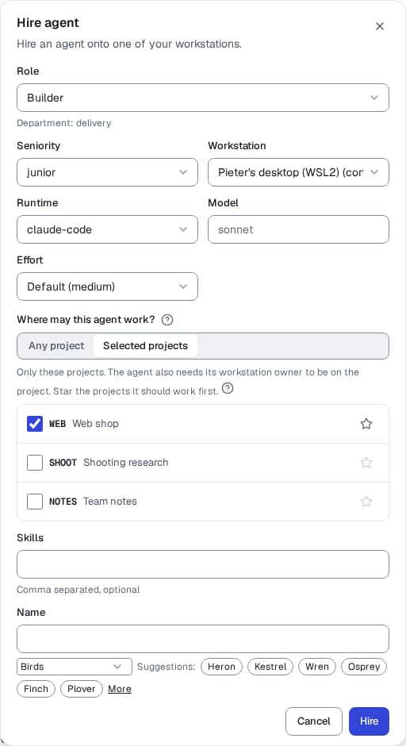

> **Tip:** two builders and one each of reviewer, tester and BA is a comfortable first team. Large changes need two different senior reviewers, so hire a second senior reviewer when you get to bigger work. Review and Finalize need seniors.

Each workstation also gets a free **DevOps engineer** automatically. You never hire or fire it.

> **In the app:** Help, "Agents" (`/help/agents`).

### 3.6 Create your first project (1 minute)

1. Open **Projects** and click **New project** (Owners and Admins only).
2. Give it a **Name** and a short **Key** (for example `WEB`; card references look like `WEB-1`). Choose the **Workflow**: **Code** for software, **Research** for investigations, or a custom workflow your organization designed. Click **Create project**.
3. For a code project, open the project's **Settings** (the gear on the Projects page) and, under **Repositories**, add your repository: a name and the address of your code (or create a new one). The git host (GitHub, GitLab, Bitbucket, Azure DevOps or a plain git server) is detected from the address, and you can pick another one. Finished work goes into the repository's main line automatically after review and test; you can change **How finished work lands** in the same settings (see 4.4). A research project needs no repository.

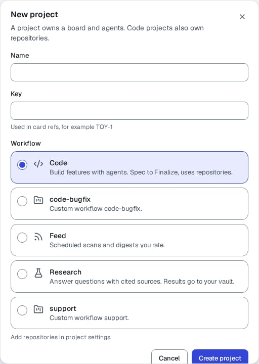

> **In the app:** Help, "Projects" (`/help/projects`).

### 3.7 Create your first card (2 minutes)

1. Open the project's board and click **New card**.
2. Fill in the form. Be concrete, as if you were briefing a new colleague:
   - **Title:** what it is ("Show the last login time on the profile page").
   - **Context:** why it matters.
   - **Requirements:** what must be done.
   - **Acceptance criteria:** how you will know it is done, one line each.
   - **Affected areas, Constraints, Test plan:** what to touch and not to touch, and how to check it.
   - **How it lands:** you do not need to choose. Finished work goes where the project's **How finished work lands** setting says (straight into main after review and test, or as a pull request you approve). With expert mode on (see 4.4) the form also offers a per-card **Completion action**.
3. Click **Specify**. The card moves to **To do** and the agents pick it up. If a required field is missing, the form tells you which. Use **Save draft** if you want to finish later.

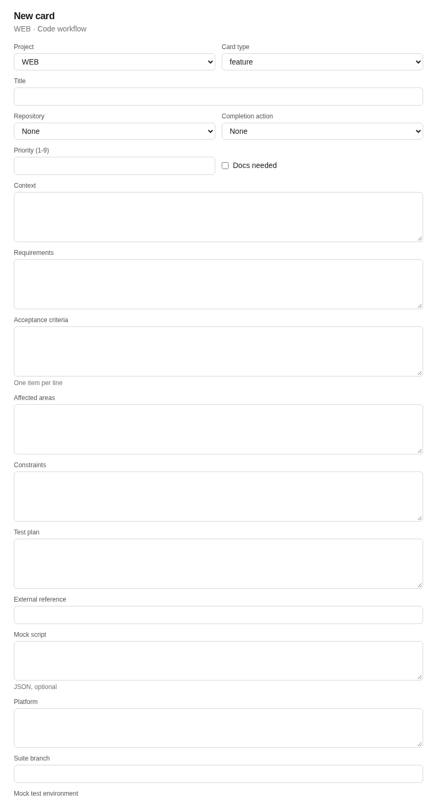

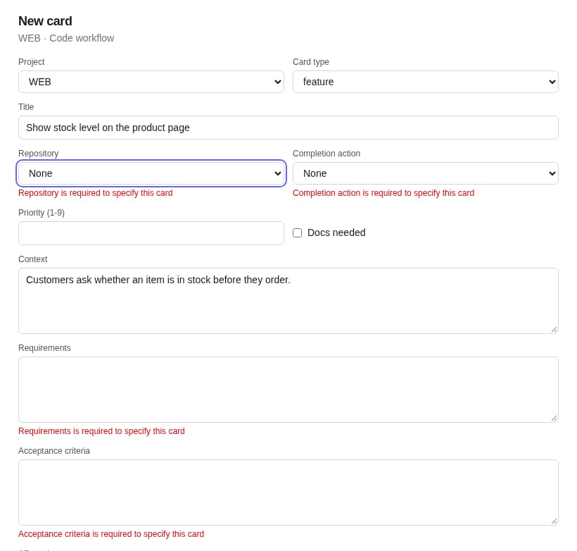

> **Tip:** you do not have to write it all yourself. Open a chat with the BA ("Chat" button on the desk), say what you want in your own words, and the BA drafts and specifies the cards for you.

### 3.8 Watch it happen

Within a minute the card moves to **Build**. A builder works on it, then a reviewer, then a tester. Open the card to follow along: the **Live shift** panel shows what the agent is doing right now, **Handoffs** shows the notes agents leave for each other, and **Timeline** records every step.

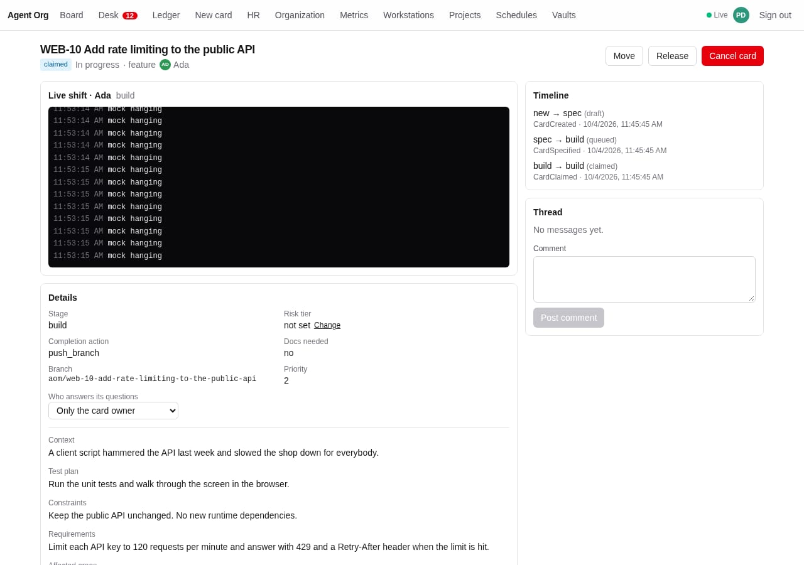

When an agent needs a decision, the card turns **Blocked** and the question appears on your **Desk**. Answer it and work continues. When the card is done, the card says where the change went: *"Your change is live on main"*, or *"Waiting for you to merge the pull request"* if the project works with pull requests.

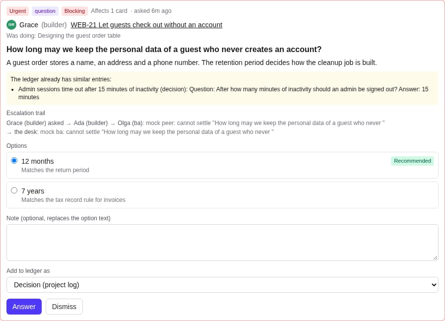

You now have a working team. The rest of this guide is for when you want more: more control, more automation, or more safety.

## 4. For Owners and Admins

The **Owner** runs the organization: there is exactly one, and the Owner can hand the role to someone else. **Admins** are appointed by the Owner and help manage. This chapter covers everything the two roles do. Where something is only for the Owner, it says so.

| | Owner | Admin |
| --- | --- | --- |
| Create projects, add people to projects, change project settings | yes | yes |
| See every project of the organization | yes | yes |
| Invite Members | yes | yes |
| Invite, promote or demote Admins; change roles | yes | no |
| Remove Members | yes | yes |
| Remove Admins | yes | no |
| Hire, change and fire any agent, widen an agent's permissions | yes | yes |
| Set budgets, see Costs | yes | yes |
| Design roles, workflows and departments | yes | yes |
| Org-wide schedules, interests quiet cap, BA settings | yes | yes |
| See plan and limits | yes | yes |
| Require two-factor login for everybody | yes | no |
| Hand over ownership | yes | no |

### 4.1 Your organization

Open **Organization** at the bottom of the sidebar. The **General** tab shows the organization's name (rename it here) and the security switch for two-factor login (4.15).

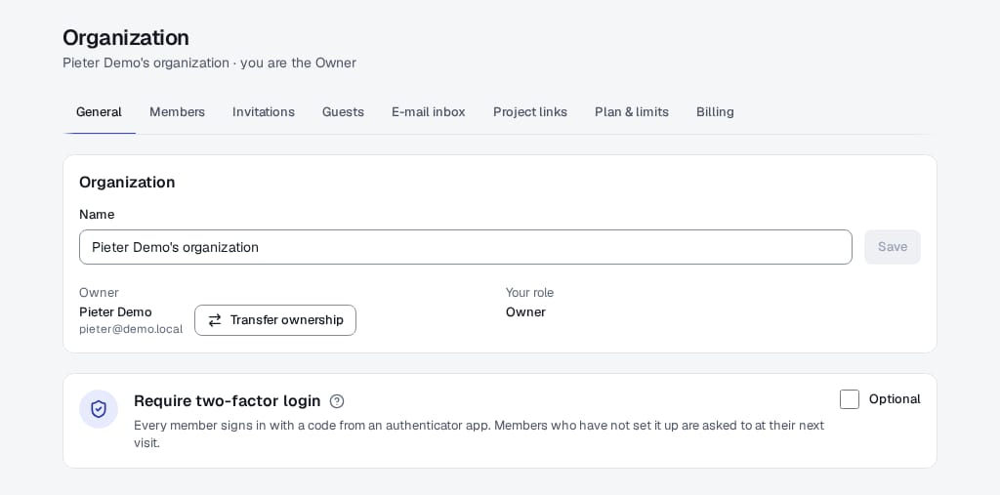

If you belong to several organizations, the **organization switcher** at the top of the sidebar shows which one this browser tab works in. A different tab can work in a different organization. Projects of an organization where you are only a guest carry a "Guest" label.

### 4.2 Members, invitations and guests

On **Organization, Members** you see everybody with their role.

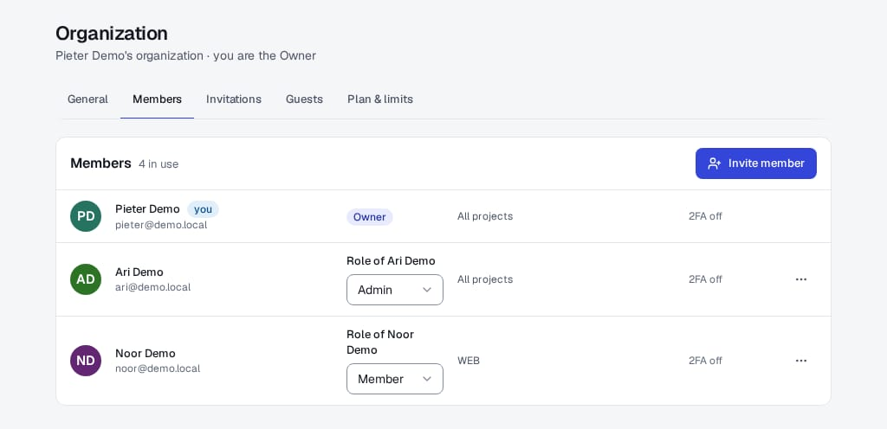

**To invite someone:** click **Invite member**, type their email, choose the role (**Member**, or **Admin** if you are the Owner) and, if you like, the projects they should start on, then **Send invitation**. They receive an email with a link that works for 7 days. On the **Invitations** tab you can see pending and past invitations, resend one or revoke one.

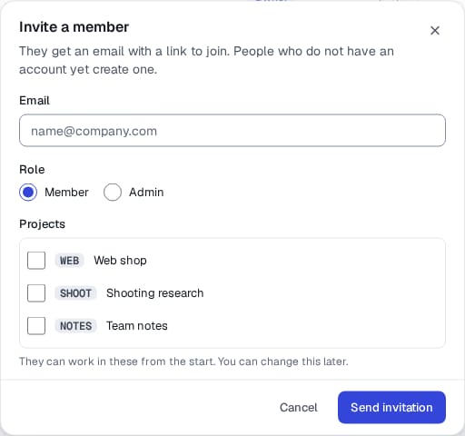

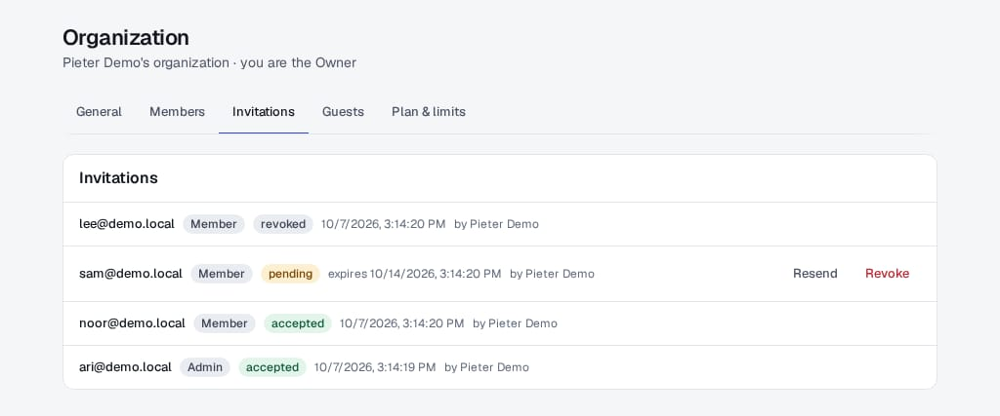

**To change a role or remove a person:** use the role selector and the remove button in the Members list. When somebody is removed, their agents are handed to you and any cards those agents held go back into the queue. Anyone except the Owner can leave an organization. The Owner must hand over ownership first (**General, Transfer ownership**, which asks for your password).

**Guests** are people from other organizations who work in a project you shared. The **Guests** tab lists them and the projects they can reach (see 4.3, sharing a project).

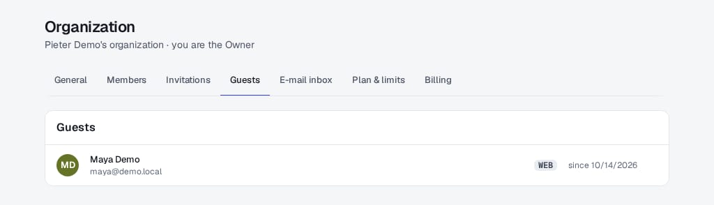

> **In the app:** Help, "Organizations and roles" (`/help/organizations-and-roles`).

### 4.3 Projects

**Create a project** as in chapter 3.6. A new project goes to the bottom of your priority order (see below). Everything about a project lives in its **Settings** (the gear on the Projects page).

**Put your projects in order.** The **Projects** page lists your organization's projects, most important first. When an agent looks for its next card, it takes work in this order: scheduled work first (schedules, interest scans and an on-demand **Research this**), then cards that came back to it for rework, then the **project order** (the card of the project higher up first), and then the card's own priority, how long it has waited and its dependencies. An agent's **focus** projects (4.4) are a gentle preference ahead of the order. A shift that has started is never interrupted: a more important card waits for it to end.

Owners and Admins change the order by **dragging** a project by its grip (the dotted handle on the left), or with the **Move up** and **Move down** buttons on each row. With the grip selected, the up and down arrow keys move it as well, and Home and End send it to the top or the bottom. The order saves by itself. Members and Guests see the order but cannot change it. Archived projects are not ranked, and the hidden projects behind interests never appear: interests run on their own schedule and are not ranked.

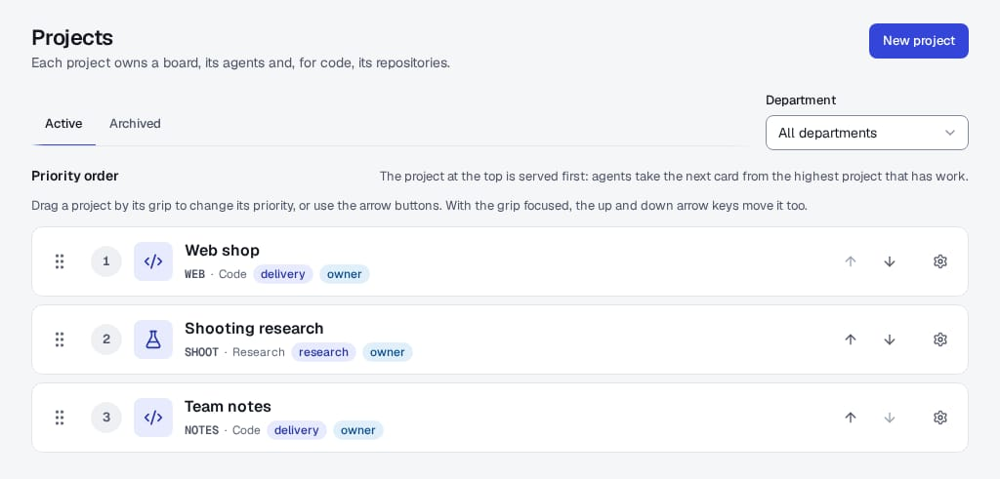

> **Good to know:** There is no work/personal split any more. "Personal" simply means your own organization: keep personal projects in it, or in an organization of your own that you switch to. If your organization had a personal vault and personal projects from before, they were merged for you: the projects sit below your work projects in the order they had, and the personal vault's files are under `personal/` in the organization vault. The desk note you received says what happened.

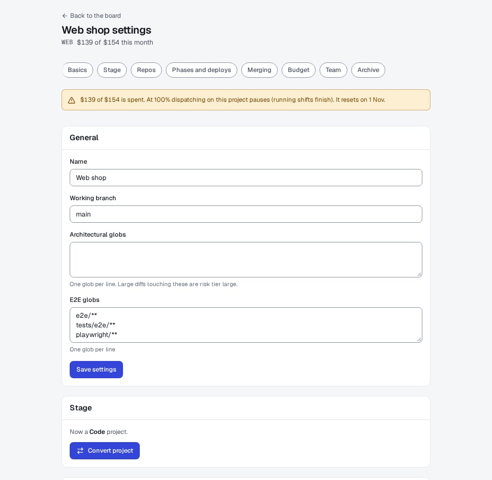

What you will find there:

- **Repos:** the code the agents work on, with its git host. With expert mode on you also see its **working branch**, the branch finished work lands on. Research projects need none.
- **How finished work lands:** straight into main after review and test (the default), or as a pull request you approve (4.4).
- **Team:** who works in the project (see below).
- **Merging:** the setting **Merge large changes without my approval** (off by default). Read chapter 4.12 before turning it on.
- **Simultaneous shifts:** an optional cap on how many shifts may run at once in this project.
- **Budget** (4.6), **Phases and deploys** (4.10), **Stage** (4.13) and **Archive** (4.14).

**Who answers a card's questions.** By default only the card's creator answers them. On the card page you can let any project member answer (**Who answers its questions**).

**Project types.** A **code** project follows Spec, Build, Review, Test and Finalize. A **research** project follows Question, Research, Fact check and Publish and writes its results as notes into the project's vault folder. Your organization can also design its own workflows (4.7).

**Adding people to a project.** Only Owners and Admins add people. Add an organization member under **Team** in the project settings. They get access at once. To share with somebody from another organization (a guest), type the email of an existing account and click **Invite**. They accept in the **Project invitations** inbox on their Projects page, and they only ever see this project. There are no guests without an organization. Someone with no account must be invited as a Member of your organization instead.

> **Watch out:** removing a person from their last project hands their agents back to you (they need a new home on one of your workstations). Cards those agents held go back into the queue.

**Vaults.** A vault is a git repository of notes that syncs to your workstations. There are two kinds: the **organization vault** (your organization's knowledge, including your interests under `interests/`, shared among Owners and Admins) and a **project vault** (shared with the project's members; a project without one reads the organization vault). Register them under **Vaults** in the sidebar. The address must not contain a password or token. Use an SSH key or a credential helper on the workstation instead.

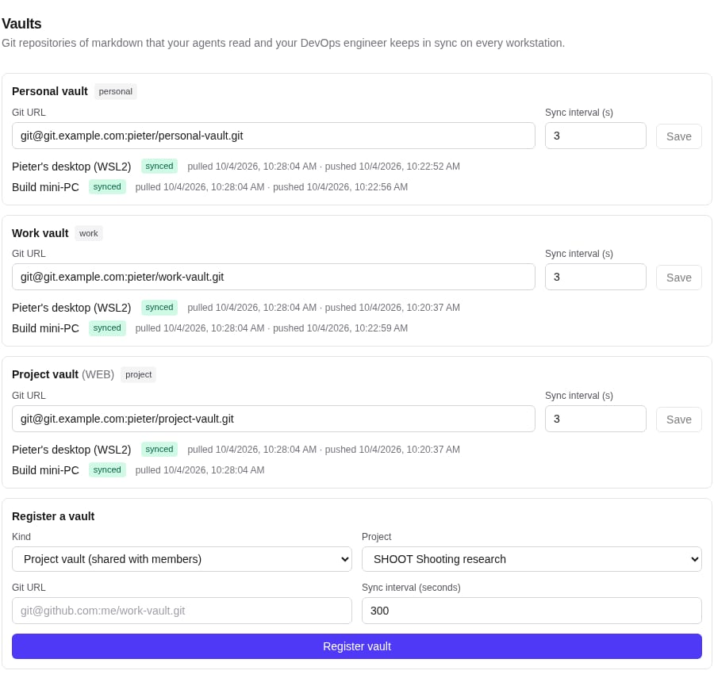

> **In the app:** Help, "Projects" (`/help/projects`) and "Ledger and vaults" (`/help/ledger-and-vaults`).

### 4.4 Agents, hiring and allow-lists

Agents belong to the organization, not to a single project. For each agent you decide where it may work: its **allow-list**. The agent is only offered cards from those projects.

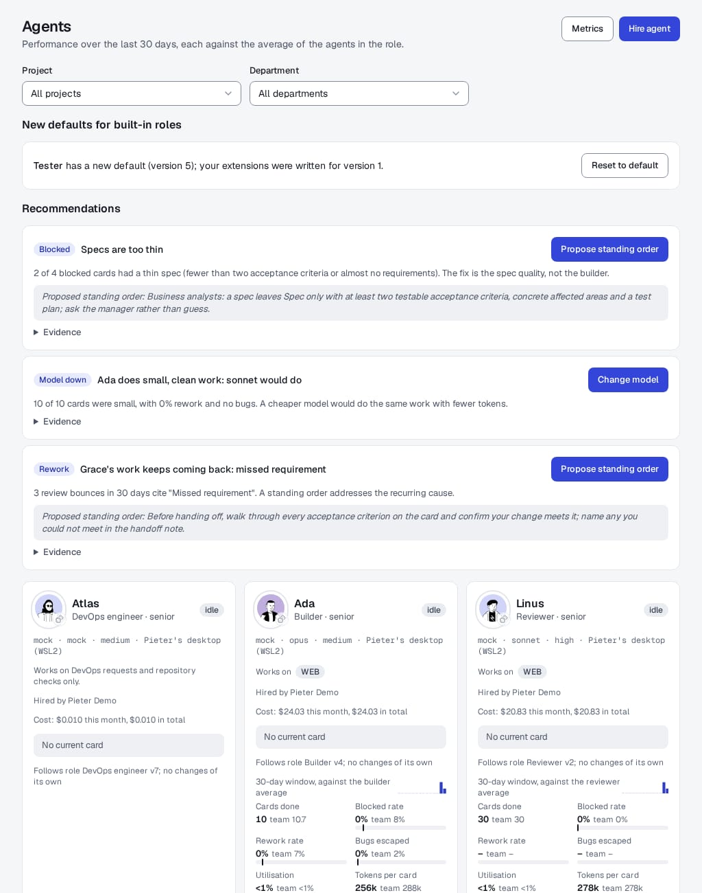

**Hiring** works as described in 3.5. Hiring has a few more options:

- **Where may this agent work?** **Any project** (Owners and Admins only) or **Selected projects**, ticked one by one. An empty list **benches** the agent: it takes no work until you give it projects again. A star next to a project means *preferred*: when two cards are waiting, the agent takes the starred project's card first.
- **Seniority** decides who may review large changes and who handles harder work.
- **Effort and Model:** how hard the agent thinks. Higher costs more.
- **Skills:** extra know-how, such as "Playwright" or "database migrations".

**Changing an agent.** On the agent's card use **Projects** (the allow-list), **Change model**, **Change role**, and **Fire**. Firing releases the cards the agent holds back to the queue with the last handoff, deletes the agent's private sandbox, and retires the name. The agent's history stays in the records. A fired name is never reused.

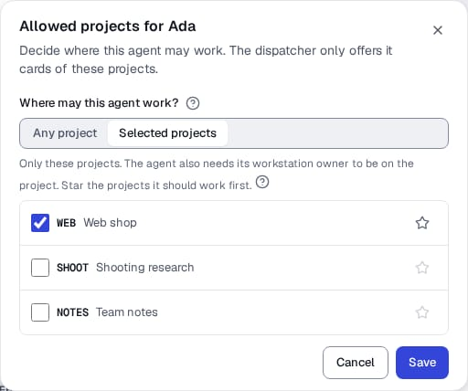

**Each agent card also shows** what the agent costs this month and in total, how many cards it finished, its bounce rate (how often review sent its work back) and its current work.

**Recommendations.** The Agents page suggests changes based on how the team performs: a different model, hiring another reviewer, or a standing order. You can apply them in one click, or ignore them.

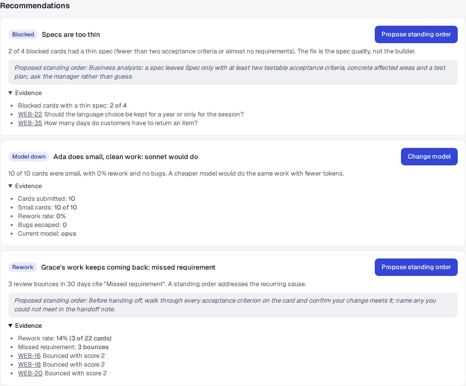

**Safety.** Agents run inside a sandbox on the workstation, so they cannot read your whole disk. The DevOps engineer is the exception: it works as you (below). Some computers cannot offer a sandbox (for example plain Windows). The app then shows an amber warning on the workstation, on each affected agent and in the Hire form, and hiring onto that machine needs an explicit confirmation. Prefer a workstation with a sandbox (Linux, macOS, or Windows with WSL2).

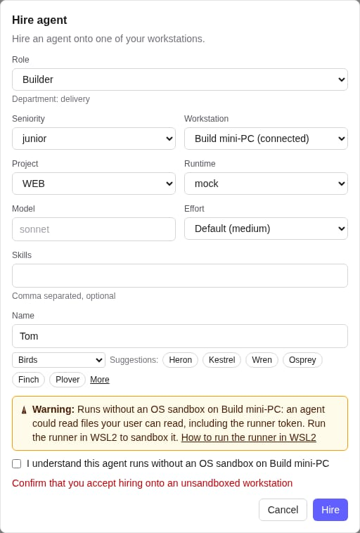

**The DevOps engineer.** Each workstation has one, free of charge. It installs tools, starts containers, pulls and pushes vault changes and keeps repositories tidy (next section). You can only reset it, never fire it, and only change its model and effort.

**Ask DevOps from anywhere.** Click **Ask DevOps** in the top bar, choose **Ask DevOps...** in the command palette, or use the button on a card, a desk item or the workstation. The page, project, card or error you were looking at is attached (remove what you do not want to share) and the right workstation's engineer is chosen for you when it is obvious. **Start chat** talks to it; **Send as a task** files a tracked request. The DevOps engineer works as you on your machine and is not sandboxed, in a chat as in a shift: a command, a Docker build or a deploy you ask for runs right away. The tick boxes on the workstation (install, Docker, sudo, paths) are instructions and limits for the automatic tool setup, not a physical barrier. On a team member's workstation an approval needs an Owner or Admin and the machine's user (one person can be both).

**A request about a card.** When a request is filed for a card (from the card's **Ask DevOps** button, or by the agent working on it), the DevOps engineer gets the card in its brief: title, type, fields, project, repository and the latest comments. It can read that card, comment on it and set the card's fields it needs (for example how to start the stack), and nothing else: it cannot change the title, stage or status, and it cannot read or change any other card.

> **In the app:** Help, "Agents" (`/help/agents`).

#### How finished work lands (and expert mode)

Guildwise keeps version control out of your way. In each project's settings, **How finished work lands** has two choices: **Straight into main after review and test** (the default) or **As a pull request I approve**. If the main line is protected on the code host (it refuses direct changes), Guildwise notices, opens a pull request instead, and switches the project to pull requests with a note on the card. The repository's default branch is used as the main line without asking you.

You see plain outcomes instead of branch names: *"Goes into main after review and test"*, *"Your change is live on main"*, *"Waiting for you to merge the pull request"*. When two changes clash, the DevOps engineer tries to fix it first and leaves a note on the card.

If you know git and want the details, turn on **Expert mode for code changes** in **Settings** (it is per person and off by default; it only changes what you see). It brings back the working-branch fields, the per-card completion action (pull request, push the branch, or merge), branch names and commit hashes, **Mark merged** on the phase page, and the questions about keeping or changing the working branch for a new intake or phase.

#### Repository hygiene and the working branch

Once a day per workstation the DevOps engineer tidies the project repositories on that machine: it fetches and pulls, **stores any uncommitted edits of yours on a separate saved-work branch** (`guildwise/saved-work/<date>`, pushed so nothing is lost; your files are left exactly as they are and nothing reaches main by surprise) and removes branches and worktrees of cards that are finished and merged. Files that look like passwords or keys (`.env*`, `*.pem`, names with *key* or *secret*) are never copied; the notice on your desk names them. Hygiene never force-pushes and never discards anything. Change the time or switch it off in the workstation's **Repository hygiene** panel on the Workstations page, or start it with **Run hygiene now**.

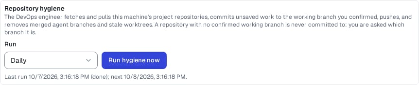

**The working branch is the repository's default branch**, confirmed automatically the first time Guildwise sees the repository. You are asked on the desk (*Which branch is the working branch of this repository?*) only when the default cannot be told. With expert mode on you can also set it in the project settings (**Change**) and you are asked again when a new intake or phase starts ("keep `main` as the working branch?").

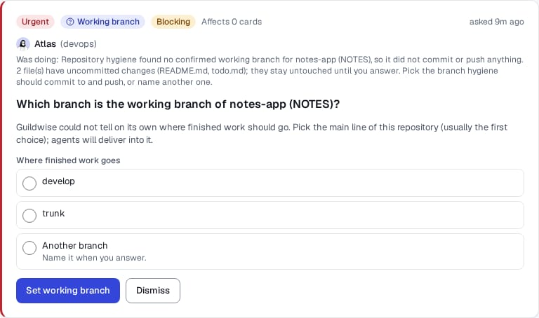

What hygiene cannot resolve, it does not force. For a conflict while pulling, the DevOps engineer first tries to resolve it on a temporary branch and runs the tests (you get a notice; after two attempts it goes to your desk). Changes on the wrong branch, a failed login, a missing clone, or a leftover worktree with uncommitted work are not forced either. These appear under Failures in your BA's daily report until a later run finds the repository in order.

> **In the app:** Help, "DevOps and repository hygiene" (`/help/devops-and-hygiene`).

### 4.5 The desk, the ledger and standing orders

The **Desk** is where every question and approval reaches you. Cards do not move past a question until you answer.

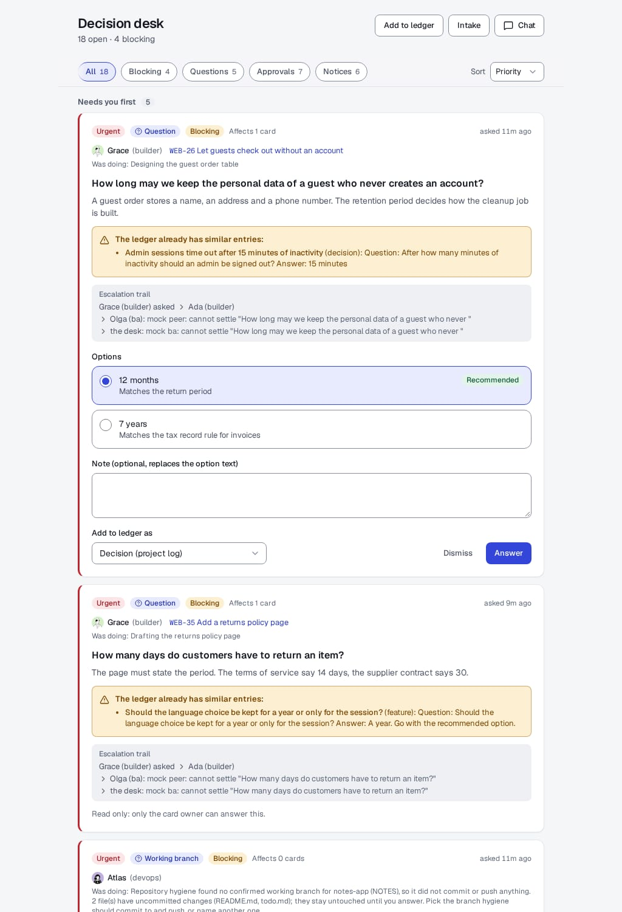

Each desk item says **what kind it is** (Question, DevOps approval, Merge approval, Outbound update, Digest to rate, Alert, Floor report, and so on), **who asked and what they were doing**, the **question** with options and a **recommendation**, and **how many cards are waiting**. To answer, click an option or type your own answer, optionally add it to the ledger, and click **Answer**.

When you answer you can also record it in the **ledger** as a **requirement** (a permanent rule), a **standing order** (an instruction every agent reads at the start of every shift) or a **decision** (a one-time choice kept for history). That is how the team learns: the next agent who is about to ask the same thing finds your answer first, and the desk shows "similar decision in the ledger".

The **Ledger** page lists everything and is searchable. Organization-wide standing orders can only come from the Owner and Admins. A project owner adds project-wide ones.

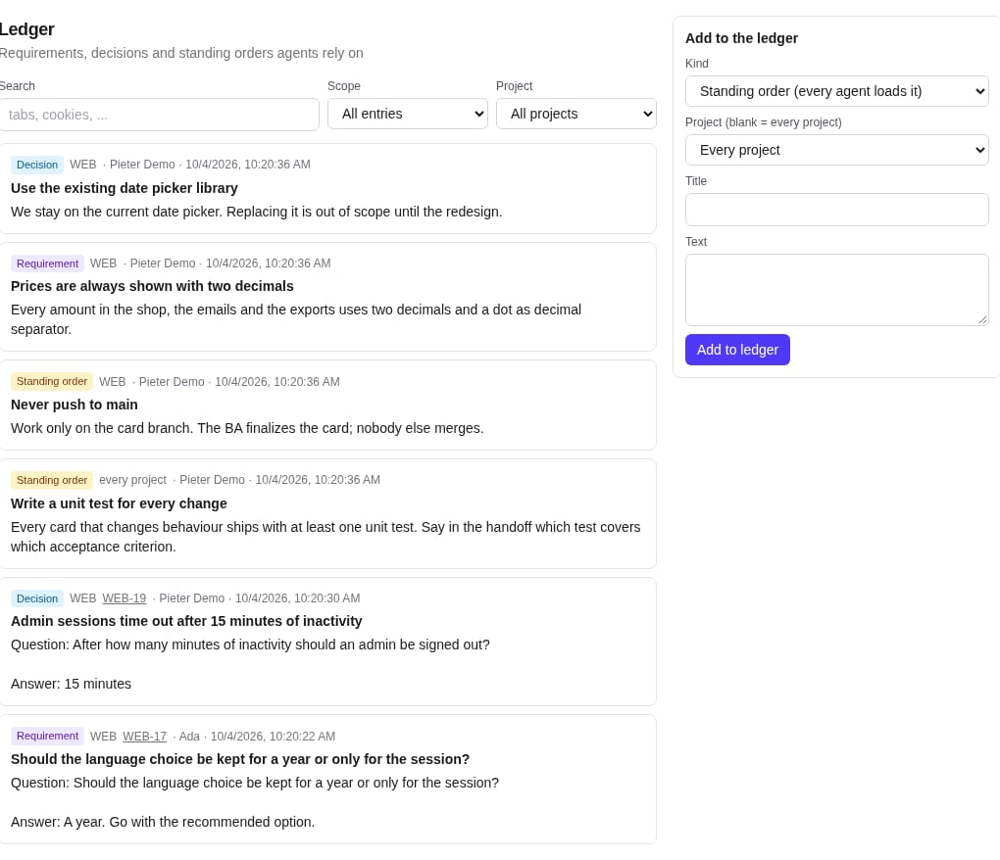

> **In the app:** Help, "The Decision desk" (`/help/desk`) and "Ledger and vaults" (`/help/ledger-and-vaults`).

### 4.6 Budgets and costs

Every shift records what it used (input, output and cache tokens and the model). The server turns that into money at the **list prices** of the models, in US dollars, and shows it in your organization's currency. These are estimates of what the work costs, not an invoice. Chats count too: to the project when the chat is about a card or project, otherwise to **Org overhead**.

**Where spend shows:**

- the **Costs** page (Owners and Admins): spend by project, agent, model and day for any date range, with an **Export CSV** button;
- the **project settings** and the **board header** ("$9.00 of $10.00 this month");
- each **agent card**, each **card** and each **phase**;
- the **BA's floor report**.

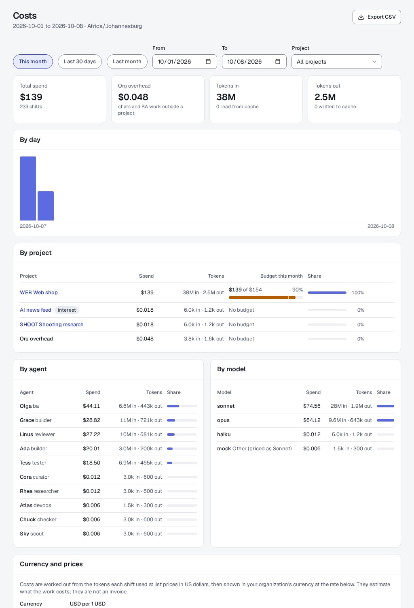

**Monthly budgets.** In the project settings, **Monthly budget** sets a limit for the project. (An interest has its own budget on its Settings tab, 4.9.) The month runs from the 1st to the end of the month in your time zone.

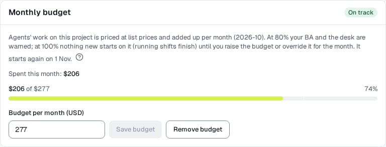

- **At 80%** you get one notice on the desk and a line in the daily report. Work carries on.
- **At 100%** the project is **paused**. Running shifts finish, but nothing new starts. Cards wait in the queue. A banner on the board says so, and a desk item offers **Raise budget** (the pause lifts as soon as the new amount is above the spend) or **Override for this month** (work resumes until the 1st).
- **On the 1st** the month starts again from zero.

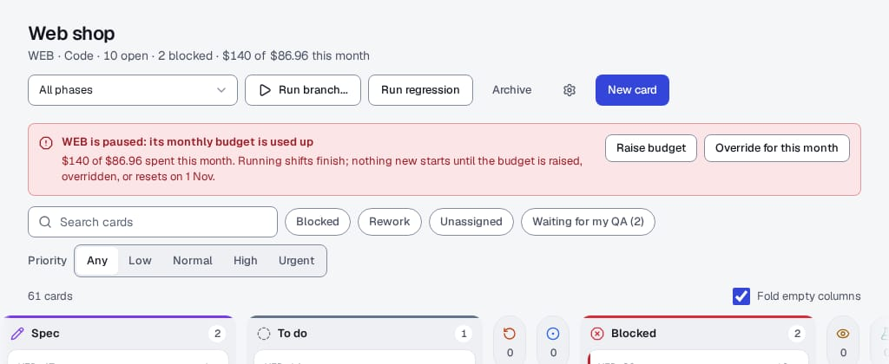

Setting a budget below what was already spent pauses the project at once. Members can see the progress but not change it. Guests see only that a project is paused.

**Currency.** Under **Costs, Currency and prices** type a three-letter currency code and how many units make one US dollar (for example `EUR` and `0.92`). Changing the rate changes how history is shown, not what was recorded.

> **In the app:** Help, "Budgets and costs" (`/help/budgets-and-costs`).

### 4.7 The org chart, roles and workflows

**Org chart** (sidebar, Organization) shows who works for you and who answers whom, as a tree: you at the top, then the BAs, then each department with its seniors above its juniors. The lines are the **escalation path**: a question goes to a senior of the same role, then to the BA, then to your desk. Each tile shows the agent's face, name, role, what it is doing and its workstation. Click an agent for its card. **List** shows the same as grouped lists (the default on a phone).

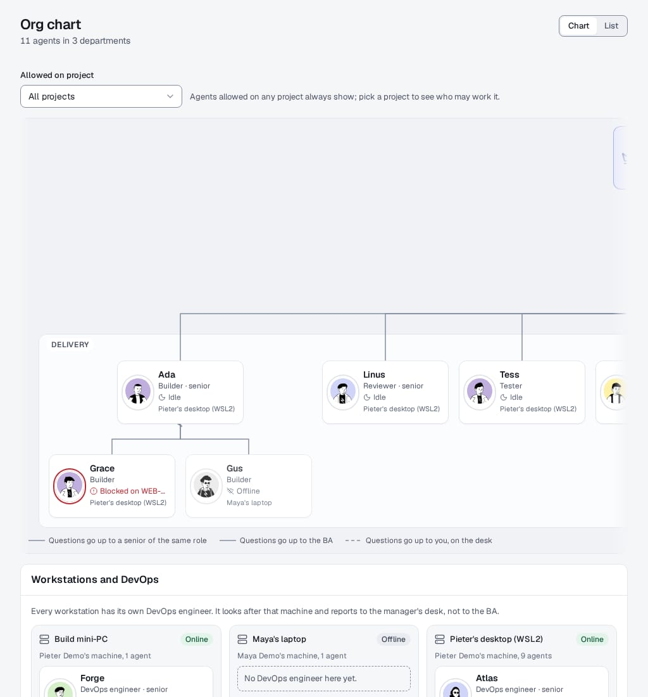

**Roles & workflows** (sidebar, Organization) lets you extend the team beyond the built-in roles.

- **Roles.** Built-in roles (builder, reviewer, tester, writer and others) cannot be removed, but you can extend them with extra instructions, skills and standing orders (**Extend**). You can also design **custom roles**: a name and purpose, instructions, permissions, skills, a default model and which workflow stages the role may claim.
- **Workflows.** A workflow is a set of stages with a role for each and a route for success and failure. Design your own, for example a support-triage flow. The BA checks that every stage can be reached and every failure ends somewhere.
- **Departments** group roles by function so you can filter the board and the Agents page.
- **Design chat.** Click **Start a design chat** and the BA interviews you and drafts the role or workflow.

Everything you design is **submitted to the desk for your approval** before it can be used.

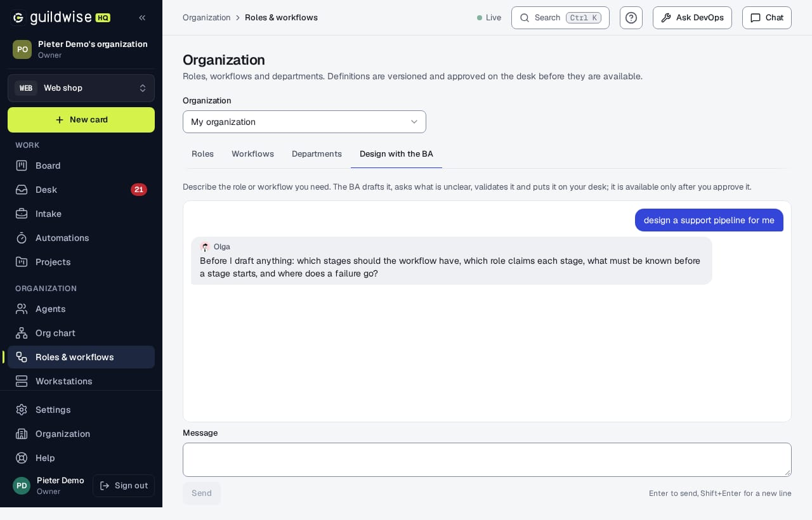

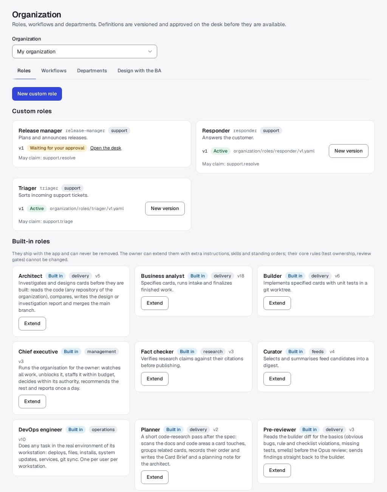

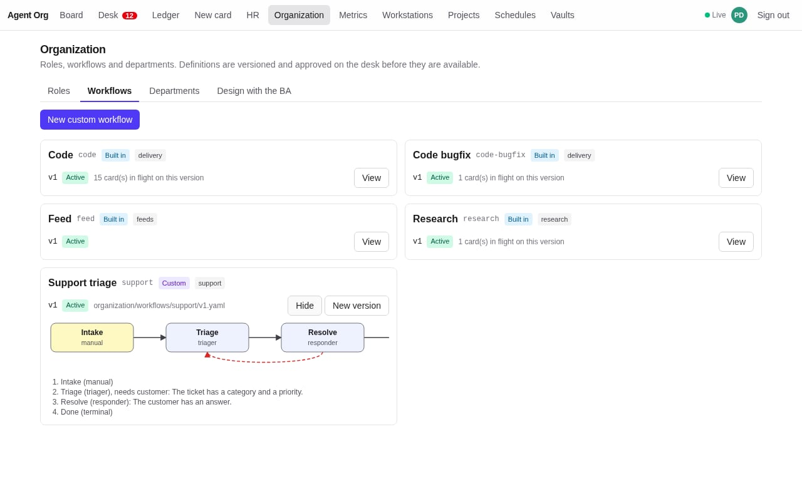

> **In the app:** Help, "Organization chart and design" (`/help/org-chart-and-design`).

### 4.8 Schedules and integrations

A **schedule** is *a trigger and one action*. Open **Schedules** in the sidebar and click **New schedule**. A three-step wizard asks **When**, **What** and **Details**.

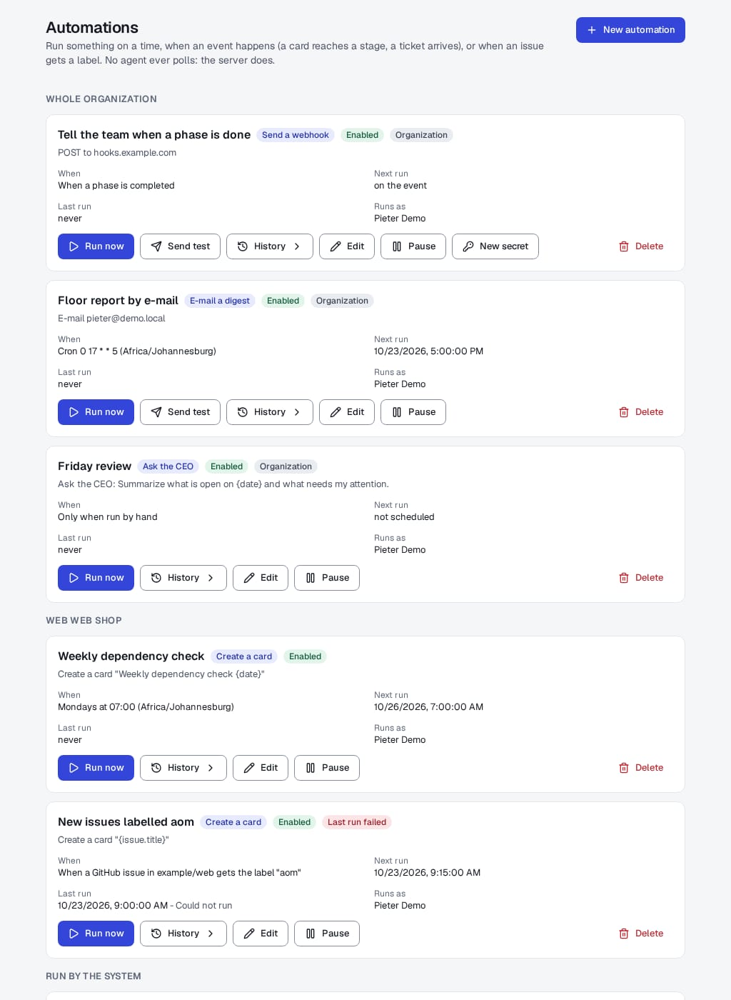

**When (the trigger):**

| Trigger | What it does |
| --- | --- |
| **On a schedule** | A time such as "Weekdays at 07:00" or your own cron expression, in a time zone you choose. If the server was down, a missed run happens once, not many times. |
| **When something happens** | A phase is completed, a card is finalized, an interest run is done, or a project is converted. |
| **When an issue is labelled** | A GitHub or Jira issue gets a label you choose. One of your workstations checks, using its own login. |
| **Only when I run it** | No automatic trigger. Use **Run now**. |

**What (the action):**

- **Create a card** from a template, with the date or the issue title in the name if you like.
- **Run a regression** (a full test run).
- **Ask DevOps** to do something on a workstation, or run repository hygiene.
- **Ask the BA** to look at something and write a report on your desk.
- **Poll GitHub or Jira issues** and send each new one into **intake**.
- **Send a webhook** to Slack, Microsoft Teams, n8n, Zapier or your own code. Every request is signed so the receiver can check it came from you. Failed deliveries are retried a few times.
- **E-mail a digest**: the floor report, a project summary or an interests digest, at a time you choose.

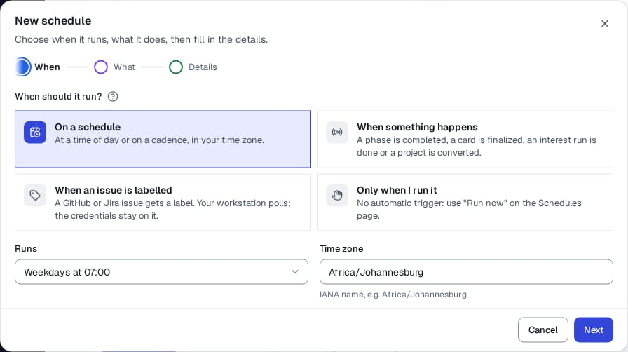

**History** on each schedule lists every run, what triggered it, what it did and why it failed if it did. **Send test** sends one test delivery for webhooks and e-mails.

**Who may do what.** A schedule inside a project can be made and run by any member of that project. A schedule that acts for the whole organization (BA tasks without a project, hygiene, the floor report digest) is for Owners and Admins. A suspended organization skips its schedules.

**Intake and the outbox.** The **Intake** page (sidebar, Owners and Admins) is where you hand the BA a ticket: paste a Jira key or a GitHub issue address and the BA reads it, asks you about anything unclear, maps it to a project and drafts the cards. Updates the agents want to post back to the ticket (a comment, a resolution) wait on your desk as **Outbound update** items. You can edit them, approve or reject. Nothing is posted without your approval, and agent names and internal details are scrubbed from the text. Jira and GitHub logins stay on your workstation.

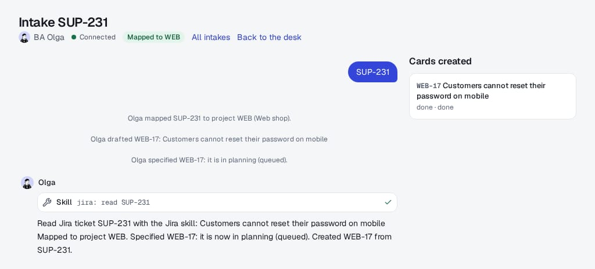

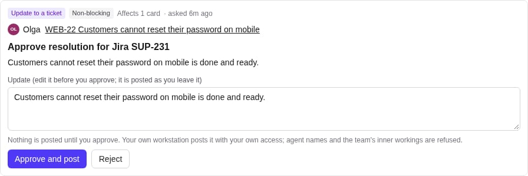

> **In the app:** Help, "Schedules and integrations" (`/help/schedules-and-integrations`) and "Intake and outbox" (`/help/intake-and-outbox`).

### 4.9 Interests

An **interest** is a topic you follow. Agents look for new items on a **run schedule**, and deliver what they found to your desk on a **delivery schedule**. Keeping those two apart is how you avoid being flooded.

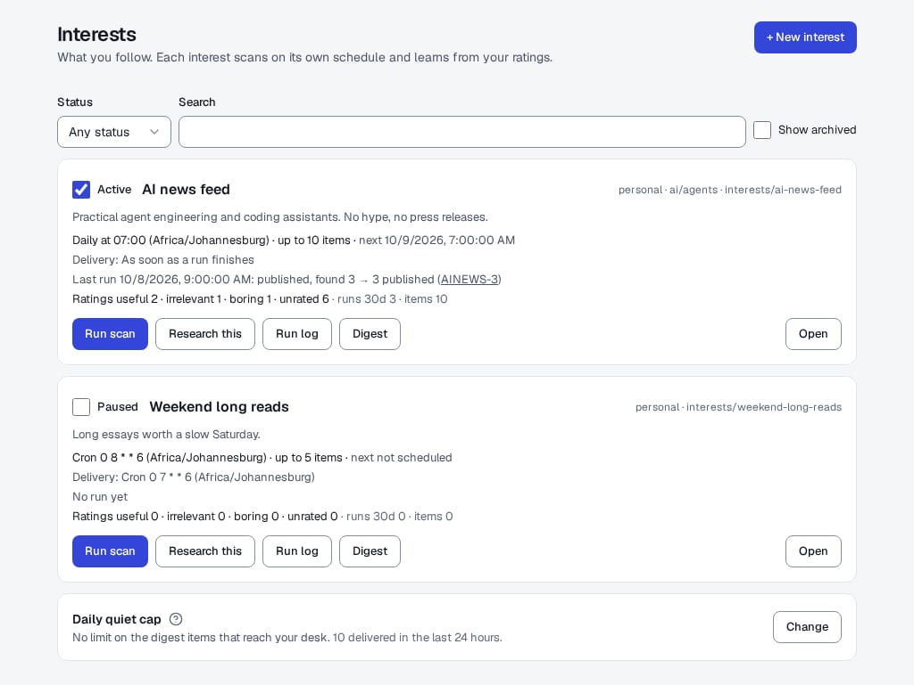

**Create one:** **Interests** in the sidebar, then **New interest**. Fill in:

- **Name and description:** the angle, what to include and what to leave out.
- **What to collect:** articles, videos, podcasts, and the most items per run.
- **Run schedule:** for example "Daily at 07:00", or only when you press **Run now**.
- **Delivery schedule:** **As one digest at set times** (for example weekdays at 07:00) or **As soon as a run finishes**.
- **Preferred agents:** a scout, a curator, a researcher and a fact checker. This is a soft preference. Any available qualified agent takes the run, so nobody waits.

On the interest's page, **Overview** shows both schedules and what is waiting for delivery. **Run log** lists every run with its items, cost and agents. **Digest** is the running list of everything delivered, with rating buttons. **Settings** and **Taste** are where you tune it.

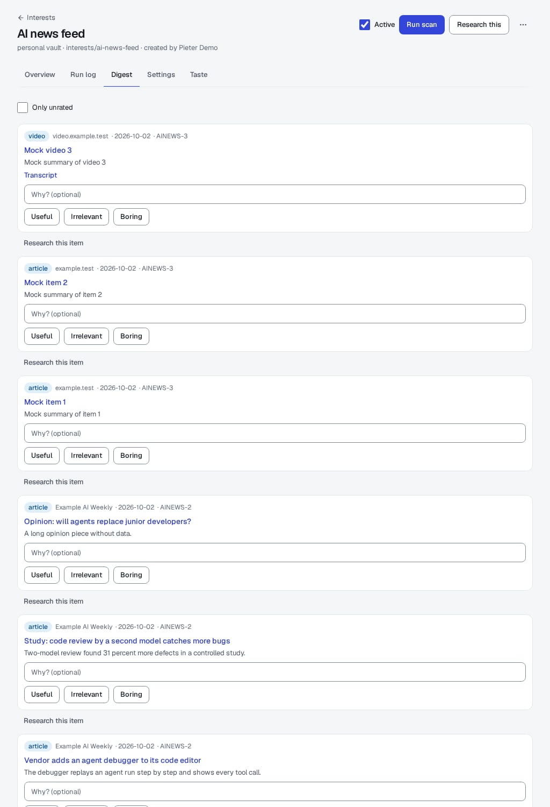

**Teach it your taste.** Rate digest items **useful**, **irrelevant** or **boring**. The curators learn from the ratings and write rules into the interest's `taste.md`. You can also type your own rules on the **Taste** tab ("Skip beginner tutorials"). Your written rules win over the learned ones.

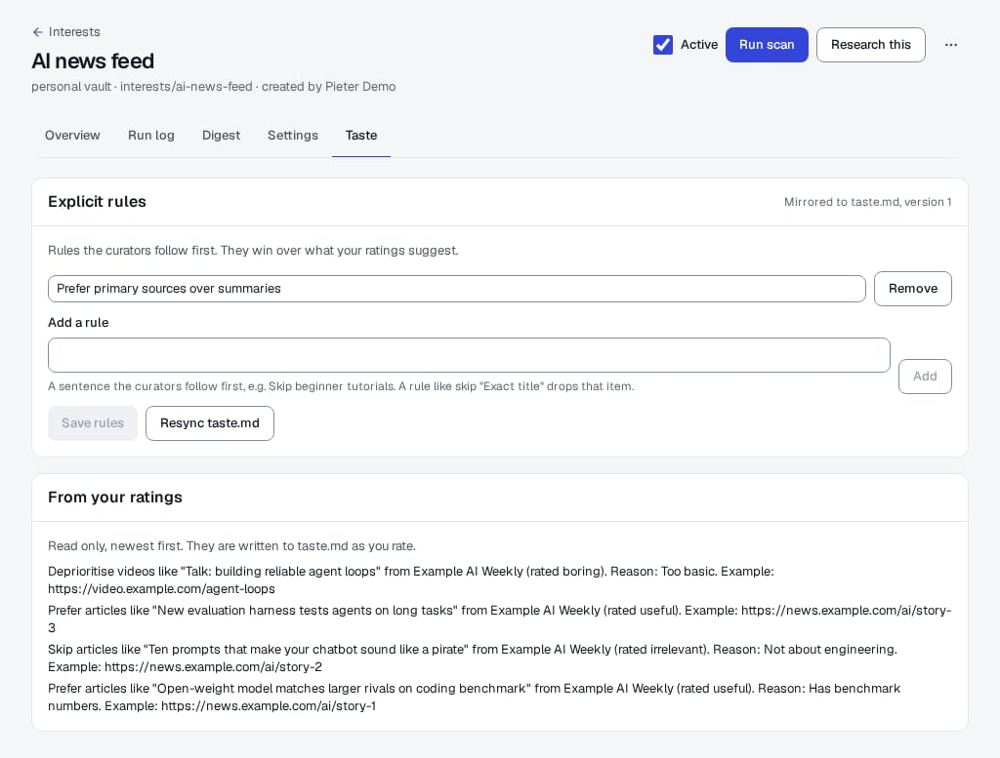

**Research this.** On an interest or on one digest item, **Research this** starts a researcher and a fact checker, with the depth you choose (**Quick**, **Standard** or **Deep**), and publishes a note into the interest's folder. Research happens only on demand.

**The daily quiet cap** (bottom of the Interests page) limits how many digest items reach your desk in a day across all interests. Items over the cap wait for the next delivery.

**Transcripts.** Videos and podcasts come with a transcript so you can read instead of watch. Transcripts of video sites need **yt-dlp** on the workstation (the installer offers it).

**Who sees an interest.** Owners and Admins see all interests. An interest made by a Member or Guest is private to them until an Owner or Admin shares it. Whoever made an interest, or someone with an equal or higher role, may change it.

> **In the app:** Help, "Interests" (`/help/interests`).

### 4.10 Phases and follow-ups

A **phase** is a named slice of a project's work, the cards you want to ship and check together. When all its cards are finished and merged into the working branch, your BA tells you and proposes what happens next: deploy, run the regression suite, something custom. **Nothing runs until you approve.**

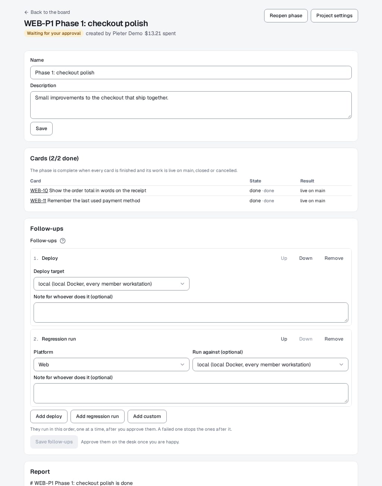

**Set up (project settings):** add **Deploy targets** (a local Docker stack on every project member's workstation, or a remote host that a workstation deploys to over SSH) and the **Default follow-ups** every new phase starts with, for example "Deploy to local, then Regression run against local". No passwords or keys are stored in the site.

**Create a phase** under **Project settings, Phases and deploys, New phase**, or let the BA propose one while you talk about the work ("this is phase 2"). Add cards from the phase page or from the card's **Phase** selector. A card belongs to at most one phase.

**When is a phase done?** The phase is complete when every card is finalized and its work is live on main (or closed or cancelled). In expert mode, if the app cannot see a squash-merged branch, click **Mark merged** on the phase page.

**The "Phase done" item** on your desk carries a report of what was delivered and what is outstanding. You can **Edit follow-ups**, **Approve all**, **Reject** (nothing runs), or **Reopen the phase**.

**What runs after you approve:** the follow-ups run **in order, one at a time**. If one fails, the ones after it are skipped. At the end a **Phase results** notice lists each result with its evidence.

> **In the app:** Help, "Phases and follow-ups" (`/help/phases`).

### 4.11 Your BA reports to you

The BA is your eyes and ears on the floor. It reports in three ways, and it never slows an agent down.

**What goes through the BA.** With **routing** on (the default), urgent items such as blocking questions and approvals reach your desk **at once**, unchanged, and the BA adds a note a little later (how often this was asked, what the ledger says). Less urgent items wait up to **10 minutes** for the BA, which passes them on, folds duplicates together, or dismisses noise it can show is covered. If the BA is slow or offline, items reach you unchanged. Switch routing off in **Settings, Your BA reports to you** to see everything as it is raised.

**Signals the server watches** (every minute, without spending tokens):

| Signal | Threshold | You hear |
| --- | --- | --- |
| A card keeps failing | 3 failed shifts on one card in 10 minutes | At once |
| The same approval asked again and again | 3 times in 24 hours | In the daily report |
| Blocked too long | A blocked card waits more than 4 hours | In the daily report |
| Nobody can take it | A queued card nobody can take for 30 minutes | In the daily report |
| Repeated failures | A card in rework round 3, or finalize failed twice | In the daily report |
| Repository hygiene problem | A conflict, wrong branch, login failure or missing clone | In the daily report |
| Budget | 80% of a monthly budget, or 100% (paused) | 80% in the report, 100% at once |

**The daily floor report.** At **08:00 your time** (change it under Settings) the BA posts one **Floor report** on your desk, on days with something to say. It lists phases waiting, stuck and backing-off cards, repeated approvals, failures, open DevOps requests, what the BA resolved itself, **spend** and highlights from your interests. Open **The facts behind this report** for the same lists straight from the server, and use the **BA reports** chat to ask "why?".

> **In the app:** Help, "Your BA reporter" (`/help/ba-reporter`).

### 4.12 Testing, finalizing and risk

Once a reviewer approves, the card moves to **Test**. A tester runs the tests of the test plan. If they fail, a bug card is created on the same branch, and the original card waits ("waiting on bug") until the bug is fixed and the tests pass.

**Risk tier.** The app computes it from the size of the change: **Small**: one reviewer and one tester. **Large** (200 or more changed lines, or changes in the architectural areas you configured, or a refactor): two different senior reviewers. You can override it on the card (**Change** next to the risk tier) with a reason. A 50-line change to a critical system may deserve large-tier review.

**Finalize.** The BA completes the card the way the project's **How finished work lands** says (4.4): straight into main, or as a pull request for you. In expert mode a card can have its own completion action: **PR** (push the branch and open a pull request), **Push branch**, or **Merge** to the working branch. **A large change that would go straight into main waits for your approval** on the desk, and the card stays in the Finalize column with an "Awaiting your approval" badge.

> **Watch out:** in project settings, **Merge large changes without my approval** lets large changes merge as soon as they are finalized. Only the two reviews, the tests and the post-merge full suite then stand in between. It is off by default, only the project owner can change it, it asks you to confirm, and every change is recorded.

After a merge, a **full suite** card runs the entire end-to-end suite once. If it fails, a bug card and a desk notice follow. **Run regression** on the board runs the whole suite on demand.

> **In the app:** Help, "Testing and finalization" (`/help/testing-and-finalization`).

### 4.13 Conversion, the Research tab and research cards

**Research cards in any project.** Pick the card type **research** on the New card form to ask a question in any project. It runs on the research workflow (question, research, fact check, publish) and gets a **Research** chip on the board.

**Converting a project.** A project that started as research converts to a delivery project when the questions are answered. Owners and Admins do it in **Project settings, Stage, Convert project** (or the **Convert to project** button on a research project's board). A short dialog asks:

1. **Workflow:** the target, usually Code.
2. **Repositories:** a workflow that works in code needs at least one. Add one, or **request a new GitHub repository**. The request lands on your desk and your own workstation creates it with your GitHub login when you approve. (A new repository on GitLab, Bitbucket or Azure DevOps is created from the project settings instead, 3.6.)
3. **Open cards:** for cards that run on another workflow, choose **Keep** (they finish on their own workflow) or **Cancel**.
4. **Hand-over:** the published notes are listed in the project's `PROJECT.md` so every agent that works there reads them.

Cards, notes and history stay as they are. For each repository added, the DevOps engineer asks which branch is the working branch.

**The Research tab.** A project with published research notes (or one that started as research) has a **Research** entry in the sidebar. It lists the research cards in progress and every published note with its path in the vault, a preview and its sources.

> **In the app:** Help, "Converting a project" (`/help/project-conversion`).

### 4.14 Archive and delete

**Archive** a project you no longer use: **Project settings, Archive, Archive project**. The dialog lists what will stop (running shifts, open cards, schedules and open desk items) before you confirm. Branches and history are kept. Agents are not fired. They simply stop getting the project's work. **Restore** it from **Projects, Archived**. Cards the archive closed stay closed.

**Delete permanently** is possible only for an archived project, only for the project owner, and asks you to type the project key. The project's cards, threads, schedules and notes are removed from the database and cannot be recovered. The audit log keeps a record and the vault folder is never touched. An agent that was allowed on that project only is **benched**, and the desk names the benched agents so you can reassign them.

### 4.15 Security and two-factor login

Everyone can turn on two-factor login under **Your settings** (3.2). As Owner you can **require it for the organization** on **Organization, General** (see the General tab in 4.1). Members who have not set it up are then held at the setup screen until they do. You need it on your own account first.

If a member loses their phone and their recovery codes, you reset their two-factor login on the **Members** tab (**Reset two-factor login**, Owner only). They set it up again at the next sign-in.

**Reset a member's password (Owner and Admins).** An Owner may reset a Member or an Admin; an Admin may reset a Member only (never an Owner or another Admin), and nobody resets their own password this way (use Account, Security). If a member cannot get the reset email, open the actions menu on their row on the **Members** tab and choose **Reset password**. Guildwise HQ makes a strong temporary password and shows it to you **once**, with a **Copy** button: send it to them yourself, in a message only they can read. No email is sent and we do not keep the password. The member is signed out everywhere, and the next time they sign in with the temporary password the app asks for a new password before anything else (two-factor login still applies). A Guildwise HQ account is one account for every organization: if the member also belongs to other organizations, the new password applies there too. The reset is recorded in the organization's activity and never contains the password.

> **Tip:** a suspended organization (unpaid, trial over) keeps its data. Running shifts finish, nothing new starts, and only the Owner can still sign in to see settings and members. Everything resumes where it stopped when the platform administrator reactivates the organization.

### 4.16 Plan and limits

**Organization, Plan & limits** shows your plan, status, licence date, how much you use, and which features are switched on. Organizations set up by invitation are on the free **Founding** plan with every feature and **no limits**; they stay free until the Owner subscribes (4.17). The platform administrator can also give an organization the **Unlimited** plan (no billing, no limits). If a feature is switched off, its page leaves the sidebar, but its data is kept.

### 4.17 Billing

Only the **Owner** sees **Organization, Billing**. Plans differ only in limits (members, workstations, projects); every plan has every feature and **no limit on agents**.

| Plan | Per month (US dollars, VAT included) | Members | Workstations | Projects |
|---|---|---|---|---|
| Starter | $19.00 | 2 | 1 | 3 |
| Team | $49.00 | 5 | 3 | 10 |
| Business | $149.00 | 20 | 10 | Unlimited |

- **Signing up.** Choose a plan at **Start free trial**, confirm your email (required), then add a card on the full-page **Start your 7-day free trial** screen that replaces the app until a card is saved (Sign out and Contact us stay available; a sign-up without a card is removed after 14 days). The **7-day free trial** starts; the first invoice is charged when it ends, then monthly. A reminder is emailed two days before.
- **Company name.** Guildwise HQ is sold to businesses, so sign-up asks for your company name.
- **Charged in rand, VAT included.** The price is a fixed dollar amount that includes 15% VAT. Each charge converts it at the day's exchange rate. Every invoice shows the dollar price, the VAT it contains (in dollars and rand) and "charged as R x at R y / USD on <date>". We never see or keep the card number: you enter it on Paystack's secure page and we keep a secure token with the brand, last four digits and expiry (we email you before it expires). **Update card** replaces it.
- **Billing profile.** Under Billing the Owner edits the company name, address, country and VAT number (optional). They are printed on your invoices; paid invoices keep the details they were issued with.
- **Tax invoice.** **View / print tax invoice** next to an invoice opens a printable page (use Print, then Save as PDF).
- **Change plan.** Takes effect at once and is prorated for the rest of the month: you pay the difference now, or get a credit on the next invoice. A plan too small for what you use is refused.
- **Business add-ons.** Add members, workstations or projects (priced per unit). They start with the next billing cycle and never go below the Business base.
- **Cancel.** The organization stays active until the end of the paid term (or trial), then is paused. **Keep my subscription** takes it back before then.
- **Failed payments.** Three attempts (now, after 1 day, after 3 days); you are emailed each time and can update the card. After the third failure the organization is **paused**: agents stop picking up work and only the Owner can sign in. The Owner sees a full-page **Resubscribe to continue** screen (reason, plan, amount due, **Update card**, **Resubscribe now**, Sign out, Contact us) instead of the app, and **Resubscribe now** charges a new month and resumes everything. The same screen appears when the subscription was cancelled and its term ended. Members see a banner asking them to contact their Owner.
- **Platform administrators** see the active payment provider and its sandbox or live mode, and edit prices (VAT included), limits, add-on prices, the VAT rate, the invoice details (company name, address, VAT number printed on tax invoices) and the exchange-rate override under **Platform, Billing**, and can pause, unpause or assign **Unlimited** from an organization's page (each with a reason, audited).

See the help article *Plans and billing*.

### 4.18 Chatting with agents

Click **Chat** in the top bar (or on the Desk), pick an agent and choose **Start chat**. Ask about a card, discuss a blocker, or ask the BA to draft cards. The BA works with your rights, so it can only use projects you are a member of. Conversations are saved, and a chat tied to a project is marked as visible to that project's managers.

> **In the app:** Help, "Chat with agents" (`/help/chat-with-agents`).

### 4.19 Cloud workstations: a VPS or a Codespace

You do not have to leave a computer switched on. In **Workstations**, **Add a workstation**, choose where the agents run:

- **A VPS (SSH).** Enter the address, port, user and a password or SSH key of any Linux server. Guildwise logs in once, installs the runner and pairs it by itself. The password or key is used for that one login and is not stored. A VPS is always on; start and stop it at your VPS company. A guide for renting and preparing one is in `docs/BYO-VPS.md`.
- **GitHub Codespaces.** Connect GitHub with a token that has the `codespace` scope, pick the repository and machine, add the generated `devcontainer.json` to the repository (it holds no secret), and create the codespace. It installs the runner and pairs by itself. It stops after 30 minutes with no agent working (you can change this), wakes by itself when a card is queued, and can be kept asleep outside optional **office hours**. **Wake** and **Stop** buttons are always there.

By default an organization has one cloud workstation, shared by all its projects. Each one shows an **estimated monthly cost**. You pay your VPS company or GitHub directly; Guildwise does not charge extra. If your Codespaces credits run out or the codespace cannot start, a notice appears on your desk, you get an email, and the card shows **Needs attention**; fix it on GitHub and press **Wake**.

**Docker.** A Codespace cannot run Docker. If you deploy Docker images you still need a workstation of yours or a VPS for that, and your deploy targets must point there. The Workstations page reminds you when you only have Codespaces.

**Claude sign-in.** Use your own Anthropic API key (the default): on a VPS run `read -rs K; printf %s "$K" | aom-runner auth api-key`, in a Codespace add the Codespaces secret `ANTHROPIC_API_KEY`. A Claude subscription also works but is for one person's own use, so the page warns about "individual use". Guildwise never receives or stores a Claude key or token.

> **In the app:** Help, "Cloud workstations (VPS and Codespaces)" (`/help/cloud-workstations`).

## 5. For Members

A **Member** works inside the projects an Owner or Admin has added them to. You do the day-to-day work: write cards, answer questions, hire your own agents and follow the board. You do not manage the organization.

### 5.1 What you can do

| You can | You cannot |
| --- | --- |
| See the board, desk items and cards of **your** projects | See other projects, create a project or change the priority order |
| Create and edit cards, and comment | Add or remove people, or change project settings |
| Move, release or cancel **your own** cards | Manage cards of other people (ask an Owner or Admin) |
| Answer questions on your own cards | Answer project-level decisions (Owners and Admins do) |
| Pair **your own** workstation and hire agents on it, for projects you are on | Hire agents on someone else's workstation, or widen an agent's permissions |
| Change or fire the agents **you** hired | Change other people's agents |
| Chat with the agents allowed on your projects | See Costs, Intake, Plan and limits or the Invitations tab |
| Create interests, and schedules inside your projects | Create schedules that act for the whole organization |
| Turn on two-factor login, and leave the organization | Change roles or remove people |

The **Members** list under **Organization** is visible to you, read-only.

### 5.2 Your first day

1. **Sign in** and take the tour (3.1 to 3.3). Turn on two-factor login (3.2).
2. **Open the board** of a project you were added to. The sidebar's **Board** entry opens the project you used last. The project switcher at the top of the page changes project.
3. **Create a card** (3.7), or ask the BA in a chat to draft one for you. Only cards you created, or that were assigned to you, show actions such as **Move** and **Cancel**.
4. **Answer questions.** The desk shows questions about your cards. Questions about other people's cards are read-only for you, unless the project's decision policy allows any member to answer.
5. **Use your own computer if you like.** Under **Workstations** you can add a workstation (3.4) and hire agents onto it. Those agents work for the projects you are on, and for no one else. Hire them with the allow-list limited to the projects you are on.

### 5.3 Good habits

- Write cards like a briefing to a new colleague. A clear card is the cheapest way to get good work.
- Use the **Chat** button to ask the BA when you are unsure how to phrase something.
- Check the desk once or twice a day. Blocked cards wait for answers, and waiting costs time, not money.
- Keep an eye on the budget bar in the board header. If the project nears its budget, tell an Owner or Admin before the pause starts.

> **In the app:** Help, "Board and cards" (`/help/board-and-cards`) and "The Decision desk" (`/help/desk`).

## 6. For Guests

A **Guest** is someone from another organization who was invited to work in one project of this one. You keep your own organization and your own account. The invitation adds one project, and nothing else.

### 6.1 Accepting the invitation

1. Sign in with the account the invitation was sent to. (There are no guests without an account in some organization. If you have none, ask for a Member invitation instead.)
2. Open **Projects**. At the top, the **Project invitations** inbox names the organization that invited you. Click **Accept invitation**.
3. The project now appears in your project list with a "Guest" label and the other organization's name. The organization switcher in the sidebar lists it under "Guest in".

### 6.2 What you can do as a Guest

- See the project's **board** and its cards, create cards, comment and answer questions on your own cards.
- **Chat** with the agents that work on this project.
- **Hire agents onto your own workstations**, for this project only. An agent of yours never works on the host organization's other projects, whatever its allow-list says.
- Leave the project when you are done.

### 6.3 What you cannot do

- You see **nothing at organization level**: no org settings, members, costs, org chart or agents of other people.
- You cannot change project settings, add people or archive the project.
- You cannot see the host organization's vaults, ledger entries that belong to other projects, or other projects at all.
- You never see the money: a paused project shows only that it is paused, not the amounts.

If you are removed from the project, the agents you hired for it move back to the owner of the project, and cards they held go back into the queue.

## 7. For the platform administrator

The **platform administrator** (also called the **super admin**) runs the Guildwise HQ service itself, not any one organization's work. You sign in at the same address as everyone else, but you see only the **Platform** area. You can never see an organization's cards, desk, vaults, ledger, chats or agents. That is by design.

### 7.1 First sign-in and two-factor login

A platform account is created on the server with a command (see `docs/DEPLOY.md`). At your first sign-in the app holds you at the two-factor setup: type your password, scan the QR code, type the first code and **save the ten recovery codes**. Two-factor login is mandatory for platform accounts. If you lose your password, use **Forgot your password?** on the sign-in page like everyone else (your two-factor code is still asked), or another platform administrator can send you a reset link (7.4). If the second factor is lost too, an operator resets it on the server (`superadmin-reset-password --reset-two-factor`).

### 7.2 Organizations

**Organizations** lists every organization with its status (trial, active, suspended, cancelled), its Owner, its plan and its usage (members, workstations, agents, projects). Click one for its detail page.

On the detail page you can:

- **Suspend** an organization (unpaid, trial over, licence date passed). Running shifts finish and nothing new starts. Scheduled runs are skipped and recorded. A banner explains it. Only the Owner can still sign in, with read access plus organization settings and members. **Reactivate** it and everything resumes where it stopped.
- **Cancel** an organization.
- Change the **plan, limits, licence date, grace period and feature switches** (Interests, Integrations and intake, Outbound updates, Research, Phases, Browser tools, Custom roles and workflows). Every change needs a **reason**, and it goes into the audit log. Organizations you invite start on **Founding** (free, no limits) until their Owner chooses a paid plan; self-service sign-ups use **Starter**, **Team** or **Business** (4.17); **Unlimited** is assigned from the organization's **Billing** panel.
- **Transfer ownership** to one of the organization's Admins, for example when the Owner left the company. This needs a written reason and is audited.

### 7.3 Invitations: starting a new organization

Most new customers sign up themselves on the website (3.1). **Invitations** is for starting an organization for someone yourself. Type the **Owner's email** and the **organization name** and click **Send invitation**. The invitee receives a link, chooses a name and password, and becomes the Owner of the new organization (they may rename it). Invitations can be resent or revoked from the **All invitations** list.

### 7.4 Accounts

**Accounts** lists every login. You can **deactivate** and reactivate an account. Deactivating someone unlinks their workstations, parks their agents and releases cards they held. You can also **reset a person's two-factor login** if they lost their phone and their recovery codes. **Send reset link** emails the person a one-time link to choose a new password (valid for an hour); the page shows when the last link was sent, and the send is recorded in the audit log. It also works for other platform administrators. Organization Owners and Admins cannot send links, but they can give a member a temporary password (4.15). The last active Owner of an active organization cannot be deactivated. Transfer ownership first.

### 7.5 The Support inbox

**Support** collects every **Contact us** request from every organization and from visitors who are not signed in (chapter 10). Filter by status (open, answered, closed), type or organization, and search by reference, name, email or subject. Open a request to see who wrote, from which organization, the page they were on, the app version, browser and recent errors, and any screenshot. Then **reply** (the reply is emailed to the person and shows under **Help, My requests** in the app) or **reply and close**. A reply to an answered or closed request from the person reopens it.

**Everything that lands on this console is emailed** to the support address(es): new requests, Contact us messages and a person's reply or reopening on a request, always. Two more notifications are switches under the addresses, off until you turn them on: **New organizations and sign-ups** (an organization is created or an invitation is accepted) and **Platform audit events** (one mail per audit entry; switching it on starts from now, the history is not mailed). Each event sends one mail.

At the top, set the **notification addresses** (one address or several, separated by commas). The **support address** receives new requests from signed-in users and every follow-up; the **Contact us address** receives the messages visitors send from the public Contact us page, and falls back to the support address when empty. Both are emailed with the writer's address as Reply-To, so your team can work from its own mailbox as well. The person who wrote in gets an acknowledgement with their reference, what happens next and when to expect an answer (within 24 to 48 hours).

The **Landing-page assistant** panel on the same page turns the public **Ask Guildwise** chat on or off, shows today's messages and spend against the daily budget, and lets you change that **Daily budget** (it starts at $2 a day; **Use the default** puts it back). It is paid by Guildwise, answers in English from the reviewed product facts (`docs/assistant/product-facts.md`) and an outline of the help articles, and keeps no conversations.

### 7.6 The audit log

Every platform action (suspending, plan changes, invitations, ownership transfers, resets) is recorded in the **Audit log** with who did it, when, and the reason given. It is kept forever and cannot be edited. Filter it by action.

### 7.7 The blog, API keys and social sharing

**Blog** is where the Guildwise HQ blog is run (details for the blog API used by outside tools: `docs/BLOG-API.md`).

- **Writer.** The blog writes itself on the Guildwise server: switch the **Writer** on (it is off by default) and it writes 1 or 2 articles a day (08:00 and 15:00 Johannesburg) from your **topics** list, researching each on the web, and sends them to the review queue. It uses the platform Anthropic key (the landing assistant's) and has its own **monthly cap** (default $10, searches included); before each article it checks that this month's spend plus one more article fits, otherwise it skips the article and mails you once that month. The panel shows this month's spend, every run (tokens, searches, cost, errors) and **Write one now**. The model is Claude Haiku 4.5 by default; another model needs its price entered first.
- **The switch.** *Switch the blog off* is the kill switch: the writer and API tools are refused when they create posts (the API answers 503), nothing is published (by you or automatically), and no digest or social post goes out. Public articles stay readable. Switch it on again to carry on.
- **The review queue.** Posts arrive *In review* (the badge on **Blog** counts them). Open one to read it exactly as it will look, edit it, then **Approve and publish** or **Reject** with a reason. You review every post until the date under **Auto-publish starts on** (by default two weeks after the first post). After it, a post with no content warning publishes by itself once it has waited the **hold** (3 hours by default). A post with a warning (for example a link that is not in its sources) always waits for you. **Unpublish** takes a post down.
- **Weekly digest.** On Mondays at 08:00 (Johannesburg) one mail goes to every organization Owner who has not opted out and to everyone else who opted in. Nothing is sent in a week without new posts. You can switch it off, send a test to yourself and see what each week did.
- **API keys.** Only for outside tools (the built-in writer needs none): create a key with only the scopes it needs. It is shown once; revoke it at any time. The list shows when each key was last used and how much it did in the last 24 hours, and *Recent requests* is the audit.
- **Social sharing.** Paste the Facebook Page and LinkedIn organization tokens (they are stored encrypted and never shown again). Published articles are shared automatically. If a token is refused or about to expire you get an email and a banner, and that network pauses until you paste a new token. Unpublishing does not remove a post that was already shared.

Everyone else reads the blog under **Help**, **Blog**, and can turn the weekly digest on or off under **Settings**.

> **In the app:** the platform area has its own Help, with "Organizations and roles" (`/platform/help`). Platform accounts get their own short tour.

### 7.8 Simulation organizations, demos and deleting them

A **simulation organization** is a safe sandbox for testing (for example your family member trying the product) and for demos. Everyone in it sees a **Simulation** banner. Its agents run on a **Simulated workstation** hosted by Guildwise, so nothing real is built, no model is used and nothing is billed. Repositories added there are throwaway copies on the server, whatever address is typed, and repositories that the BA or a DevOps engineer asks for are simulated the same way (you still approve the request on the desk; nothing is created on a git host). Chats are answered with prepared replies for typical questions (status, scope, acceptance criteria, estimates, risks, tests, deployments). Emails still go out, with **[Simulation]** at the start of the subject whenever the email is about the simulation organization (an invitation, a support request, a notice), even for someone who also belongs to a real organization. Your own workstations receive no work from it.

- **Create one:** on **Invitations** tick **Simulation organization** and invite the Owner. Or open an existing organization and switch **Simulation** on. That works only while the organization is **empty**: no projects (archived ones count) and no active billing subscription. Otherwise you get a clear message and should invite a new simulation organization instead.
- **No way back:** a simulation organization cannot be switched off. It stays a simulation until it is deleted, so test data can never turn into a real organization. Only the pace can change.
- **Pace:** Fast (tests), Normal or Slow (demos, so people can watch cards move).
- **Load demo scenario:** on an empty simulation organization it adds two projects with repositories, a team for each, cards at several priorities, two desk questions, a draft idea and a schedule. It refuses when the organization already has projects.
- **Delete simulation organization:** removes the organization and everything in it, including its history. You type its name to confirm. Accounts that belong only to it are deleted so their email addresses can be used again; accounts that also belong elsewhere only leave this organization. The audit log keeps a short record. The server does not back up the database for you: on a live system take a backup first (`docs/DEPLOY.md`).

## 8. Everyday workflows

Four situations you will meet again and again, start to finish.

### 8.1 A feature, from intake to deploy

**You want:** the order history page gets a CSV export, and it should be live for customers.

1. **Say what you want.** Open a chat with the BA (**Chat** on the desk): "Customers keep asking for a spreadsheet of their orders. Add a CSV export to the order history page." Or paste the Jira or GitHub issue into **Intake**. The BA reads it, asks you what it cannot decide (which columns, which delimiter) and drafts the card with requirements and acceptance criteria.
2. **Check the card.** Open it. If the draft is not quite right, **Edit** it (possible while it is a draft or queued and not yet claimed). Click **Specify** when it reads well.
3. **Let the team work.** The builder builds, the reviewer reviews (sending the work back with comments if needed, which shows as *rework*), the tester tests. Open **Timeline** and **Handoffs** any time to see why.
4. **Answer questions.** If the builder asks "should the CSV include cancelled orders?", the question reaches your desk with options and a recommendation. Pick one and add it to the ledger as a **decision**, and nobody will ask again.
5. **Finalize.** The change goes into main (or arrives as a pull request, if the project works that way). A large change waits on your desk for **Approve merge**.
6. **Group it into a phase** if several cards ship together. When they are all merged, the **Phase done** item arrives with a report. Approve the **Deploy** and **Regression run** follow-ups and watch **Phase results**.
7. **Done.** The card is in the Done column and says *"Your change is live on main"* (and, after the phase, it is deployed and tested).

### 8.2 From research to a project

**You want:** to find out whether a new payment provider is worth using, and build the integration if it is.

1. **Create a research project.** **New project**, workflow **Research**. No repository is needed.
2. **Ask the question as a card:** a title, the question, the scope and the depth (**Quick**, **Standard** or **Deep**). A researcher finds sources, a fact checker verifies every claim against them, and the result is **published as a note** in the project's vault folder, with sources.
3. **Read the notes** on the **Research** tab. If a claim is not supported, the fact checker sends the note back for rework and says why.
4. **Decide.** When the answers are good enough, **convert** the project (**Project settings, Stage, Convert project**): choose Code as the target, add the repository (or request a new GitHub repository, which waits for your approval on the desk), decide what happens to open research cards, and write a hand-over note.
5. **Build.** The published notes are listed in the project's `PROJECT.md`, so every builder reads them. Create the first cards and carry on as in 8.1. The project remembers that it **started as research**, and the Research tab stays.

### 8.3 Setting up interests without being flooded

**You want:** to follow AI news, but not get a hundred links a day.

1. **Create the interest** (**Interests, New interest**). Write the description like a briefing: "Practical agent engineering and coding assistants. No hype, no press releases." Choose the vault where its files live, and the kinds you want (articles, videos, podcasts).
2. **Keep the volume low.** Set **max total items** to something small, such as 5 or 10 per run. Choose a **run schedule** that matches how fast the topic moves (daily is plenty for most), and a **delivery schedule** of **one digest at set times** (for example weekdays at 07:00) instead of "as soon as a run finishes". Runs can happen as often as they like, but you only hear from them at the times you chose.
3. **Set the quiet cap.** At the bottom of the Interests page, **Daily quiet cap** limits how many items reach your desk per day across all interests.
4. **Teach it.** For the first two weeks, rate what arrives: **useful**, **irrelevant** or **boring**, with a short reason. Add taste rules ("Prefer primary sources over summaries", "Skip beginner tutorials").
5. **Go deeper only when it is worth it.** **Research this** on one item produces a fact-checked note. Research never starts by itself.
6. **Watch the cost.** The interest's **Settings** tab has a monthly budget. A paused interest does not run.

If an interest cannot run (for example its workstation is offline), it shows a red **Cannot run** badge with the reason and raises a notice on your desk after the third attempt.

### 8.4 Controlling spend

**You want:** the agents to be useful without surprises on the bill.

1. **Look at what things cost.** Open **Costs** for the breakdown by project, agent, model and day, and the **Agents** page for each agent's monthly and total cost.
2. **Set budgets.** For every project, set a **Monthly budget** in its settings. Start with a number you would be comfortable losing and raise it when you trust it.
3. **Use the right model for the job.** A smaller model for reviewers and testers, a stronger one for builders and the BA. Change an agent's model any time (**Change model**).
4. **Let the 80% notice work for you.** When it arrives, check the **Floor report's Spend section** for which projects and agents cost the most.
5. **At 100%** the project pauses by itself. Decide on the desk: **Raise budget** or **Override for this month**. Declining to act is also a decision: the project stays paused until the 1st.
6. **Stop loops early.** If a card keeps failing, the loop breaker already backs it off (see 9.3) and your BA warns you. Do not keep feeding a card that cannot succeed. Cancel it or fix what it cannot do.
7. **Review monthly.** Export the Costs CSV and look for agents that cost more than they deliver.

## 9. Troubleshooting

### 9.1 The installer

| What you see | What to try |
| --- | --- |
| The wizard stays on "waiting for the installer" | The command was not run, or was run on a different computer than you chose. Run it on the computer that will host the agents. Check you pasted all of it. |
| The command link says it expired | The link works for 30 minutes. Choose your system again on the page to get a new command. |
| "Paired" never appears | The computer cannot reach this website. Check its internet connection, proxy and clock. Run the command again, it is safe to repeat. |
| A health check shows a warning (Claude, sandbox, Docker, yt-dlp, a repository) | Each row says what is wrong and how to fix it. Claude not signed in: run `claude` on the workstation and sign in. Sandbox missing on Linux: install `bubblewrap` and `socat`. Docker and yt-dlp are optional. |
| Windows asked to restart | Restart. The installer continues by itself when you sign in again. |
| Anything else | Open **Contact us** from the installer's failure screen. It already knows what went wrong. |

> **In the app:** Help, "Installing a workstation: if something goes wrong" (`/help/install-troubleshooting`).

### 9.2 The runner is offline

A workstation that shows **Offline** or **Disconnected** cannot take work. Its agents show "offline" and cards that only they could take show an amber warning ("Reviewer Linus is offline").

1. Is the computer on and awake? Laptops that sleep disconnect.
2. On the workstation open a terminal and run `aom-runner status`. It shows whether the runner is running and connected.
3. If it is not running, `aom-runner start` (or restart the service the installer set up). Run `aom-runner doctor` for a health check of Node, git, Claude and the connection to the server.
4. Still stuck? Running the installer command again repairs the installation and keeps the pairing.

The warning icons clear by themselves when the machine returns (within about 30 seconds). Logs are in `~/.aom-runner/logs/`.

### 9.3 A card is backing off

An amber badge "Backing off until 14:32 (3 failures)" on a card means the **loop breaker** stepped in. When three shifts on the same card end without a report within 10 minutes (the agent crashed, timed out or was stopped by a denied tool), the dispatcher stops handing the card out. The wait starts at 1 minute and doubles with each failure, up to 1 hour. You also get one alert on the desk.

1. Open the card and read the **Timeline** and the last **Handoff** for the reason. The usual cause is something the agent cannot do: a tool that is denied, a missing capability, a repository that is not on its workstation.
2. Fix the cause (adjust the card, the agent or the workstation).
3. Click **Release back-off** on the card to try again at once. Moving the card to another stage also clears it.
4. If it keeps failing, cancel the card and write a better one.

### 9.4 A budget pause

A banner "This project has used its monthly budget" and a desk item mean the project is paused. Running shifts finish, nothing new starts. See 4.6. On the desk choose **Raise budget** (the pause lifts as soon as the new amount is above the spend) or **Override for this month**. If you are a Member, tell an Owner or Admin.

### 9.5 A missing working branch

Guildwise uses the repository's default branch by itself, so you rarely see this. Symptom: the DevOps engineer does not commit or pull in a repository, and the desk asks "Which branch is the working branch?" (or the project settings show *not confirmed*). Answer the question on the desk, or set the branch in **Project settings, Repositories, Change**. The DevOps engineer commits and pushes right away. If the branch you named does not exist yet, the runner creates it from the repository's default branch and pushes it when the next card starts (the card shows "Created working branch X from Y"); you only get this question when it cannot tell the default branch or the push is refused. See 4.4.

**Git hosts.** Every repository has a git host, detected from its address and changeable by the project owner (Project settings, Repositories, Change). One project can mix hosts. For pull requests, listing your repositories and creating new ones, the workstation must be connected to that host: the Workstations page shows Connected or Not connected per host, and **Connect** gives the one command to run on that workstation (`aom-runner git-connect github`, `gitlab`, `bitbucket-cloud` or `azure-devops`); your login or token stays on that computer and the server only learns whether it works. The DevOps engineer can walk you through it: it can start a browser sign-in and show you the address and code, but it never asks for or types a token (if one is needed it tells you to run the command yourself or use **Connect**). **Azure DevOps:** personal access tokens that are not limited to one organization stop working on 2026-12-01, so use a **Microsoft Entra service principal** (or workload identity) as the main sign-in: register an app in Entra, add it to your Azure DevOps organization with Basic access and Contributor on the repositories, and set `AZURE_TENANT_ID`, `AZURE_CLIENT_ID` and `AZURE_CLIENT_SECRET` (or `AZURE_FEDERATED_TOKEN_FILE`) for the runner on that workstation. A token for one organization and `az login` remain supported fallbacks. Agents can also ask for a new repository on any of these hosts (GitHub, GitLab, Azure DevOps, Bitbucket Cloud); you approve it on the desk and your own login on the workstation creates it. A plain git server needs no connection but gets no pull requests: the branch is pushed and the desk tells you to open the request yourself. If the working branch is protected on the host, finishing a card opens a pull request instead, says so on the card, and the project switches to pull requests for new work.

**Repositories, tools and rights on a workstation.** A repository you add under Project settings, Repositories is cloned (or, with "Create a new repository", created and cloned) onto the project's workstations by their DevOps engineers; the Repositories tab shows Cloning, Cloned on a workstation or Failed with the reason and a Try again button. Before build work starts on a workstation the DevOps engineer installs the tools the repository needs (for a .NET MAUI app: the .NET SDK, the MAUI workloads, a JDK and the Android SDK), if you ticked "Install packages and tools", and then the project's own packages (pnpm/npm/yarn/bun install, Python into the project's environment, dotnet restore, Go, Rust, Maven, Ruby, PHP); until the workstation is ready every agent card of the project waits with the reason, a notice on your desk tells you when it needs your help or failed, and Project settings shows the Development environment per workstation with Check again. On the Workstations page every ticked DevOps right shows verified or failed with how to fix it, and a sudo password, if sudo needs one, is entered there: it is encrypted for that workstation and never shown again.

**Fix with DevOps.** Next to every item that failed or is missing (a tool in the Development environment, a ticked right that failed verification, a repository that could not be cloned) there is a **Fix** button. It sends the DevOps engineer of that workstation a request with the error text, the workstation, the project and the repository, so you do not have to write it yourself. The status shows right next to the item: *Requested*, *DevOps is working on it*, *Needs your approval on the desk* (when the fix is outside what you allowed), *Done* or *DevOps could not fix it* (with **Fix again**). When DevOps reports done, the check runs again by itself (the environment check, the rights check, or the clone), and **Check again** is there if you want to run it yourself.

### 9.6 Two-factor recovery

- **You lost your phone, but have your recovery codes:** at the sign-in code step, type one of the ten recovery codes instead of the six digits. Each works once. Then set up two-factor login again on a new phone (**Your settings**), which gives you new codes.
- **You lost both:** ask your Owner to **reset your two-factor login** (**Organization, Members**; only the Owner can). If you are the Owner, ask the platform administrator (**Accounts**). If you are the platform administrator, an operator resets it on the server with `superadmin-reset-password --reset-two-factor`.
- **Too many wrong codes:** after five wrong codes the sign-in attempt is cancelled. Sign in again with your password and type the right code.

> **In the app:** Help, "Two-factor login" (`/help/two-factor`) and "Troubleshooting" (`/help/troubleshooting`).

### 9.7 Other things you may see

| What you see | What it means |
| --- | --- |
| A red warning icon on a card, "Not workable" | Nobody hired could ever take this stage. Hire the missing role (hover, focus or click the icon: the explanation has a **Hire** link). |
| An amber icon, "Waiting" | Agents exist but are offline or busy. It clears by itself. |
| An amber icon, "Last attempt failed: ..." | The runner turned the last shift down (for a missing working branch it names the branch and the repository's default, and links to Project settings, Repositories). A desk question offers the existing branches, with the default preselected; the message clears when a shift starts. |
| The card says "waiting on bug" | The tester found a bug and a bug card is being fixed. |
| A desk item "Could not post the update" | The ticket system refused the post. Fix the login on the workstation and use **Retry**. |
| Vault sync paused with a conflict | A local and a remote change collided. Resolve it in the vault, then restart the sync. |
| "Out of scope" in a handoff | The agent found work outside its role. Adjust the card or the agent's skills. |

## 10. Contact us

If something is broken, confusing or missing, tell us. **Contact us** is in your avatar menu, in the command palette (Ctrl+K, type "contact"), on the **Help** page, on the installer's failure screens and, for people who are not signed in, in the footer of the sign-in page.

1. Choose what it is about: **bug report**, **question**, **feature request** or **billing**.
2. Write a subject and a message.
3. When you open it from the menu or the palette, a screenshot of the page you were looking at is attached automatically. You can remove it or upload a different image (PNG, JPEG or WebP up to 2.5 MB).
4. Open **What we send with your request** to see exactly what goes along: the page you were on, the app version, your browser and screen, and the last few errors from your browser (untick the box to leave the errors out). Your name, email and organization are added so that support can answer.

We answer by email, and the answer also appears under **Help, My requests**, where you can reply. A request is **Open** until we answer, **Answered** until you write again, and **Closed** when we are done. A request with a new answer shows a "New reply" badge.

> **In the app:** Help, "Writing to us" (`/help/writing-to-us`).

## 11. Frequently asked questions

**Is Guildwise HQ hosted, or do I install it?**
It is a hosted service: you sign up on the website (3.1). Only the runner goes on your workstation, your own computer, a VPS or a GitHub Codespace, and your code stays in your own repositories.

**Do the agents see my whole computer?**
No. They run inside a sandbox on the workstation, with access to the repositories and folders they need. Warnings appear if a workstation cannot provide a sandbox. The DevOps engineer is the exception: it works as you, so only give it a machine you are happy to hand it (4.4).

**Where is my code stored?**
On your workstations and in your git remotes, exactly as before. The Guildwise HQ website holds the board, cards, desk, ledger, and records of what the agents did. Passwords and tokens for Jira, your git hosts and Claude stay on your workstation.

**Can an agent change my main branch by itself?**
Only after review and test, and only if the project's **How finished work lands** is *straight into main* (the default). Choose *as a pull request I approve* to merge everything yourself. Large changes wait for your approval either way, unless you turned that off in the project settings. If main is protected on your git host, a pull request is opened instead.

**What does it cost?**
Guildwise HQ is $19 (Starter), $49 (Team) or $149 (Business) a month with a 7-day free trial, in US dollars including VAT, charged in rand (4.17). The AI work is billed by Claude: through your subscription or your API key. The app estimates the spend (4.6) and you set budgets.

**How many agents do I need?**
Start with a builder, a reviewer, a tester and a BA (3.5). Add more when cards queue up.

**Can I stop an agent?**
Yes. **Cancel** a card, or **Fire** an agent. A running shift is stopped, and its card goes back to the queue.

**An agent asked something I already decided.**
Add the decision to the ledger when you answer (4.5). Agents search the ledger before they ask.

**What if two of my projects have a card with the same number?**
Card numbers are unique only within one organization. If you are in two organizations with a `WEB-1` each, the app asks which one you mean.

**Can I use it on my phone?**
Yes: the board, the desk, cards, chat and most pages work on a phone. The installer needs a computer.

**Where do I find help?**
**Help** in the sidebar: articles, the glossary, Contact us and My requests. The **?** hints open the matching article. Press **Ctrl+K** to search the app.

**Which keys can I press?**
Press **?** (when not typing in a field) for the list of shortcuts. **Ctrl+K** opens the command palette.

## Appendix A. Where to find things

| I want to | Go to |
| --- | --- |
| See my work | **Board** (sidebar, Work) |
| Answer questions and approve things | **Desk** |
| Hand the BA a ticket | **Intake** (Owners and Admins) |
| Set up recurring jobs and integrations | **Schedules** |
| Create or change a project, or put the projects in priority order | **Projects** |
| Follow a topic | **Interests** (Knowledge) |
| Look up a past decision | **Ledger** (Knowledge) |
| Register a notes vault | **Vaults** (Owners and Admins) |
| Hire or change agents | **Agents** (Organization) |
| See who answers whom | **Org chart** |
| Design roles and workflows | **Roles & workflows** |
| Add a computer, a VPS or a Codespace | **Workstations** |
| See how the team performs | **Metrics** |
| See and control spend | **Costs** (Owners and Admins) |
| Time zone, picture, two-factor, BA reporting, expert mode for code changes, weekly blog digest | **Settings** (your avatar menu, Your settings) |
| Members, invitations, plan, billing | **Organization** (bottom of the sidebar) |
| Help, glossary, contact us | **Help** |

## Appendix B. More documentation

- `docs/RUNNER.md`: the runner in depth (data folder, command-line, configuration, Windows and WSL2).
- `docs/DEPLOY.md`: installing and running the Guildwise HQ server (for whoever hosts it).
- `docs/SPEC.md`: the full product specification.
- `docs/ARCHITECTURE.md`: technical design.
- `docs/guide/Guildwise-HQ-User-Guide.pdf`: this guide with screenshots, as a PDF.
