# Guildwise HQ: User Guide

*Many hands. One master.*

Guildwise HQ is a place where you run a team of AI agents the way you would run a small company. You write down what you want. The agents do the work. They stop and ask you whenever a decision is really yours to make.

This guide is for people who have never worked with AI agents before. You do not need to be a programmer to read it. Where a technical word is unavoidable, it is explained the first time it appears and again in the glossary in chapter 2.

**How to use this guide**

- New here? Read chapters 1 to 3. They take about half an hour, and chapter 3 gets you from an invitation to your first working card in about 15 minutes.
- Then read the chapter for your role: chapter 4 for Owners and Admins, chapter 5 for Members, chapter 6 for Guests, chapter 7 for the platform administrator (the person who runs the Guildwise HQ service itself).
- Chapter 8 shows four everyday workflows from start to finish. Chapter 9 helps when something goes wrong. Chapters 10 and 11 cover Contact us and frequently asked questions.
- Inside the app, the **Help** page has short articles on every topic. This guide points to them like this: *In the app: Help, "Budgets and costs"*. The same articles open from the small **?** hints next to many headings.

<!-- toc -->
**Contents**

- [1. What Guildwise HQ is](#1-what-guildwise-hq-is)
  - [1.1 The idea in one minute](#11-the-idea-in-one-minute)
  - [1.2 What you do and what the agents do](#12-what-you-do-and-what-the-agents-do)
  - [1.3 Where the agents run](#13-where-the-agents-run)
- [2. Key ideas](#2-key-ideas)
  - [2.1 The words you will meet](#21-the-words-you-will-meet)
  - [2.2 How a card travels](#22-how-a-card-travels)
  - [2.3 Who is allowed to do what](#23-who-is-allowed-to-do-what)
- [3. Getting started in 15 minutes](#3-getting-started-in-15-minutes)
  - [3.1 Accept the invitation and sign in (2 minutes)](#31-accept-the-invitation-and-sign-in-2-minutes)
  - [3.2 Turn on two-factor login (3 minutes)](#32-turn-on-two-factor-login-3-minutes)
  - [3.3 Take the tour (1 minute)](#33-take-the-tour-1-minute)
  - [3.4 Add a workstation (5 minutes)](#34-add-a-workstation-5-minutes)
  - [3.4a Connect your integrations](#34a-connect-your-integrations)
  - [3.5 Hire your first agents (2 minutes)](#35-hire-your-first-agents-2-minutes)
  - [3.6 Create your first project (1 minute)](#36-create-your-first-project-1-minute)
  - [3.7 Create your first card (2 minutes)](#37-create-your-first-card-2-minutes)
  - [3.8 Watch it happen](#38-watch-it-happen)
- [4. For Owners and Admins](#4-for-owners-and-admins)
  - [4.1 Your organization](#41-your-organization)
  - [4.2 Members, invitations and guests](#42-members-invitations-and-guests)
  - [4.3 Projects](#43-projects)
  - [4.3a Project vaults and the code map](#43a-project-vaults-and-the-code-map)
  - [4.3b The project backlog](#43b-the-project-backlog)
  - [4.4 Agents, hiring and allow-lists](#44-agents-hiring-and-allow-lists)
  - [4.5 The desk, the ledger and standing orders](#45-the-desk-the-ledger-and-standing-orders)
  - [4.6 Budgets and costs](#46-budgets-and-costs)
  - [4.7 The org chart, roles and workflows](#47-the-org-chart-roles-and-workflows)
  - [4.8 Automations and integrations](#48-automations-and-integrations)
  - [4.9 Interests](#49-interests)
  - [4.10 Phases and follow-ups](#410-phases-and-follow-ups)
  - [4.11 Your CEO reports to you](#411-your-ceo-reports-to-you)
  - [4.12 Testing, finalizing and risk](#412-testing-finalizing-and-risk)
  - [4.13 Conversion, the Research tab and research cards](#413-conversion-the-research-tab-and-research-cards)
  - [4.14 Archive and delete](#414-archive-and-delete)
  - [4.15 Security and two-factor login](#415-security-and-two-factor-login)
  - [4.16 Plan and limits](#416-plan-and-limits)
  - [4.17 Billing](#417-billing)
  - [4.18 Chatting with agents](#418-chatting-with-agents)
  - [4.19 Cloud workstations: a VPS or a Codespace](#419-cloud-workstations-a-vps-or-a-codespace)
  - [4.20 The architect: investigate and design](#420-the-architect-investigate-and-design)
  - [4.21 Run a branch to try it](#421-run-a-branch-to-try-it)
  - [4.22 Your CEO](#422-your-ceo)
  - [4.23 Integration tests run by the tester](#423-integration-tests-run-by-the-tester)
  - [4.24 When the Claude usage limit is reached](#424-when-the-claude-usage-limit-is-reached)
  - [4.24a Claude accounts per project](#424a-claude-accounts-per-project)
  - [4.24b AI runtimes and accounts per provider](#424b-ai-runtimes-and-accounts-per-provider)
  - [4.25 How many shifts a workstation runs at once](#425-how-many-shifts-a-workstation-runs-at-once)
  - [4.26 The lean team workflow (code version 6)](#426-the-lean-team-workflow-code-version-6)
  - [4.27 Environments and deploying with a recipe](#427-environments-and-deploying-with-a-recipe)
  - [4.28 Releases](#428-releases)
  - [4.29 Metrics](#429-metrics)
  - [4.30 Your settings](#430-your-settings)
- [5. For Members](#5-for-members)
  - [5.1 What you can do](#51-what-you-can-do)
  - [5.2 Your first day](#52-your-first-day)
  - [5.3 Good habits](#53-good-habits)
- [6. For Guests](#6-for-guests)
  - [6.1 Accepting the invitation](#61-accepting-the-invitation)
  - [6.2 What you can do as a Guest](#62-what-you-can-do-as-a-guest)
  - [6.3 What you cannot do](#63-what-you-cannot-do)
- [7. For the platform administrator](#7-for-the-platform-administrator)
  - [7.1 First sign-in and two-factor login](#71-first-sign-in-and-two-factor-login)
  - [7.2 Organizations](#72-organizations)
  - [7.3 Invitations: starting a new organization](#73-invitations-starting-a-new-organization)
  - [7.4 Accounts](#74-accounts)
  - [7.5 The Support inbox](#75-the-support-inbox)
  - [7.6 The audit log](#76-the-audit-log)
  - [7.7 The blog, API keys and social sharing](#77-the-blog-api-keys-and-social-sharing)
  - [7.8 Simulation organizations, demos and deleting them](#78-simulation-organizations-demos-and-deleting-them)
  - [7.9 Platform team: Guildwise repairs itself](#79-platform-team-guildwise-repairs-itself)
  - [7.10 Billing](#710-billing)
  - [7.11 API keys](#711-api-keys)
  - [7.12 Runners](#712-runners)
  - [7.13 Inbound mail](#713-inbound-mail)
- [8. Everyday workflows](#8-everyday-workflows)
  - [8.1 A feature, from intake to deploy](#81-a-feature-from-intake-to-deploy)
  - [Reopening a finished card](#reopening-a-finished-card)
  - [8.2 From research to a project](#82-from-research-to-a-project)
  - [8.3 Setting up interests without being flooded](#83-setting-up-interests-without-being-flooded)
  - [8.4 Controlling spend](#84-controlling-spend)
- [9. Troubleshooting](#9-troubleshooting)
  - [9.1 The installer](#91-the-installer)
  - [9.2 The runner is offline](#92-the-runner-is-offline)
  - [9.3 A card is backing off](#93-a-card-is-backing-off)
  - [9.4 A budget pause](#94-a-budget-pause)
  - [9.5 A missing working branch](#95-a-missing-working-branch)
  - [9.6 Two-factor recovery](#96-two-factor-recovery)
  - [9.7 Other things you may see](#97-other-things-you-may-see)
- [10. Contact us](#10-contact-us)
- [11. Frequently asked questions](#11-frequently-asked-questions)
- [Appendix A. Where to find things](#appendix-a-where-to-find-things)
  - [The section map](#the-section-map)
  - [Questions you may have](#questions-you-may-have)
- [Appendix B. More documentation](#appendix-b-more-documentation)

<!-- /toc -->

## 1. What Guildwise HQ is

### 1.1 The idea in one minute

Imagine you hire a small team: someone who builds, someone who checks the work, someone who tests it, and an assistant who keeps notes and reports to you. Each of them can work on several things, but they cannot read your mind. When they are unsure, they ask. When something is risky, they wait for your go-ahead.

Guildwise HQ is that team, made of AI agents. It gives you:

- a **board** that shows every piece of work and where it stands, from left to right;
- a **desk**, which is your inbox of decisions: questions, approvals and go-aheads that only you can give;
- **agents** with names, faces and roles, who do the actual work on one of your own computers;
- a **memory** (the ledger) that remembers every decision, so nobody asks you the same thing twice;
- **reports and limits**: a daily report from your CEO, monthly spending budgets, and loop protection, so the team cannot run away with your money or your patience.

### 1.2 What you do and what the agents do

| You | The agents |
| --- | --- |
| Say what you want, in plain words, as a card | Turn it into a proper specification, build it, review it, test it |
| Answer questions on the desk | Ask when they cannot decide, and carry on once you answer |
| Approve risky steps (merging big changes, posting to a ticket, spending beyond a budget) | Wait for your approval and never go around it |
| Choose the team, the budgets and the rules | Follow them, and report if something does not fit |

### 1.3 Where the agents run

Guildwise HQ itself is a website you sign up for. The agents do their work on a machine you choose, called a **workstation**: your own PC, a Mac or a Linux machine, a server you rent (a VPS), or a GitHub Codespace (4.19). Your code, your passwords and your files stay on that machine and in your own repositories. The Guildwise HQ website only holds the board, the desk and the records. A small helper program called the **runner** (installed in the next chapters with a guided installer) connects the workstation to the website.

> **Good to know:** the AI itself is Claude. You sign in to Claude once on your workstation, either with your own Claude subscription or with an API key. The agents' work is billed by Claude to you (a subscription uses your plan, an API key is pay-as-you-go). Guildwise HQ estimates and limits that spend for you (see chapter 4.6).

## 2. Key ideas

Read this chapter once. Everything else builds on these words.

### 2.1 The words you will meet

| Word | What it means |
| --- | --- |
| **Organization** | Your company's space in Guildwise HQ. It holds the people, projects, agents, workstations and records. You can belong to more than one. |
| **Owner, Admin, Member, Guest** | The four roles a person can have. The Owner runs the organization, Admins help manage it, Members work in the projects they are added to, Guests are visitors from another organization who can work in one shared project. |
| **Project** | A body of work with its own board, for example "Web shop". A *code* project builds software. A *research* project looks things up and writes notes. |
| **Card** | One piece of work with its requirements and acceptance criteria ("what done looks like"). A card moves across the board until it is done. |
| **Board** | The columns of a project. Each column is a stage of the work. |
| **Agent** | One AI team member: a **role** (such as builder or reviewer), a **seniority** (junior or senior), a face, a name and a track record. |
| **Allow-list** | The projects an agent may work on. An agent only ever gets cards from projects on its list. |
| **Workstation** | A computer of yours where agents run. |
| **Runner** | The small program on a workstation that does the agents' work and talks to the website. |
| **Shift** | One stretch of work by one agent on one card. You will see the word in logs and reports. |
| **Desk** | Your inbox of decisions. |
| **Ledger** | The shared memory: decisions, standing orders and requirements, searchable. |
| **Standing order** | A rule every agent reads at the start of every shift, such as "write a unit test for every change". |
| **BA** | The business analyst agent, a spec writer. It drafts and specifies cards from your requests and tickets, answers what it can from the ledger and finishes finished work. It does not report to you: your CEO does. |
| **CEO** | The agent you talk to first. Every organization has exactly one, built in. It watches the floor, handles routine items before they reach your desk and writes you a daily report (4.22). |
| **Architect** | An optional senior agent that investigates and designs a card before the builder starts, or answers a question in a written report. Off until a project turns the design step on (4.20). |
| **DevOps engineer** | A free agent that looks after one workstation: installs tools, keeps your repositories tidy, starts and stops things. |
| **Vault** | A folder of notes (a git repository) that is synced to your workstations: your organization's knowledge base, or one project's own notes. |
| **Priority order** | The order of your projects on the Projects page, most important first. Agents serve the project higher up first. |
| **Automation** | A trigger plus one action, for example "every Monday at 07:00, create a card" or "when a card reaches Review, create a follow-up". Called a schedule before October 2026. |
| **Interest** | A topic you follow, such as "AI news". Agents look for new items on a schedule and deliver them to your desk. |
| **Phase** | A named slice of a project ("Phase 2: autosave") that you ship and check together, followed by steps such as deploy and regression run. |
| **Budget** | A monthly spending limit on a project (or an interest). |

The in-app glossary is at **Help, Glossary**.

### 2.2 How a card travels

A card in a code project goes through the same stages every time. You do not have to push it along. The agents do.

1. **Spec**: the card is written down: context, requirements, acceptance criteria. You (or the BA) write it. Until it is specified it is a draft.
2. **Design (optional)**: when the project (or the card) asks for it, an architect investigates the code and writes a design first (4.20). Off by default.
3. **To do and Build**: a builder takes the card and works on a branch of your repository.
4. **Review**: a reviewer reads the change and either approves or sends it back (rework). The reviewer also tries to break the change (an *adversarial* review: callers, edge cases, old data and clients, security, performance) and writes a short **risk analysis** with an overall risk of **low, medium or high**: what else could break, concrete failure scenarios, what was and was not verified, and what to do about it. The risk badge and the analysis are on the card page (**Reviewer risk analysis**). A **medium** or **high** risk passes the reviewer's "what to test by hand" on to the tester and to the manual QA steps. A **high** risk also makes the merge wait for your approval on the desk, even if the project lets large merges through without it. A review can be sent back as a likely **regression** (it would break something outside the card). Reviewers run at high effort on purpose, and the automatic suggestions (HR and the CEO) never lower a reviewer's effort or model; only you can.
5. **Test**: a tester runs the tests in the test plan. A failure creates a bug card, and the original waits for the fix.
6. **Finalize**: the BA completes the card the way the project says: committed and pushed to the working branch with no pull request, or as a pull request for you to approve (4.4, *How finished work lands*).
7. **QA (optional, on by default)**: the person who started the card tests it, with test steps an agent wrote (4.12, *Manual QA*).
8. **Done**.

If anyone gets stuck or needs a decision, the card turns to **Blocked** and a question appears on your desk.

**Around the board.** The project's page has two tabs, **Board** and **Backlog** (4.3b). The header shows the project's cost this month against its budget, **New card**, and for Owners and Admins **Pause project** (4.6). Filter chips narrow the board, for example **Blocked**, **Rework**, **Waiting for my QA (n)** and **Waiting for my approval (n)**. On a phone the same controls sit behind **Filters** and **Project actions**, and the columns are an accordion.

> **In the app:** Help, "Board and cards" (`/help/board-and-cards`) and "Testing and finalization" (`/help/testing-and-finalization`).

> **In the app:** watch the video "The Board and your cards" (Help, "Board and cards", `/help/board-and-cards#reading-the-board`). The page's own help panel (**?** in the top bar) has it too, under **Watch the video**.

### 2.3 Who is allowed to do what

In short: **Owners and Admins manage**, **Members work** in the projects they were added to, **Guests work** in the one project that was shared with them, and the **platform administrator** only runs the service and never sees your work. Chapter 4 to 7 have the details for each role.

> **In the app:** Help, "Organizations and roles" (`/help/organizations-and-roles`).

## 3. Getting started in 15 minutes

By the end of this chapter you have: a working login with two-factor protection, a workstation connected, a small team hired, a project and your first card moving across the board.

> **Before you start:** you need an invitation email or your own sign-up (below), a computer to use as a workstation (it can be the one you are on now; a VPS or a GitHub Codespace works too), and a Claude account. A Claude subscription (Pro, Max, Team or Enterprise) is the easiest. An API key works too.

> **In the app:** watch the video "Getting started with Guildwise HQ" (Help, "Getting started", `/help/getting-started#training-video`). It is also the first step of the guided tour.

### 3.1 Accept the invitation and sign in (2 minutes)

1. Open the invitation email. It comes from either the **platform administrator** ("start your organization": you become its Owner) or from the **Owner or an Admin** of an existing organization ("join Acme": you become a Member or Admin). Invitations work for 7 days.
2. Click the link. Type your name and choose a password of at least 12 characters, then confirm it.
3. You land inside the app. If you already had an account, sign in instead and confirm.

If the link says the invitation is no longer valid, it has expired, was used already, or was withdrawn. Ask the person who invited you to send a new one.

**No invitation? Sign up yourself.** On the website click **Start free trial** (or a plan's button under **Pricing**), choose a plan and enter your organization name, your name, email and a password. Open the link in the confirmation email: you are signed in and see one page, **Start your 7-day free trial**, with your plan, its price (US dollars, VAT included, and the rand amount at today's rate) and the trial's start and end dates. Add a card there: your **7-day free trial** starts and the app opens, with the tour and the Get started checklist; nothing is charged until the trial ends (4.17). Until the card is saved nothing else in the app opens, and coming back later shows the same page. A sign-up that never adds a card is removed after 14 days. You are the Owner of the new organization.

**Forgot your password?** On the sign-in page click **Forgot your password?**, type your email and we send a link (it works once and expires after an hour). We answer the same way whether or not the email has an account, so nobody can find out who is registered. Choose a new password (at least 12 characters); every other place you were signed in is signed out. Then sign in as usual: if you use two-factor login you still enter your code. A platform administrator can also send you this link (7.4). Platform administrators may use it too (their two-factor code is still asked at the next sign-in). If the email never reaches you, your organization's Owner or an Admin can give you a temporary password instead (4.15).

Visitors who are not signed in see the landing page, with **Log in** and **Start free trial** buttons, a link to the blog, and a small **Ask Guildwise** chat that answers questions about the product.

The footer links the **Privacy policy** and the **Terms and conditions**. The sign-in and invitation pages remind you that signing in or creating an account means you accept them.

To sign in later, go to the sign-in page, type your email and password, and press **Sign in**.

A wrong email or password always gives the same message, so nobody can use the page to find out who has an account.

### 3.2 Turn on two-factor login (3 minutes)

Two-factor login means that after your password you also type a six-digit code from an app on your phone. Even if somebody learns your password, they cannot get in. It is strongly recommended for everybody, and your Owner may require it.

1. Open your avatar menu at the bottom of the sidebar and choose **Your settings**.
2. On that page, in the **Two-factor login** panel, press **Set up**. Type your password, scan the QR code with an authenticator app (any one will do, for example Google Authenticator, Microsoft Authenticator or 1Password), type the first six-digit code and press **Turn on two-factor login**.
3. You are shown **ten recovery codes, once**. Save them in a password manager or print them. Each code works one time, if you lose your phone.

> **Watch out:** the recovery codes are the only way back in if you lose your phone, apart from asking your Owner to reset your two-factor login. Save them now.

> **In the app:** Help, "Two-factor login" (`/help/two-factor`).

### 3.3 Take the tour (1 minute)

The first time you sign in, a short guided tour highlights the main areas and tells you what each is for. The tour is different for each role. You can skip it and replay it any time from **Help**; a tour you closed half way does not come back by itself, but **Help** offers to resume it.

The tour walks down the sidebar in order, one step for every entry you have (Board, Backlog, Environments, Research, Desk, Intake, Automations, Projects, Agents, Org chart, CEO, Roles & workflows, Workstations, Releases, Integrations, Metrics, Costs, Interests, Ledger, Vaults, Settings and Organization), then shows the search, the page help, **Ask DevOps** and Help. It takes about three minutes. Appendix A lists the tour step of every section.

The tour starts with the training video: its first step is **Watch the 3-minute getting-started video**, with the player (captions and chapter buttons) in the tour card; press **Next: take the tour** to carry on (the video pauses). The same video is on the **Help** page as **Getting started**, a spoken tutorial of under three minutes: the Get started checklist, adding a workstation, a project and its repository, hiring a lean team, a first card and a talk with the business analyst, answering on the Desk, the board moving by itself, and where Help and Ctrl K are. If the video file is missing, the first step shows a short text instead.

After an update, a window called **What's new in Guildwise HQ** opens the next time you sign in and lists the changes meant for your role, newest first. Click **Got it** to close it; it is remembered for your account, so it does not come back on another device. It never opens on top of the tour, and a brand-new account does not see changes from before it existed. To read the list again, open **Help** and choose **See what's new**.

Three things worth knowing from the start:

- **Search and jump anywhere:** press **Ctrl+K** (on a Mac **Cmd+K**) to open the command palette. Type a project, card, page or action ("contact", "new card") and press Enter.
- **The ? hints:** small question-mark buttons next to headings open the matching help article in a side panel, without leaving your page.
- **On a phone:** the whole app works on a phone. Open the menu with the button at the top left.

> **Your checklist.** The **Get started** button at the bottom of the sidebar lists the five things this chapter walks through (project, repository, workstation, team, talking to the business analyst) and ticks each one by itself as it becomes true. Each step opens the right page. Hide it with **Hide this checklist**; bring it back from **Help**.

### 3.4 Add a workstation (5 minutes)

A workstation is the computer where your agents will work. The guided installer sets everything up for you.

1. Open **Workstations** in the sidebar and click **Add a workstation**.
2. **Choose where your agents run**: **My computer** (the rest of this section), **A VPS (SSH)** or **GitHub Codespaces** (section 4.19). For your own computer, **pick the system**. The page guesses from your browser (Windows, Linux or macOS). Change it if the machine that will run the agents is a different one. Windows runs the agents inside WSL2, Microsoft's built-in Linux, and the installer turns it on for you. You may also type a name for it ("Office PC").
3. **Copy the command** with the copy button, or choose **Download the script** if you would like to read it first. The command contains a link that is valid for 30 minutes and a one-time pairing code. It never contains a password.
4. **Run it on that computer.** Open a terminal (on Windows, PowerShell), paste the command and press Enter. Say yes when it asks for permission. Windows may ask to restart once. The installer carries on by itself when you sign in again.
5. **Watch the page.** It shows "Waiting for you to run the command", then the installer starting, the computer pairing, and then health checks one by one (Node, git, Claude, the sandbox, Docker, yt-dlp, your repositories, the server), ending with **Ready**.

**Pair with a code.** If you would rather not paste the long command, use **Pair workstation** at the top of the Workstations page (or **Pair with a code** on an empty page, or **Pair it with a code instead** at the bottom of the wizard). Press **Generate pairing code**, then run the command it shows on the machine that will host your agents; the page updates when the runner connects.

The installer asks only what it must: your password once to install system tools, whether you want the optional extras (yt-dlp for transcripts of videos and podcasts; Docker only if your tests run containers), and how Claude should sign in. Your code lives in `~/src`; the installer asks about the folder only in expert mode (Settings) or with `--choose-folders`. It explains the two ways in plain words. Choose **Claude subscription** if you have one: you sign in with your Claude account in a browser. Choose **API key** if you would rather pay for exactly what the agents use.

> **Good to know:** you can run the same command again at any time. It upgrades the runner, repairs a broken installation and keeps your existing pairing.

**The runner updates itself.** Once installed, the runner checks once a day (and a few minutes after it starts) whether the server offers a newer version. It downloads and checks it, then waits until no agent is working on that workstation before restarting into it, so a running job is never cut short (after about six hours of being busy it updates anyway). The Workstations page shows the runner version and, when there is something to know, a label: *Update pending*, *Updating*, *Update failed*, *Update rolled back* (the new version did not connect within a few minutes, so the runner went back to the previous one by itself), *Updates paused* (a platform administrator paused automatic updates) or *Updates by hand* (this runner was not started by the installer's service). Platform administrators pause and resume automatic updates under **Runners** in the platform area. To not wait for the daily check, press **Check for updates** next to the runner version: the runner looks right away and the page tells you the result (*Up to date*, *Update found: installs when idle*, *Updates are paused* ...). It still waits until no agent is working before it restarts. The button needs runner 0.1.34 or newer and a connected workstation; an older runner checks by itself once a day. You can still run the install command again at any time, and set `AOM_RUNNER_AUTO_UPDATE=0` for the runner to switch updating off on one computer.

If something goes wrong, the installer says what happened and links to the install help and to **Contact us**. Chapter 9.1 covers the usual problems.

> **In the app:** Help, "Workstations and the installer" (`/help/workstations-and-installer`) and "Installing a workstation: if something goes wrong" (`/help/install-troubleshooting`).

> **In the app:** watch the video "Workstations" (Help, "Workstations and the installer", `/help/workstations-and-installer#add-a-workstation`). The page's own help panel (**?** in the top bar) has it too, under **Watch the video**.

### 3.4a Connect your integrations

Once the workstation is paired, open **Integrations** in the sidebar (or the **Integrations** button on the workstation's card). With several workstations you choose one first. Each tile is one connection with its status: *Connected*, *Not connected*, *Refused*, *Expired*, *Needs sign-in*, *Unreachable*, *Tool missing* or *Not needed*; it also shows who it is signed in as, the scopes (missing ones in amber), when it expires and when it was last checked. **Connect**, **Replace**, **Test** and **Remove** are on the tile; "How to set it up" lists the steps with links to where the token is made, and "From a terminal" gives the command for a machine without a browser.

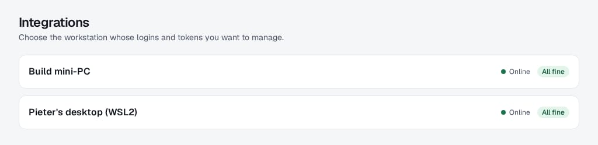

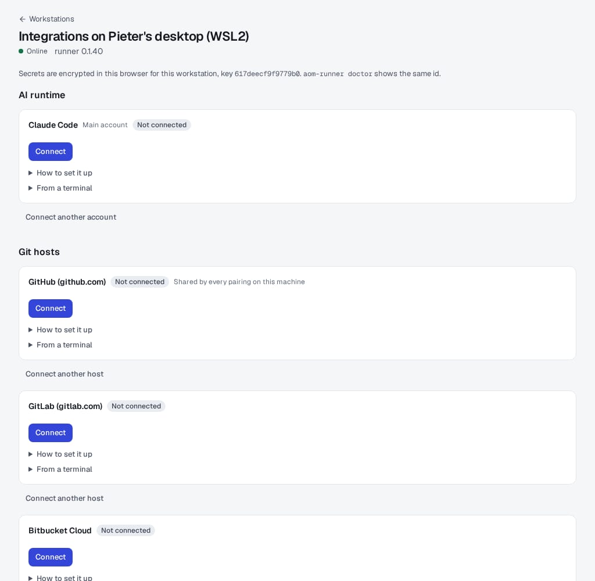

What you type is **sealed in your browser** with a key that belongs to that workstation (the page shows the key id; `aom-runner doctor` shows the same id) and only the workstation can open it. Guildwise relays it and cannot read it; it is checked with the provider on the workstation and saved there only when the provider accepts it. If you would rather never send a credential from the browser, run `aom-runner integrations allow-web off` on the workstation: the page then says it is turned off there and you use the terminal commands.

- **Claude Code.** *Sign in with your Claude subscription*: **Connect**, open the link, sign in at claude.ai, copy the code the page shows and paste it back. The workstation keeps a year-long token and switches to it by itself; agents wait no longer for a login that expired. Or paste an **Anthropic API key** (best for a cloud workstation), or a token made elsewhere with `claude setup-token`. A subscription is for your own use. There is one Claude tile for each account of the workstation: the main account and one for every project account (4.24a). Add another with **Connect another account**.
- **GitHub.** *Sign in with a code*: the page shows a code and a link; enter the code at GitHub and approve. Or paste a classic personal access token (`repo`, `read:org`, `gist`).
- **GitLab, Azure DevOps.** Paste a personal access token (GitLab: `api` and `write_repository`; Azure DevOps: an organization-scoped token with Code read and write and Project and Team read). GitLab shows the expiry.
- **Bitbucket Cloud.** Your Atlassian e-mail and an API token with the five Bitbucket scopes the tile lists. A refusal names the missing scope.
- **Jira.** The base URL, your Atlassian e-mail and a classic API token ("Create API token", not "with scopes"). Leave the e-mail empty for a Data Center personal access token.
- **MCP servers** (from Claude Code plugins). Each server has a tile with **Sign in** (**Sign in again** once signed in) and **Sign out**. **Sign in** opens the provider's link. When you have signed in, the provider sends you to an address that starts with `http://localhost`. If your browser is not on the workstation that page does not load: that is expected. Copy the whole address from the address bar and paste it into the field. (If the browser is on the workstation itself, it finishes by itself.)
- **SSH keys** show the status and the public key to add; create and choose keys in **Workstations**, Git hosts.

Some logins belong to the whole computer (the `gh` login, `~/.claude`, MCP sign-ins) and are shared by every pairing on it; the tile says so, and from the web they can be changed only through the computer's primary pairing. The same page is where the notices *Claude login expired* and *needs sign-in* on your desk lead to: **Sign in from the web**.

> **In the app:** Help, "Integrations" (`/help/integrations`).

> **In the app:** watch the videos "Workstations" (Help, "Workstations and the installer", `/help/workstations-and-installer#add-a-workstation`) and "Integrations" (Help, "Integrations", `/help/integrations#connect`). The page's own help panel (**?** in the top bar) has each too, under **Watch the video**.

### 3.5 Hire your first agents (2 minutes)

You need at least a builder, a reviewer and a tester to get a card from idea to done. The BA is also strongly recommended. New projects use the lean team workflow (4.26), which also uses a planner, an architect and a pre-reviewer: hire those too for the intended cost, until then the architect plans and the reviewer does the pre-review.

1. Open **Agents** and click **Hire agent**.
2. Choose a **Role**: *Builder* writes the change, *Reviewer* checks it, *Tester* runs the tests, *BA* writes cards (your CEO writes the reports), *Writer* documents, *Planner* does a short code-research pass before design, *Pre-reviewer* checks the basics before the review. A senior *Architect* designs every card on the lean team workflow (4.20, 4.26). Choose **Seniority**: seniors take larger and riskier work and may review large changes. Pick the **Workstation** where the agent runs.
3. Choose where the agent may work: **Any project**, or **Selected projects** (the allow-list). For now keep the project you will create next, or any project.
4. Choose the **Runtime** (the AI engine the agent uses), the **Model** and the **Effort** (how hard it thinks) : a bigger model or a higher effort is smarter and costs more; a smaller one is fast and cheap. A good start is a stronger model for builders and BAs and a lighter one for reviewers and testers. Give the agent a **Name**. The name generator suggests unused names; pick a theme or type your own.
5. Click **Hire**. Repeat for each role.

> **Tip:** two builders and one each of reviewer, tester and BA is a comfortable first team. Large changes need two different senior reviewers, so hire a second senior reviewer when you get to bigger work. Review and Finalize need seniors.

Each workstation also gets a free **DevOps engineer** automatically. You never hire or fire it.

> **In the app:** Help, "Agents" (`/help/agents`).

> **In the app:** watch the video "Your agents" (Help, "Agents", `/help/agents#hiring`). The page's own help panel (**?** in the top bar) has it too, under **Watch the video**.

### 3.6 Create your first project (1 minute)

1. Open **Projects** and click **New project** (Owners and Admins only).
2. Give it a **Name** and a short **Key** (for example `WEB`; card references look like `WEB-1`). Choose the **Workflow**: **Code** for software, **Research** for investigations, or a custom workflow your organization designed. Click **Create project**.
3. For a code project, open the project's **Settings** (the gear on the Projects page) and, under **Repositories**, add your repository: a name and the address of your code (or create a new one). The git host (GitHub, GitLab, Bitbucket, Azure DevOps or a plain git server) is detected from the address, and you can pick another one. If the app lives in a folder of the repository (a monorepo, `src/app`), fill in **Project path**; leave it empty when the app is at the top. Each repository has a **Main branch** (where pull requests go) and a **Working branch** (where finished work is combined), both the repository's default branch unless you change them; finished work is committed and pushed to the working branch automatically after review and test, and you can change **How finished work lands** in the same settings (see 4.4). A research project needs no repository.

> **In the app:** Help, "Projects" (`/help/projects`).

> **In the app:** watch the video "Projects and their settings" (Help, "Projects", `/help/projects#ranking`). The page's own help panel (**?** in the top bar) has it too, under **Watch the video**.

### 3.7 Create your first card (2 minutes)

1. Open the project's board and click **New card**.
2. Fill in the form. Be concrete, as if you were briefing a new colleague:
   - **Title:** what it is ("Show the last login time on the profile page").
   - **Context:** why it matters.
   - **Requirements:** what must be done.
   - **Acceptance criteria:** how you will know it is done, one line each.
   - **Affected areas, Constraints, Test plan:** what to touch and not to touch, and how to check it.
   - **How it lands:** you do not need to choose. Finished work goes where the project's **How finished work lands** setting says (committed and pushed to the working branch, or as a pull request you approve). With expert mode on (see 4.4) the form also offers a per-card **Completion action**.
3. Click **Specify**. The card moves to **To do** and the agents pick it up. If a required field is missing, the form tells you which. Use **Save draft** if you want to finish later. Through the API, a card created with `specify: true` that lacks required fields is still saved as a draft, and the answer says so: `specified: false`, a `message` and the `missing` fields.

> **Tip:** you do not have to write it all yourself. Open a chat with the BA ("Chat" button on the desk), say what you want in your own words, and the BA drafts and specifies the cards for you.

**Attachments.** A card can carry files: screenshots, a design (SVG, PDF), a spec, a log. On the New card form use **Attachments, Add files**; on an open card use the **Attachments** section (drag files in or choose **Add files**; images show as previews; **Download** and **Remove** are on each file). The card owner and the project owner can add and remove files; every member of the project can look and download. Limits: 20 MB per file, 100 MB and 50 files per card; images, SVG, PDF, zip, Office files and text are accepted, programs and scripts are refused. Builders, reviewers and testers get the files as read-only copies next to their shift and can look at them (an agent can view an image), so say in the card what each file shows. The BA attaches the files of a Jira ticket to the cards it drafts and says which went where.

### 3.8 Watch it happen

Within a minute the card moves to **Build**. A builder works on it, then a reviewer, then a tester. Open the card to follow along: the **Live shift** panel shows what the agent is doing right now, **Handoffs** shows the notes agents leave for each other, and **Timeline** records every step.

When an agent needs a decision, the card turns **Blocked** and the question appears on your **Desk**. Answer it and work continues. When the card is done, the card says where the change went: *"Your change is live on main"*, or *"Waiting for you to merge the pull request"* if the project works with pull requests.

You now have a working team. The rest of this guide is for when you want more: more control, more automation, or more safety.

## 4. For Owners and Admins

The **Owner** runs the organization: there is exactly one, and the Owner can hand the role to someone else. **Admins** are appointed by the Owner and help manage. This chapter covers everything the two roles do. Where something is only for the Owner, it says so.

| | Owner | Admin |
| --- | --- | --- |
| Create projects, add people to projects, change project settings | yes | yes |
| See every project of the organization | yes | yes |
| Invite Members | yes | yes |
| Invite, promote or demote Admins; change roles | yes | no |
| Remove Members | yes | yes |
| Remove Admins | yes | no |
| Hire, change and fire any agent, widen an agent's permissions | yes | yes |
| Set budgets, see Costs | yes | yes |
| Design roles, workflows and departments | yes | yes |
| Org-wide automations, interests quiet cap | yes | yes |
| Talk to and configure the CEO | yes | read its page and activity log, pause it |
| See plan and limits | yes | yes |
| Require two-factor login for everybody | yes | no |
| Hand over ownership | yes | no |

### 4.1 Your organization

Open **Organization** at the bottom of the sidebar. The tabs are **General**, **Members**, **Invitations**, **Guests**, **E-mail inbox**, **Project links**, **Plan & limits** and (Owner only) **Billing**. The **General** tab shows the organization's name (rename it here), who the Owner is and **Your role**, the security switch for two-factor login (4.15), **Transfer ownership** (Owner, asks for your password) and **Leave organization**. Where the platform offers it, a **Share diagnostic data** switch lets the CEO send general research topics to Guildwise (4.22); it is not yet available to customer organizations.

**Project links.** Owners and Admins find the **Project links** tab on the same page (Organization, then **Project links**). Here you tell Guildwise how your projects belong together: add a link between two projects, or between a project and something outside Guildwise (type its name). A link says that one **depends on**, **uses** or **is related to** the other, with an optional note. **Remove** takes a link away. The CEO reads these links, with the project names, to decide which project a request is for. The tab lists only the links you add. What the code suggests stays on your workstation: the CEO can show those suggestions in chat, and they count only after you add the link here.

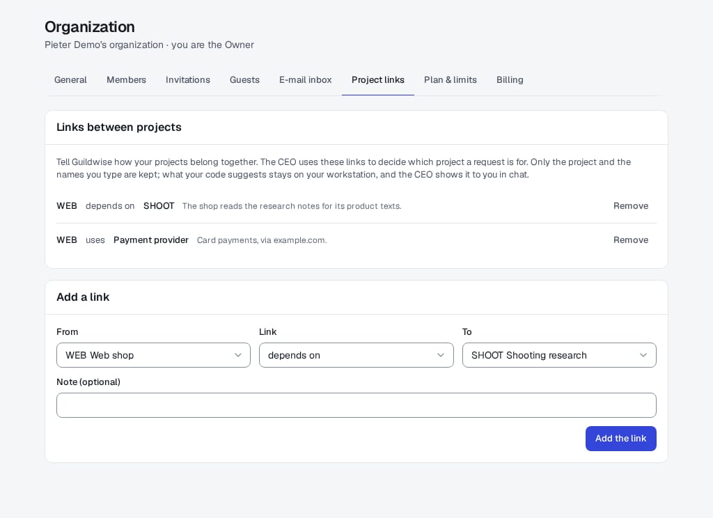

If you belong to several organizations, the **organization switcher** at the top of the sidebar shows which one this browser tab works in. A different tab can work in a different organization. Projects of an organization where you are only a guest carry a "Guest" label.

> **In the app:** watch the video "Your organization" (Help, "Organizations and roles", `/help/organizations-and-roles#members-and-invitations`). The page's own help panel (**?** in the top bar) has it too, under **Watch the video**.

### 4.2 Members, invitations and guests

On **Organization, Members** you see everybody with their role.

**To invite someone:** click **Invite member**, type their email, choose the role (**Member**, or **Admin** if you are the Owner) and, if you like, the projects they should start on, then **Send invitation**. They receive an email with a link that works for 7 days. On the **Invitations** tab you can see pending and past invitations, resend one or revoke one.

**To change a role or remove a person:** use the role selector and the remove button in the Members list. When somebody is removed, their agents are handed to you and any cards those agents held go back into the queue. Anyone except the Owner can leave an organization. The Owner must hand over ownership first (**General, Transfer ownership**, which asks for your password).

**Removing a person runs an offboarding checklist.** The remove dialog lists it before you confirm, and a report shows what was done. Notification links of this organization are revoked; the organization's packs come off their workstations and the sealed copies of pack credentials are deleted; the organization's key is cleared from their workstations (rotate it if you do not trust them: a machine that is unlinked never receives the clear command); their agents and cards go to the Owner; Discovery and Boardroom sessions and organization packs they owned move to **you** (to the Owner when they left or were deactivated); private chats and private packs are kept for **30 days** and then deleted. If this was the person's last organization, they are also signed out everywhere, their workstations are unlinked and their notification devices removed; if they still belong to another organization, those stay.

**Audit log export.** **Organization, Audit log** (Owner and Admins) downloads what people did in the organization as CSV or JSON, for a date range (up to a year at a time) and optionally one person. It holds actions (decisions, changes, additions, removals, exports), not message text, and anything that looks like a secret is masked. Each export is itself recorded.

**Guests** are people from other organizations who work in a project you shared. The **Guests** tab lists them and the projects they can reach (see 4.3, sharing a project).

> **In the app:** Help, "Organizations and roles" (`/help/organizations-and-roles`).

> **In the app:** watch the video "Your organization" (Help, "Organizations and roles", `/help/organizations-and-roles#members-and-invitations`). The page's own help panel (**?** in the top bar) has it too, under **Watch the video**.

### 4.3 Projects

**Create a project** as in chapter 3.6. A new project goes to the bottom of your priority order (see below). Everything about a project lives in its **Settings** (the gear on the Projects page).

**Put your projects in order.** The **Projects** page lists your organization's projects, most important first. When an agent looks for its next card, it takes work in this order: scheduled work first (schedules, interest scans and an on-demand **Research this**), then cards that came back to it for rework, then the **project order** (the card of the project higher up first), and then the card's own priority, how long it has waited and its dependencies. An agent's **focus** projects (4.4) are a gentle preference ahead of the order. A shift that has started is never interrupted: a more important card waits for it to end.

Owners and Admins change the order by **dragging** a project by its grip (the dotted handle on the left), or with the **Move up** and **Move down** buttons on each row. With the grip selected, the up and down arrow keys move it as well, and Home and End send it to the top or the bottom. The order saves by itself. Members and Guests see the order but cannot change it. Archived projects are not ranked, and the hidden projects behind interests never appear: interests run on their own schedule and are not ranked.

> **Good to know:** There is no work/personal split any more. "Personal" simply means your own organization: keep personal projects in it, or in an organization of your own that you switch to. If your organization had a personal vault and personal projects from before, they were merged for you: the projects sit below your work projects in the order they had, and the personal vault's files are under `personal/` in the organization vault. The desk note you received says what happened.

What you will find there:

- **Repos:** the code the agents work on, with its git host, its **Main branch** and **Working branch** (4.4) and its **Project path**: the folder of the repository the app lives in (empty: the repository root). The owner can change the path with **Change**, and how the repository is reached (**Access**: the workstation default, an API token / CLI login, or an SSH key); the development environment check, the package installs and the agents' build and test commands then run from that folder. After changing it, click **Check again** under the development environment. Research projects need none.
- **Reference repositories:** other repositories your agents may **read**, in card work and in chats, so they can compare code or look up how something is done elsewhere. The owner picks them under **Add a reference repository**: the repositories of the organization's other projects (organization Owners and Admins see every project's repositories, everyone else the projects they belong to, listed under **Projects**), or **any repository cloned on one of your workstations**, even one that is not in a project (listed under **On <workstation name>**; a clone without a remote shows as "no remote"). **Remove** takes one away. Nothing is added on its own: only what you pick is opened. The agents get them read-only on every workstation that has them cloned: they cannot change them, and secret files inside (`.env` files, keys, certificates) stay blocked. Every repository you do not pick stays blocked, and so does everything else on the workstation, including this platform's own code.
- **MCP servers:** external tools such as Jira or Confluence for your agents, taken from the **Claude Code plugins** installed and enabled on your workstation (the runner reports them; nothing secret is sent). Only the **organization Owner** can grant a server to a project, under **Grant an MCP server**; **Remove** takes it away; everyone on the project can read the list. Two things are needed before an agent can use a server: the grant here **and** the server in the agent's tool permissions, either through a custom role (Organization, Roles, "What it may do", "External tools") or, for any hired agent including the built-in roles, the **External tools (MCP)** switches on its card on the Agents page (see "External tools (MCP)" under the Agents page; only the Owner can switch them on). Agents then work with the access your signed-in plugin has, so a server whose tools can write, send or delete lets an agent change data in that service as you. Each server carries a warning (judged from its tool names when they are known, otherwise a general one): prefer read-only use and grant such servers only to roles you trust with it. The tools an agent called are listed on the card under **External tools used**. The DevOps engineer is not affected. Claude.ai connectors and servers you added by hand are not offered yet.
- **Code map for agents:** the status of the project's code map, and **Index again** (4.3a).
- **Architect:** whether new cards are investigated and designed before they are built (off by default), whether the latest main branch is merged first (on by default) and where the architect's reports go (4.20).
- **Commit as:** the name and e-mail every commit of the project carries, so the work reads as yours. Read-only work (planning, reviews) never needs one. Leave it empty to use the repository's own git setting, then your workstation's global one. The page shows which one each workstation uses; with none set, nothing is committed and the desk says so. Agents never commit under their own names.

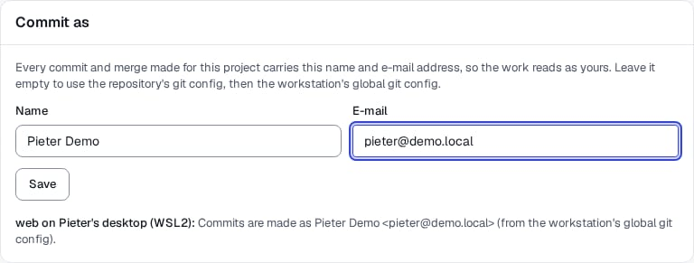
- **How finished work lands:** **Commit and push to the working branch** (the default; no pull request) or **Pull request I approve** (4.4).
- **Team:** who works in the project (see below).
- **Merging:** the setting **Merge large changes without my approval** (off by default). Read chapter 4.12 before turning it on.
- **Simultaneous shifts:** an optional cap on how many shifts may run at once in this project.
- **Workflows:** which workflows the project runs and your own steps in them (4.7).
- **Claude account:** a second Claude subscription for the project (4.24a).
- **Owner approval after the review:** *large and high-risk cards* (the default) or *every card* (4.26).
- **Manual QA before done:** whether a finalized card waits for a person's test (4.12).
- **Testing and decisions:** testing without an environment (4.5), keeping the project's decisions at project level, and **Full test run after each card** (4.26).
- **Pull request branch prefix** and **Remove finished card branches:** how a pull request branch is named and whether finished branches are tidied up (4.4).
- **Budget** (4.6), **Phases** (4.10), **Environments** (4.27), **Stage** (4.13) and **Archive** (4.14). The page has jump chips at the top for Basics, Stage, Workflows, Repos, Phases, Environments, Reference repos, Merging, Budget, Team and Archive.

**Who answers a card's questions.** By default only the card's creator answers them. On the card page you can let any project member answer (**Who answers its questions**).

**Project types.** A **code** project follows Spec, Build, Review, Test and Finalize. A **research** project follows Question, Research, Fact check and Publish and writes its results as notes into the project's vault folder. Your organization can also design its own workflows (4.7).

**Adding people to a project.** Only Owners and Admins add people. Add an organization member under **Team** in the project settings. They get access at once. To share with somebody from another organization (a guest), type the email of an existing account in **Invite by email** and click **Send invitation**. They accept in the **Project invitations** inbox on their Projects page, and they only ever see this project. There are no guests without an organization. Someone with no account must be invited as a Member of your organization instead.

> **Watch out:** removing a person from their last project hands their agents back to you (they need a new home on one of your workstations). Cards those agents held go back into the queue.

**Vaults.** A vault is a folder of notes. Most are git repositories that sync to your workstations; a project's vault can also be a local folder (see "Project vaults and the code map" below). Agents read it (never write it directly) in card work, chats, questions and the BA's tasks. There are two kinds: the **organization vault** (your organization's knowledge, including your interests under `interests/`, shared among Owners and Admins) and a **project vault** (shared with the project's members). Agents read a project's git vault first, then the organization vault, then the project's local folder. Register git vaults under **Vaults** in the sidebar. The address must not contain a password or token. Use an SSH key or a credential helper on the workstation instead.

> **In the app:** Help, "Projects" (`/help/projects`) and "Ledger and vaults" (`/help/ledger-and-vaults`).

> **In the app:** watch the video "Projects and their settings" (Help, "Projects", `/help/projects#ranking`). The page's own help panel (**?** in the top bar) has it too, under **Watch the video**.

### 4.3a Project vaults and the code map

**Every project has a vault.** It is created with the project. A vault is one of two kinds of storage:

- **Git (recommended).** A git repository. The vault sync commits and pushes it, so a copy lives on your git host.
- **Local folder.** A folder on the Owner's primary workstation (the first one you paired). Nothing syncs it and it has no
  other copy. The Vaults page says so. Back it up yourself: copy it to a second disk or a private repository on a schedule.
  A folder inside OneDrive, iCloud, Dropbox or Google Drive is only as safe as that sync tool.

To move a local vault to git, register a git repository for the project. The folder is kept (renamed, not deleted) and the
repository is cloned in its place. If the Owner has no workstation yet, the vault is created when the first one connects.

> **Good to know:** Guildwise uses the git vault for knowledge first, then the organization vault, then the local folder.

**The code map.** Each project can have a map of its code and docs (a project graph). A workstation that holds the
repository builds it, and it is kept in the project vault under `graph/`. Agents use it to find where a thing is and what
touches it, so they read fewer files. A card's brief gets a short "Graph context" section when the map knows the card's
areas, and agents can ask the map with `aom graph` (where is it, what calls it, what does a change reach).

The map is built when a workstation that holds the repository connects and the project has no map yet, after each merge, and when you press **Index again**
in project settings (under **Code map for agents**). The panel shows, per repository, one of: *not indexed yet*,
*indexing*, *indexed* (with the number of nodes and links, the modules, the commit and the time) or *could not index*. A
failure names its cause: no workstation holds a clone, the vault is not reachable from the workstation, the working branch
has no commit yet, the model usage limit was reached (it is tried again), or the indexer stopped (see the workstation's log).
Building the map uses no model, so it costs no tokens.

> **Trust:** Your code and its code map stay on your workstation and in your project vault. They never go to Guildwise HQ.
> The server keeps only the status shown in the panel (counts, the commit, the time) and the work it already tracks (cards,
> decisions, merges). Nothing derived from your code, not even a module name, is sent.

To measure whether the map saves tokens, one card in five runs without it for four weeks after a project's first index. See
"Code map: what it saved" under 4.6.

> **In the app:** watch the video "Vaults" (Help, "Ledger and vaults", `/help/ledger-and-vaults#vaults`). The page's own help panel (**?** in the top bar) has it too, under **Watch the video**.

### 4.3b The project backlog

Every project has a **Backlog** tab next to its **Board**. It is your list of wanted work that is **not in development yet**: nothing on the backlog is worked on by an agent, becomes a card, appears on the board or creates a desk item until you send it to the BA.

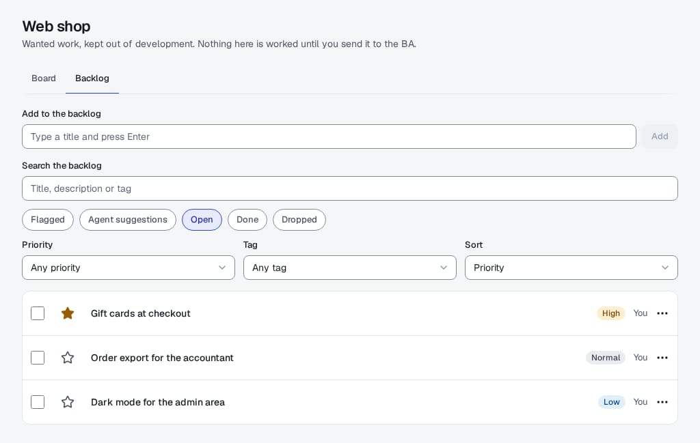

**Add and edit.** Type a title in the quick-add field and press **Enter** (or **Add**, which is there for touch screens). The item is **Open**, priority **Normal**, with no tags, not starred, and its source is you. **Edit** opens the title, description (what you want), priority (Critical, High, Normal, Low) and tags. The **star** marks an item to look at soon. **Drop** sets the item to **Dropped**. Done is set only by sending; reopening a dropped item is not possible. Only **Owners and Admins** of the organization manage the backlog (add, edit, star, drop, send); every member of the project, guests included, can read it.

**Find things.** Search looks in the title, description and tags. Filter by tag, priority, flagged, source (you or an agent) and status; the filters combine. The list shows **Open** items only until the status filter includes Done or Dropped. Sort by priority (Critical first, newest first within a priority) or by **Newest** (newest first). Items an agent suggested show the agent's name and the card it was working on.

**Send to BA.** **Send to BA** on an Open item starts a normal BA intake for the project from its title and description, exactly as if you had started it yourself. The priority maps to the card's priority (Critical 1, High 3, Normal 5, Low 8), and the priority and the tags are written at the end of the card's context. The new card goes on the board. When it exists, the item becomes **Done**, links to the card (find it with the **Done** status filter) and leaves the default list. If the intake cannot be created (for example no BA is hired, or the project is archived) the item stays Open and you see the error. Select several items and use **Send {n} to the BA** (for example "Send 3 to the BA") to send them in one go: each becomes its own card; the ones that fail stay Open and are named.

**Suggestions from agents.** An agent that finds a follow-up outside its card can add it to the backlog (`aom backlog suggest`) instead of putting it on the board. The agent and its card are recorded by the server. An agent can only add (at most 5 per shift); it cannot edit, star, drop or send. Suggestions create no desk item; the CEO's **daily report** lists the new ones since the previous report under **New backlog suggestions from agents** (project, title, priority, agent, card) and leaves the section out when there are none.

**Through the CEO.** In the CEO chat you can say "add X to the backlog of project P" or "send the flagged ui items to the BA". The CEO uses `aom ceo backlog add | list | update | send`: `add` needs a project and a title (optional description, priority, tags, flag); `list` filters by project, tag, priority, flagged and status (default Open) with an optional text search; `update` changes the title, description, priority, tags or flag of one item by id, or drops it; `send` sends one item by id or all Open items that match the filters (at least one filter is required, at most 25 at once) and prints the card or the reason for each item. The web page and the CEO work on the same data and follow the same rules.

> **In the app:** Help, "Board and cards" (`/help/board-and-cards`), section "The project backlog".

> **In the app:** watch the video "The project backlog" (Help, "Board and cards", `/help/board-and-cards#backlog`). The page's own help panel (**?** in the top bar) has it too, under **Watch the video**.

### 4.4 Agents, hiring and allow-lists

Agents belong to the organization, not to a single project. For each agent you decide where it may work: its **allow-list**. The agent is only offered cards from those projects.

**Hiring** works as described in 3.5. Hiring has a few more options:

- **Where may this agent work?** **Any project** (Owners and Admins only) or **Selected projects**, ticked one by one. Hiring needs at least one project (or **Any project**): an empty list is refused. Later, when you remove the last project of an agent in its **Projects** dialog, the agent is **benched**: it takes no work until you give it projects again. A star next to a project means *preferred*: when two cards are waiting, the agent takes the starred project's card first.
- **Seniority** decides who may review large changes and who handles harder work.
- **Effort and Model:** how hard the agent thinks. Higher costs more.
- **Skills:** extra know-how, such as "Playwright" or "database migrations".

**Changing an agent.** On the agent's card use **Projects** (the allow-list), **Change model**, **Change role**, **Pause** (and **Resume**) and **Fire**. A paused agent takes no new work; the card says "Paused" or "Paused by the CEO". An agent that lost its home (for example when its owner left) shows **needs rehome**: press **Re-home** to give it to someone. A small button on the face re-rolls it. Firing releases the cards the agent holds back to the queue with the last handoff, deletes the agent's private sandbox, and retires the name. The agent's history stays in the records. A fired name is never reused.

**Agents follow their role.** An agent always works with the current version of its role: when a role gets a new version (a built-in update, or a custom role you approve), the agents in that role pick up its new permissions and instructions. What you changed on one agent yourself (extra blocked commands, narrowed tools, external tools) stays. The card shows "Follows role Builder v4" and lists those changes of its own.

**Describe the agent you need.** **Agents > Describe the agent you need** turns one sentence into a drafted role. The Analyst writes the draft on your own workstation (about a minute; its cost is booked like a chat): name, purpose, instructions, tools, a suggested model, and skills and playbooks that exist in your registry. You edit all of it in a review step; **What it may do** is clamped to what you may grant (an Owner or Admin: read, edit, shell and web; anyone else: read only, with a note of what was left out). **Continue to hire** opens the normal hire dialog with the draft as a new chat-only role (it works in chats, sessions and mentions, not on the board). Nothing is hired until you press **Hire**; suggested playbooks you can run are granted to the new agent at that point.

**Mentioning an agent in a card.** In a card's thread type **@** and pick an agent (**@una what is left to test?**). The agent runs a small chat turn about the card on its own workstation and posts the answer as a reply in the thread. When an Owner or Admin mentions it, a Claude Code agent whose role can edit or run commands may do so in the card's working folder, within what that person may grant (never the web, a browser or other tools; it does not push, merge or delegate); when anyone else mentions it, it only reads. It works only while the card is free: with a shift holding the card, another agent already working on it from a comment, or a runner older than 0.1.60, it reads and answers, and says why. A card with a mention at work is not picked up until the mention is done (30 minutes at most). Its cost is booked to the card, so the project budget and the provider cap apply. Owners and Admins can mention any agent allowed on the project; other project members only agents whose manager switched on **Project members may mention this agent** (**Who may mention it** on the agent's card; off by default). A mention is refused, with a note in the thread, when the agent's workstation is offline, the project is paused or over its budget, another agent is still answering on that card, or you reached the limit of 5 per card and 20 in all per hour.

**External tools (MCP).** Each agent card has an **External tools (MCP)** section: one switch per plugin MCP server your workstations report, with a plain-language note and the same warning as in the project settings (a server that can write, send or delete lets the agent change data in that service as you; prefer read-only use). This is how a built-in agent such as the business analyst, the builder or the architect gets Jira or Confluence, since built-in roles have no external tools of their own. Everyone who can see the agent reads the switches; only the **organization Owner** can change them (Administrators and the hiring manager get a clear refusal, but may still switch a server off). The server must **also** be granted to the project (project settings, MCP servers), otherwise the agent cannot use it. The DevOps engineer has no such section and cannot be given external tools.

**Each agent card also shows** what the agent costs this month and in total, how many cards it finished, its bounce rate (how often review sent its work back) and its current work.

**Recommendations.** The Agents page suggests changes based on how the team performs: a different model, hiring another reviewer, or a standing order. You can apply them in one click, or **Dismiss** one, or **Dismiss all (N)**.

**Safety.** Agents run inside a sandbox on the workstation, so they cannot read your whole disk. The DevOps engineer is the exception: it works as you (below). Some computers cannot offer a sandbox (for example plain Windows). The app then shows an amber warning on the workstation, on each affected agent and in the Hire form, and hiring onto that machine needs an explicit confirmation. Prefer a workstation with a sandbox (Linux, macOS, or Windows with WSL2).

**The DevOps engineer.** Each workstation has one, free of charge. It installs tools, starts containers, pulls and pushes vault changes and keeps repositories tidy (next section). You can only reset it, never fire it, and only change its model and effort.

**Ask DevOps from anywhere.** Click **Ask DevOps** in the top bar, choose **Ask DevOps...** in the command palette, or use the button on a card, a desk item or the workstation. The page, project, card or error you were looking at is attached (remove what you do not want to share) and the right workstation's engineer is chosen for you when it is obvious. The dialog says "DevOps works through <CEO name> now": press **Ask <CEO name>** and your CEO chat opens with the question filled in; the CEO hands it to DevOps and tells you the result (4.22). The DevOps engineer works as you on your machine and is not sandboxed, in a chat as in a shift: a command, a Docker build or a deploy you ask for runs right away. The tick boxes on the workstation (install, Docker, sudo, paths) are instructions and limits for the automatic tool setup, not a physical barrier. On a team member's workstation an approval needs an Owner or Admin and the machine's user (one person can be both).

**Questions and approvals from DevOps.** The DevOps engineer asks for **approval** (`aom devops-approval`) only for something destructive or outside its granted access. A plain question (which branch, which option, what is missing) is asked with `aom devops-question` and is an ordinary question: it goes to a senior agent or the BA, then the CEO, and reaches your desk only when nobody before you can answer; the request carries on with the answer. When the card's project does not require your approval for merges ("Merge large changes without my approval" is on and the owner approval policy is not "always"), the DevOps engineer resolves merge conflicts in the card's own worktree without asking, and the server approves such a request by itself ("Auto-approved: the project does not require approval for merges"); deleting branches, force-pushing and resetting shared branches are always asked.

**A request about a card.** When a request is filed for a card (from the card's **Ask DevOps** button, or by the agent working on it), the DevOps engineer gets the card in its brief: title, type, fields, project, repository and the latest comments. It can read that card, comment on it and set the card's fields it needs (for example how to start the stack), and nothing else: it cannot change the title, stage or status, and it cannot read or change any other card.

> **In the app:** Help, "Agents" (`/help/agents`).

#### How finished work lands (and expert mode)

Every project repository has two branches, and the settings name both under the repository:

- The **main branch** is where pull requests go. By default it is the repository's default branch (usually `main`); the owner can name another one with **Change**.
- The **working branch** is where finished card work is combined. It can be the same branch as the main branch (the default, so you can ignore the difference), or another one such as `develop`. If the working branch does not exist yet, Guildwise creates it from the main branch and pushes it when the first card starts; the repository row says when it will be created and, afterwards, when it was and from which branch. If the push is refused, the card says so and the desk asks you, naming the branch, with the reason from the git host.

Agents always work on a card branch of their own. **How finished work lands** (per project, and per card in expert mode) decides what happens to that card branch when the work is reviewed and tested:

| Completion action | What happens | Pull request |
| --- | --- | --- |
| **Commit and push to the working branch** (the default; stored as `merge`) | The card branch is merged into the working branch and the working branch is pushed. | None. |
| **Pull request** (`pr`) | The card branch is pushed and a pull request is opened into the working branch (that is the main branch when you use one branch), for you to review and merge. | Card branch to working branch. |

A card follows its project: it has no completion action of its own unless a person sets one on that card (expert mode, at any time before it is finalised). Agents, the BA included, never set it. When you change the project setting, every card that has not set its own, open or not yet started, follows the change; a card with its own action keeps it. In expert mode choose **Project default** on the card to go back to following the project.

When the working branch is not the main branch, the work reaches the main branch the way you choose: in the repository row of the project settings the owner clicks **Open pull request: develop to main**, and the workstation opens a pull request from the working branch to the main branch through the git host (or reports that there is nothing new to open). This is deliberately a project action and not part of every card, so a release is reviewed once, not per card.

If the working branch is protected on the code host (it refuses direct changes), Guildwise notices, opens a pull request for the card instead, and switches the project to pull requests with a note on the card. A large change that would be committed to the working branch waits for your approval on the desk first (see 4.12).

You see plain outcomes on cards: *"Goes into the working branch after review and test"*, *"Your change is live on the working branch"*, *"Waiting for you to merge the pull request"* (with the working branch's name when it is not main). When two changes clash, the DevOps engineer tries to fix it first and leaves a note on the card.

If you know git and want the details, turn on **Expert mode for code changes** in **Settings** (it is per person and off by default; it only changes what you see). It brings back the per-card completion action (commit and push to the working branch, or pull request), branch names and commit hashes, **Mark merged** on the phase page, and the questions about keeping or changing the working branch for a new intake or phase. The main and working branch rows in the repository settings are shown to everyone.

#### Repository hygiene and the working branch

Once a day per workstation the DevOps engineer tidies the project repositories on that machine: it fetches and pulls, **stores any uncommitted edits of yours in a git stash** (`git stash list` shows `saved work <date>: N file(s) not committed`; it stays on your machine, is never pushed and adds no branch; your files are left exactly as they are and nothing reaches main by surprise) and removes branches and worktrees of cards that are finished and merged. Files that look like passwords or keys (`.env*`, `*.pem`, names with *key* or *secret*) are never copied; the notice on your desk names them. Hygiene never force-pushes and never discards anything. Change the time or switch it off in the workstation's **Repository hygiene** panel on the Workstations page, or start it with **Run hygiene now**.

**The working branch is the repository's default branch** unless you name another, confirmed automatically the first time Guildwise sees the repository. You are asked on the desk (*Which branch is the working branch of this repository?*) only when the default cannot be told. The owner can change it in the project settings (**Change**) and you are asked again when a new intake or phase starts ("keep `main` as the working branch?").

Card branches only go to the git host when the card needs them (a pull request, or "push the branch"). A pull request goes out as `<prefix>/<ticket>`, for example `pieter/DCPL-4276`: the prefix is the project setting **Pull request branch prefix** (empty: `feature`), the ticket is the Jira key the card came from, else the card reference (`-2`, `-3` if the name is taken). Rework pushes to the same branch and pull request. Your local card branch keeps its name; with "Commit and push to the working branch" only the working branch is pushed. Hygiene also deletes the branch of a **done or cancelled** card, on the host, on the workstation and its worktree, once its work is in the working branch (merged, rebased or cherry-picked) or its pull request is merged (a declined pull request alone does not delete a branch that holds unmerged commits). Open pull requests, branches with work found nowhere else and branches of open or reopened cards are never touched. The card records each deletion and your desk gets one notice per run. Turn it off with **Remove finished card branches** in the project settings.

What hygiene cannot resolve, it does not force. For a conflict while pulling, the DevOps engineer first tries to resolve it on a temporary branch and runs the tests (you get a notice; after two attempts it goes to your desk). Changes on the wrong branch, a failed login, a missing clone, or a leftover worktree with uncommitted work are not forced either. These appear under Failures in your CEO's daily report until a later run finds the repository in order.

> **In the app:** Help, "DevOps and repository hygiene" (`/help/devops-and-hygiene`).

> **In the app:** watch the video "Your agents" (Help, "Agents", `/help/agents#hiring`). The page's own help panel (**?** in the top bar) has it too, under **Watch the video**.

**What it may do.** **What it may do** on an agent's card shows, in one place, its tools, the repositories and projects it can reach, its provider and which key pays, who it may delegate to (including what its role gives it and what you excluded), its playbooks, skills and packs, what it has cost and the budgets that apply. Below that are its **approval gates**: switch on **Ask me before** merge and push, deploy, delegation or running a playbook, and that action pauses and lands on your Desk as an approval; the agent goes on after you approve it (once per approval; it is told to carry on and try the same command again). Outbound updates always ask. You can also gate **pack scripts**: the agent then gets no script copied into its folder and each script file of a pack is handed over only after you approve it (needs runner 0.1.60 or newer). No agent has a gate until you set one. Whoever manages the agent can switch a gate on; only an Owner or Admin switches it off. The CEO keeps its own policy.

**Packs say what they need.** A pack or one of its skills, personas or playbooks can declare scopes (such as `shell`, `web`, `commit`). When you grant one to an agent that lacks a scope, you see what is missing and must choose **Grant anyway**; granting does not give the agent the permission.

### 4.5 The desk, the ledger and standing orders

The **Desk** is where every question and approval reaches you. Cards do not move past a question until you answer.

An agent can wait for an answer without losing its work, and an agent's answer can say **keep this card parked until** something happens. If the same question is asked again on a card with nothing changed, the card is parked with a back-off and you get one item about it instead of another round of questions. A card that uses up its passes, review rounds or shifts (small 2 / 2 / 10, medium 3 / 2 / 15, large 4 / 2 / 25, adjustable per project) goes to its architect first and reaches you only if the architect cannot resolve it. Cards that already existed when stop-loss was introduced are counted from that day, not from their whole history; a card the crash-loop breaker has already parked does not get a second stop-loss item, and a stop-loss question about mostly crashed shifts names the crashes and the last error.

The items are grouped (**Needs you first**, **Blocking work**, **Decisions**, **Heads-up**) and the filter chips narrow the list: **All**, **Blocking**, **Questions**, **Approvals**, **Notices**, **Handled by CEO** and **CEO decisions**. **Handled by CEO** shows the items your CEO answered or passed on.

Each desk item says **what kind it is** (Question, DevOps approval, Merge approval, Outbound update, Digest to rate, Alert, and so on; the CEO's morning report is an Alert titled "Daily report <date>", 4.11), **who asked and what they were doing**, the **question** with options and a **recommendation**, and **how many cards are waiting**. To answer, click an option or type your own answer, optionally add it to the ledger, and click **Answer**. When your CEO has a recommendation, **Accept recommendation** answers with exactly what it recommends.

**CEO decisions.** When your CEO decides something on its own that you would otherwise have been asked (it answers a question routed to it, or decides a matter you delegated, such as which working branch a repository uses), the decision appears under **CEO decisions** at the bottom of the Desk, and under its own filter chip. It is information, not a request: it never sends a notification, is not blocking and is not counted in "open" or in the badge on the Desk tab. Each one shows what was asked, the CEO's decision and reason, the card, the time and "CEO decision · <name>". **Acknowledge** marks it read (the memories the decision relied on gain a little confidence); **Acknowledge all** marks every open CEO decision read in one go. **Correct** is for a decision that was wrong: write what the right decision is. The CEO adds it to its memory at once ("Owner corrected: ... (was: ...)"), the CEO and the BA then discuss it in exactly three turns. The BA analyses it (why the instinct was wrong, which signal it missed, a proposed rule) and assesses the consequences: what already happened because of the wrong decision, with the fix work proposed as concrete cards (nothing is created yet). The CEO replies in its own words: it agrees or disagrees, says what it got wrong and records the lesson (a disagreement is recorded for you, your correction always stands), and comments on the proposed cards. The BA then adjusts the proposal and creates the fix cards in the right projects (drafted by the BA, in the specify stage, linked to the decision and to the original card; on a paused project they are created but do not start). The item shows the discussion as a small timeline and the chip changes from "Under review" to "Lesson recorded · N fix cards". If the BA concludes that no fix work is needed and the CEO does not object, no cards are created. If the CEO does not reply within two hours (it is paused, offline or over budget) the lesson is recorded without it, marked "recorded without the CEO", and the BA still creates the cards it proposed. None of this sends a notification or needs anything from you. Where the decision can be undone (the Owner only), **Apply the correction now** also re-opens the question on your desk. Owners and Admins can acknowledge and correct; decisions taken before this feature existed are not listed.

When you answer you can also record it in the **ledger** as a **requirement** (a permanent rule), a **standing order** (an instruction every agent reads at the start of every shift) or a **decision** (a one-time choice kept for history). That is how the team learns: the next agent who is about to ask the same thing finds your answer first, and the desk shows "similar decision in the ledger".

The **Ledger** page lists everything and is searchable, and has a **Project** filter. Organization-wide standing orders can only come from the Owner and Admins. A project owner adds project-wide ones.

**Editing a standing order.** Press **Edit** on a standing order in the Ledger to change its title or text; the people who may add it may edit it (the Owner and Admins for an organization-wide one, the project's owner for a project one). The order keeps its place, shows *edited* with who and when, and **History** lists every earlier wording. Agents are briefed from the Ledger each time, so the new wording reaches their next shift or chat, and the copy in the vault's `standing-orders.md` is rewritten to match. Every agent follows the standing orders as binding rules that override its usual habits: builders, reviewers and the BA, and also the DevOps engineer (for its requests, repository hygiene, running a branch and its chats), which receives the organization's orders plus those of the projects involved. Decisions and requirements cannot be edited, only replaced.

**Retiring an entry.** Press **Retire** on an entry in the Ledger and give a reason when it is a one-off order, a duplicate, or a rule that a setting now replaces. A retired entry is kept for the record (switch on **Show retired** to see it greyed out, with its reason), but no agent is briefed with it and a search no longer finds it. The same people who may edit an entry may retire it, the BA can retire one (`aom ledger retire <id> --reason "..."`), and so can the CEO (as a recommendation until you let it decide).

**Duplicates and contradictions.** When you save a standing order the ledger compares it with the live ones. A near-duplicate is refused with a pointer to the existing order (hyphens, plurals, articles and small word endings do not make an order different: "user-facing copy" and "the user facing copies" are the same order); the form offers **Merge into the existing order instead**, which puts the new wording into that order. An order that looks like it says the opposite of another one (the same subject, one asks and the other forbids) is saved but marked **May contradict another order**, and one desk item asks you or the BA to retire or reword one of them.

**Decisions stay with their project.** An answer on a card is a decision of that card's project. HR and the CEO never turn it into an organization-wide order; only you can promote one (the **organization-wide** switch when you answer). For a project that must keep its decisions to itself, such as the platform project, switch on **Keep this project's decisions at project level** in its settings: the switch is then refused on its questions and HR leaves its questions out when it looks for patterns.

> **In the app:** Help, "Your desk" (`/help/desk`) and "Ledger and vaults" (`/help/ledger-and-vaults`).

**Approve from the notification.** A push for an approval has **Approve** and **Reject** buttons, and a push for a question with options has its first two options (phones show two at most; the notification itself opens the Desk for the rest). A button opens a small page that asks you to sign in, shows the item and waits for you to press the button: nothing happens just from opening it. The link works once, for 15 minutes, only for you. It is not offered for code approvals (you see the diff first) or items that need more input. Every use is on the audit log.

#### Testing without an environment

In the project settings, **Test without an environment** replaces the old "Test mode" and "Test Environment" standing orders (which contradicted each other). Off (the default): when a card needs a test environment and none is ready, it waits for DevOps to start one. On: the tester runs what it can without an environment and records in its note that none was used.

> **In the app:** watch the videos "Your Desk" (Help, "Your desk", `/help/desk#desk-items`) and "The Ledger" (Help, "Ledger and vaults", `/help/ledger-and-vaults#ledger`). The page's own help panel (**?** in the top bar) has each too, under **Watch the video**.

**Reminders for open items.** A question, approval, escalation or digest rating that stays open for **3 days** (the period is an organization setting under **Settings > General > Reminders for open items**; 0 turns it off) reminds the person it is waiting for (the person it is addressed to, else the card's owner, else the project's owners, else the Owners and Admins). They get a notification on their devices (category **Reminders for open items**, on by default) and the item shows **Reminded**. It repeats at most once per period. An item that sits with an agent is handed back to the agent once instead. **Snooze** on an item holds its reminders back for 1 day to 2 weeks. Reports (the floor report, BA reports, CEO notices) are never chased.

### 4.6 Budgets and costs

Every shift records what it used (input, output and cache tokens and the model). The server turns that into money at the **list prices** of the models, in US dollars, and shows it in your organization's currency. These are estimates of what the work costs, not an invoice. Chats count too: to the project when the chat is about a card or project, otherwise to **Org overhead**.

**Where spend shows:**

- the **Costs** page (Owners and Admins): spend by project, agent, model and day for any date range, with an **Export CSV** button;
- the **project settings** and the **board header** ("$9.00 of $10.00 this month");
- each **agent card**, each **card** and each **phase**;
- the **CEO's daily report** (older floor reports stay on the desk).

**Monthly budgets.** In the project settings, **Monthly budget** sets a limit for the project. (An interest has its own budget on its Settings tab, 4.9.) The month runs from the 1st to the end of the month in your time zone.

- **At 80%** you get one notice on the desk and a line in the daily report. Work carries on.
- **At 100%** the project is **paused**. Running shifts finish, but nothing new starts. Cards wait in the queue. A banner on the board says so, and a desk item offers **Raise budget** (the pause lifts as soon as the new amount is above the spend) or **Override for this month** (work resumes until the 1st).
- **On the 1st** the month starts again from zero.

Setting a budget below what was already spent pauses the project at once. Members can see the progress but not change it. Guests see only that a project is paused.

**Pausing a project by hand.** An organization Owner or Admin can press **Pause project** in the board header (optionally with a reason). Nothing new starts on the project until an Owner or Admin presses **Resume project** on the banner: no card is claimed at any stage, and the BA, DevOps and question shifts, scheduled runs and interest scans for it wait. Shifts already running finish, and cards keep their place in the queue. People can still view and edit cards, create new ones, answer questions and change settings; agents pick the work up at resume. Scheduled runs that fall due during the pause are skipped (they are not made up afterwards), while cards that arrive by e-mail, webhook or a trigger are created and wait in the queue. Everyone on the project sees the banner (who paused it, when, why) and a **Paused** badge in project lists; only Owners and Admins see the buttons. Agents and the CEO cannot pause or resume.

**Cost by cause.** Each card on the board shows what it has cost so far. Behind it, the cost of a card (and of a day) is split by what the shift was spent on: working, asking (a shift that ended with a question), answering (a colleague's question), reviewing, re-review after a conflict (a review done again because a rebase conflict reset it) and rejected (the runner turned the shift away). Prices are the list prices of October 2026 (Sonnet 5.5 $2 / $10 per million tokens, Opus 5.5 $4 / $20, cache reads at 10%, writes at 1.25x, or 2x when the runner reports a one-hour cache write). A shift that reported and was then stopped counts as reported, and a crashed shift is priced from the usage the runner reports afterwards.

**What the agents delivered (the value report).** The panel of this name at the top of the Costs page: "This month: 42 cards, ~168 hours of work, $84 usage, ~80x return", the change against last month, and **Next best actions** (cards that have not moved for days, agents that fail often, projects with no work). The hours are an estimate of what a person would have needed, by card type; Owners and Admins can change them under **Adjust the estimates**. **Export value report (CSV)** downloads it.

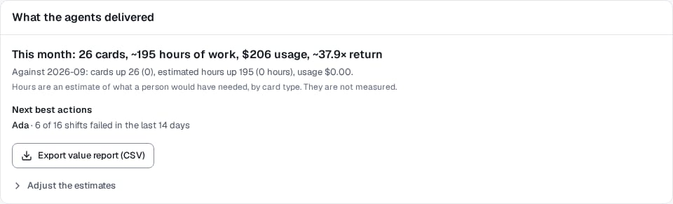

**Code map: what it saved.** The Costs page has a panel with this name. It compares finished cards that ran with the code map
against the one card in five that ran without it (the holdout, chosen by a hash of the card's id, for four weeks after a
project's first index). For each group it shows the cards, the median billed input tokens with the middle half, and the
median searching before the first edit and the median number of search calls. Only numbers are kept.

The panel states a saving (for example "used 25% fewer billed input tokens", with the likely range) only when all of these
hold:

- at least 10 finished cards in each group;
- the likely range of the difference lies entirely below zero, so chance does not explain it;
- no quality measure is worse with the map: rework rounds, changes requested, tester failures, days to done, or cost per
  card.

Otherwise the panel says why no saving is claimed (for example "not enough finished cards yet", or "the cards with the
map did worse on a quality measure"). Until then it shows the numbers only.

**Monday briefing.** Every Monday at 08:00 (organization time) you get an e-mail with what was finished, what waits on you, what is blocked and the health of your agents and workstations; Owners and Admins also get spend against budget and the value report. Switch it off under **Settings, Monday briefing**.

**Currency.** On the Costs page, in the **Currency and prices** panel, type a three-letter currency code and how many units make one US dollar (for example `EUR` and `0.92`). Changing the rate changes how history is shown, not what was recorded.

> **In the app:** Help, "Budgets and costs" (`/help/budgets-and-costs`).

> **In the app:** watch the video "Costs and budgets" (Help, "Budgets and costs", `/help/budgets-and-costs#monthly-budgets`). The page's own help panel (**?** in the top bar) has it too, under **Watch the video**.

### 4.7 The org chart, roles and workflows

**Org chart** (sidebar, Organization) shows who works for you and who answers whom, as a tree: you at the top, then your CEO (always there), then the BAs, then each department with its seniors above its juniors. The lines are the **escalation path**: a question goes to the colleague its topic names (the card's architect for design questions, the BA for requirements, the builder for code, the DevOps engineer for environment problems), else to a senior of the same role, then to the BA, then to your CEO, then to your desk. Each tile shows the agent's face, name, role, what it is doing and its workstation. Click an agent for its card. **List** shows the same as grouped lists (the default on a phone). The **Allowed on project** filter shows only the agents that may work on one project. The **Workstations and DevOps** panel lists the machines and their DevOps engineers, and **Hire a BA** appears on the chart when you have none.

**Roles & workflows** (sidebar, Organization) lets you extend the team beyond the built-in roles. The page itself is titled **Organization** and has the tabs Roles, Workflows, Departments and **Design with the BA**.

- **Roles.** Built-in roles (builder, reviewer, tester, writer, architect and others) cannot be removed, but you can extend them with extra instructions, skills and standing orders (**Extend**). You can also design **custom roles** with a guided form in sections: name and purpose, instructions and rules, **what it may do** (plain-language switches such as change files, run commands, search the web or commit, each with a risk note; reading all organization repositories is for the Owner only), the model and effort, seniority and skills, and a checklist of the **steps of your custom workflows** it can take. Problems are explained in plain words beside each section, and **Preview what the agent is told** shows the instructions an agent with the role would get, from a sample card, without running anything. The BA can still draft a role for you to check in the form.
- **Workflows.** A workflow is a list of steps with a role for each, and a route for success and for sending work back. Design your own, for example a support-triage flow, in the **workflow builder** (below). The BA checks that every step can be reached and every failure ends somewhere.
- **Departments** group roles by function so you can filter the board and the Agents page.
- **Design with the BA.** On that tab click **Start a design chat** and the BA interviews you and drafts the role or workflow. It needs a BA that is allowed on any project, and Owners and Admins can use it.

Everything you design is **submitted to the desk for your approval** before it can be used.

**The workflow builder.** **New custom workflow** (Workflows tab) opens a template gallery: Blank, Simple review, Request, do, check, Content (draft, edit, publish), Support reply, or a **copy of a built-in** workflow (Code or Research; the copy does not keep the built-in's special behaviour, such as tests opening bug cards, and the builder lists what it left out). Then you work on the page:

- **Steps** (left): for each step a name, what to do and what "done" looks like, **who does it** (a role), the information it needs first, **When finished, go to**, **If it is not good enough, send back to**, and **Only when** a yes-or-no answer applies. Add, move up or down, and remove steps with buttons (no dragging). **Information the card carries** defines the fields of the card.
- **Diagram and Try a card** (right): the diagram redraws as you edit, and **Try a card** walks a card through the steps with the answers you tick and marks the path on the diagram. It also warns when no agent with a step's role is hired.
- **Things to fix**: every problem in plain words, pinned to its step; problems block **Save and send for approval**, tips do not. A role must list a step among the steps it may take before it can work it.
- **Ask the BA**: a chat beside the builder that gets an outline of your current draft.
- **Versions**: each save is a draft of the next version; **Compare with previous** shows what changed step by step. After a version is approved its steps keep their internal names for good, so renaming a step never breaks roles or running cards; **Edit as new version** starts the next one.
- **Advanced: table editor** keeps the original table with ids and events.

**More than one workflow per project, and your own steps in a built-in workflow.** A project runs on one workflow by default (its type). In the project's settings, **Workflows** (organization Owners and Admins) you can:

- **Enable more workflows** next to the project's own, for example a support workflow in a code project. Tick **Default for** a card type to make that workflow the one new cards of that type use. When a card type has two choices, the **New card** form shows a **Workflow** list so you can pick; cards that are already running always finish on the version they started on. Disabling a workflow does not touch its open cards.
- **Customise a workflow for this project.** Click **Customise** on Code (or on an approved custom workflow). This opens the workflow builder in project scope: the steps of the base workflow are listed locked and cannot be changed; use **Insert step after ...** to add your own, for example a custom security check after Build, or the **Investigate and design** template (done by the architect) after Test. A custom step has a name, the role that works it and what done means. You can rename, move up or down and remove the steps you added. The builder checks the steps as you work and lists every problem in plain words at the top and on the step it is about; the diagram shows the flow, **Try a card** walks a sample card through the steps, and **Compare with previous** lists what your draft changes against the approved version (or the base workflow for a first draft). **Save draft** keeps your work; **Send for approval** puts the new version on your desk; **nothing changes for any card until the owner approves it**. A new version affects new cards only. When the base workflow gets a newer version, the project shows "code v2 available" and **Rebase** (in the list and in the builder) re-applies your steps on it as a new draft.
- Ask the **BA in a design chat** to do the same: it drafts a project variant with `aom org workflow variant`, you approve it on the desk, then enable it in the project's settings.

**Steps for a person (approval and QA).** In the workflow builder choose **A person approves it on the desk** as the kind of step, say who approves (the Owner, the project owner, the person who started the card or a named member) and which earlier step a send back returns to. The card waits in the step's column and shows on that person's desk; **Approve** moves it on, **Send back** needs a comment, which the earlier step reads as a review comment, and the card comes back to the approval after the rework. The Owner and Admins can always decide. **A person tests it** is the same for manual QA (pass, skip or send back). A project's customised workflow can insert an approval step after any step too.

**A step that starts another workflow (sub-workflows).** A step of a custom workflow can start a card in another workflow instead of being worked by an agent. In the workflow builder choose **Start another workflow** as the kind of step (or ask the BA in a design chat to draft it). The step names the workflow, the project (the same one, or another project of your organization where that workflow is enabled and where the card's owner is a member), which fields to pass on (from a field of the card, a fixed value or a text with placeholders) and, while waiting, which to bring back, whether the new card starts queued or as a draft, whether the step **waits** or **carries on**, and what happens when the new card is cancelled. A waiting card sits in the step's column with a line such as "Waiting for SUP-12 (Translate) in project Web, now in Review"; when the new card finishes, the card takes the step's **done** route and the chosen fields are copied back, and when the new card is cancelled it takes the **failed** route. A card that carries on moves at once. The new card says "Started by" its parent, and the card page has a **Sub-workflows** panel. Cancelling a waiting card cancels only that card unless you tick **Also cancel the card it is waiting for** in the cancel window (shown only when you may cancel that card). A manager who moves a card back into a step whose earlier new card still runs makes the card wait for that card again; no second card is started. Nesting is limited to three levels, a workflow cannot start itself (directly or through others), and both are checked when the workflow is saved. When a step cannot start its card (too deep, workflow not enabled in that project, not a member of it, a field that no longer exists) the card is **Blocked** and a notice lands on your desk; fix the cause, acknowledge the notice and the step is tried again.

A role that works an inserted step must be allowed to claim it: the roles that already work a base step (the builder on Build, and so on) keep working it, while a step you add needs a role that claims it (a custom role naming the step, or the architect for steps named `investigate...`).

> **In the app:** Help, "Organization chart and design" (`/help/org-chart-and-design`) and "Projects" (`/help/projects#workflows`).

> **In the app:** watch the videos "The org chart" (Help, "Organization chart and design", `/help/org-chart-and-design#org-chart`) and "Roles and workflows" (Help, "Organization chart and design", `/help/org-chart-and-design#custom-workflows`). The page's own help panel (**?** in the top bar) has each too, under **Watch the video**.

### 4.8 Automations and integrations

An **automation** (called a schedule before October 2026) is *a trigger and one action*. Open **Automations** in the sidebar and click **New automation**. A three-step wizard asks **When**, **What** and **Details**. The old address `/schedules` still opens the page.

**When (the trigger):**

| Trigger | What it does |
| --- | --- |
| **On a schedule** | A time such as "Weekdays at 07:00" or your own cron expression, in a time zone you choose. If the server was down, a missed run happens once, not many times. |
| **When something happens** | A phase is completed, a card is finalized, an interest run is done, a project is converted, a card **reaches a stage** of a workflow, a card of a workflow is **done**, or an **investigation is reported**. For the card events you can narrow it to a workflow, a stage, a card type or a field value. Each event runs an automation once. |
| **When an intake ticket arrives** | The BA took a request into intake, from an issue poll or the intake chat. You can limit it to one source. |
| **When an e-mail arrives** | Someone writes (or forwards) to one of your Guildwise inbox addresses. You can limit it to some senders or to a word in the subject. See "E-mail inbox" below. |
| **When a web address is called** | Another system (monitoring, a form, n8n, Zapier) calls a private address. Saving makes the address and its secret; you see it **once**. Fields of what it sends fill the card through tokens such as `{hook.title}` and `{hook.customer.name}`, and are read as information, never as instructions. Cards start as drafts unless the Owner allows queued. Calls per hour are limited, every call is a run in the history, and **New secret** or **Switch the secret off** ends the old address. |
| **When a reply arrives** | Someone replies to a mail that became a card. The reply is added to the card as a comment, and the automation runs for it too. |
| **When an issue is labelled** | A GitHub or Jira issue gets a label you choose. One of your workstations checks, using its own login. |
| **Only when I run it** | No automatic trigger. Use **Run now**. |

**What (the action):**

- **Create a card** from a template, with the date or the issue title in the name if you like. For automations that react to an event you can also **fill the card from the event**: each line sets the title, the context or any card field to a text with tokens such as `{card.ref}`, `{card.title}`, `{issue.title}`, `{issue.key}`, `{event}` and `{date}` (the editor lists them). What a token stands for is copied as it is and never read as a token again. Choose whether the card **starts as a draft** (it waits for the BA or you to specify it) or **queued** for the agents. Cards made this way are marked as made by an automation. An automation makes at most 20 cards an hour unless you set another limit; more are skipped and one notice on your desk tells you. **Repeats** can prevent a second card for the same source card or ticket, or with the same title.
- **Run a regression** (a full test run).
- **Ask DevOps** to do something on a workstation, or run repository hygiene.
- **Ask the CEO** to look at something and put the answer on your desk as a notice (schedules that were made with "Ask the BA" now ask the CEO).
- **Poll GitHub or Jira issues** and send each new one into **intake**.
- **Send a webhook** to Slack, Microsoft Teams, n8n, Zapier or your own code. Every request is signed so the receiver can check it came from you. Failed deliveries are retried a few times.
- **E-mail a digest**: choose **Floor report (organization)** (the organization-wide facts of the day) or **Project summary**, at a time you choose. There is no interests digest here: an interest delivers its own digest (4.9).

**History** on each automation lists every run, what triggered it, what it did and why it failed if it did. **Send test** sends one test delivery for webhooks and e-mails.

**Who may do what.** An automation inside a project can be made and run by any member of that project; a member's event automations make **draft** cards only, and an Owner or Admin can also let one queue its cards directly. An automation that acts for the whole organization (**Ask the CEO**, hygiene, the organization digest) is for Owners and Admins. A suspended organization skips its automations.

**From a workflow.** In the workflow builder, **Starts automatically when** lists the automations that react to cards of that workflow and opens the same form with the workflow already chosen.

**E-mail inbox.** Every organization gets a **Main inbox** address automatically when it is created, so there is nothing to set up before you can use it. Under **Organization > E-mail inbox** (Owner and Admins) you see it and can make more, each with its own address, for example `acme-k3x9p2m7qd@in.guildwisehq.com`. **Copy** it, or use **New address** to replace it (the old address stops working at once). People can write to it directly, or you can **forward your own mailbox to it**: in Gmail, Settings > Forwarding and POP/IMAP > Add a forwarding address; in Outlook, Settings > Mail > Forwarding; in other systems use a forwarding rule or an alias. Your customers keep writing to support@yourcompany.com, and the **?** next to the forwarding note on the inbox page explains the same steps. The inbox page lists the recent messages and what became of each: *Draft card created*, *Card created*, *Added to a card* (a reply), or *Skipped* with the reason (looked like spam, the sender failed the DKIM check, an automatic reply, too large, too many in an hour, or no automation picked it up).

Then add an automation **When an e-mail arrives** and choose the inbox. **Fill the card from the event** with `{email.subject}`, `{email.body}`, `{email.from}`, `{email.date}` and `{email.thread}`. Mail is read as information, never as instructions: the text reaches the agents inside a marked block that tells them to treat it as data, HTML is turned into plain text, attachments are listed but not kept, and links are never opened. Cards from e-mail **start as drafts** for the BA or you to specify. The Owner can put senders (an address such as `ana@acme.com`, or a domain such as `acme.com`) on the inbox's **allow-list**; when the automation is set to *Queued for the agents*, a card from such a sender skips the draft step, but only if the sender's address could be verified (SPF or DKIM passed), because a From address is easy to forge. **Repeats** can limit it to one card per conversation or per subject and sender. A reply to a mail that became a card (by its reply headers or the address it was sent to) is added to the card as a comment and starts any **When a reply arrives** automation. **Reply.** On a card made from e-mail the card page shows the conversation with a reply box (also under **Conversation** in the inbox list). The Owner, Admins and the project's owner and managers may reply; it goes out as plain mail under your organisation's name, the answer comes back to the same card, and the reply is kept on the card. A reply that mentions agents, AI or Guildwise is refused so you can edit it. **Busy senders.** A sender who sends more than 20 mails an hour (`AOM_INBOUND_RATE_PER_SENDER_PER_HOUR`) is skipped and you get one notice a day.

**Reply to a mail from Guildwise, and Draft with BA.** On a card made from an e-mail (panel *E-mail conversation*) and on **Conversation** in the inbox page you can read the thread and **reply as your organization**; the reply goes to the sender of the latest accepted message and their answer comes back to the same card. Owners, Admins and the owner or managers of the card's project may reply. A reply that names an agent of the organization, "AI agent" or Guildwise is refused so you can take it out: your customers see your organization only. **Draft with BA** next to *Send reply* asks a business analyst to write a reply from the conversation and the card, as your organization's own person in plain professional mail. It takes a minute or so; the draft then appears in the reply box for you to read, change and send. Nothing is ever sent by itself, and the sent reply records that it started from a draft. You need a BA hired under Agents; without one the button says so.

**Intake and the outbox.** The **Intake** page (sidebar, Owners and Admins; it needs the integrations feature) is where you bring a ticket in, in **One ticket (chat)** or **Batch** mode. As the Owner you can press **Tell your CEO** (it opens the CEO chat with your request waiting, and the CEO has the BA write the spec), or **Work with the BA directly** (Admins see **Start intake** instead): paste a Jira key or a GitHub issue address and the BA reads it, asks you about anything unclear, maps it to a project and drafts the cards. Updates the agents want to post back to the ticket (a comment, a resolution) wait on your desk as **Outbound update** items. You can edit them, approve or reject. Nothing is posted without your approval, and agent names and internal details are scrubbed from the text. Jira and GitHub logins stay on your workstation.

**Batch intake.** To bring in many tickets without a chat per ticket, open **Intake**, switch to **Batch**, paste one ticket per line (Jira keys or URLs, GitHub issues; up to 50), optionally pick a project for all of them and add a note, then **Start batch**. The BA works through the tickets in the background, two at a time, doing what it does in a chat: it reads the ticket, maps it to a project, writes the spec and creates the cards. Tickets that already have a card are skipped ("skipped: already P4-12"). When the BA cannot go on with a ticket (unclear, no project fits, missing access) it asks one question on your desk that names the ticket; your answer resumes that ticket and the others carry on. The batch page shows each ticket's status, its cards and the question, with **Retry** for failed tickets and **Cancel batch** (tickets the BA is already working on finish).

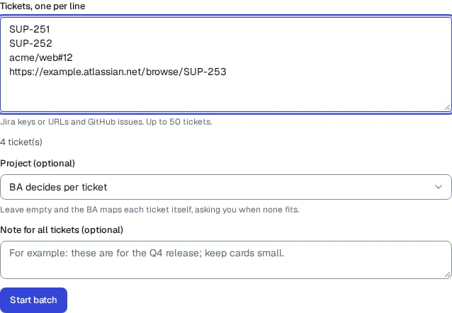

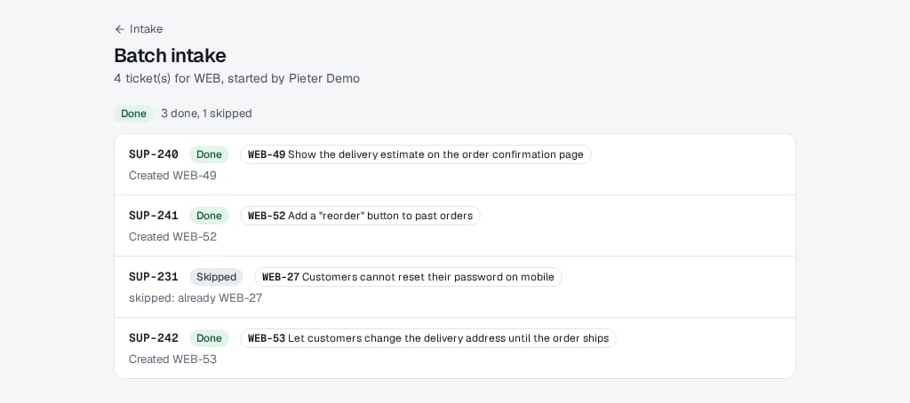

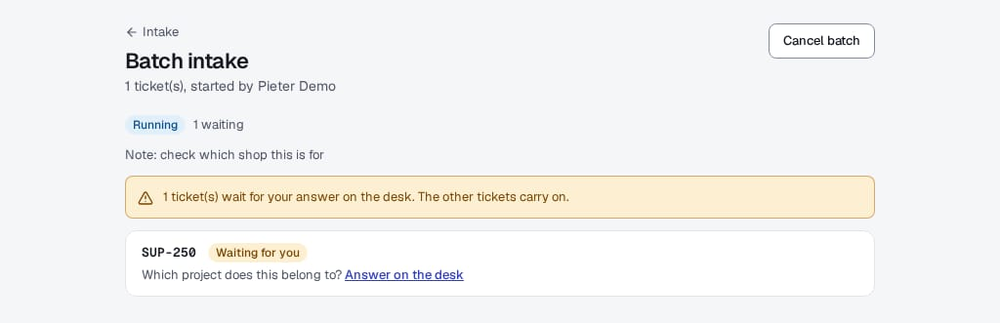

**Jira attachments (screenshots and design files).** The Atlassian tool the BA reads Jira with shows the names of a ticket's attachments but not their content, and the agents' sandboxes have no internet. So the BA asks your **workstation's runner** to download them: it uses an API token that you save once on that computer and that never leaves it. On the workstation run `aom-runner jira-connect` (Jira Cloud: your Atlassian e-mail and an API token from https://id.atlassian.com/manage-profile/security/api-tokens; Jira Data Center: a personal access token and no e-mail). The Workstations page then shows **Jira: Connected as your name** (or **Not connected** / **Refused** with what to do). From then on, when you hand the BA a Jira ticket, it lists the ticket's attachments, downloads the images and design files (20 MB per file), looks at every screenshot and SVG, writes what they show into the cards and attaches the relevant files to the cards (see 3.7), so builders and testers can look at the same pictures. It only reaches the ticket you gave it, never another one. If the workstation is not connected the BA tells you and carries on without the files.

> **In the app:** Help, "Automations and integrations" (`/help/automations-and-integrations`; the old `/help/schedules-and-integrations` still works) and "Intake and outbox" (`/help/intake-and-outbox`).

> **In the app:** watch the videos "Intake: bring in tickets" (Help, "Intake and outbox", `/help/intake-and-outbox#intake`) and "Automations" (Help, "Automations and integrations", `/help/automations-and-integrations#triggers`). The page's own help panel (**?** in the top bar) has each too, under **Watch the video**.

### 4.9 Interests

An **interest** is a topic you follow. Agents look for new items on a **run schedule**, and deliver what they found to your desk on a **delivery schedule**. Keeping those two apart is how you avoid being flooded.

**Create one:** **Interests** in the sidebar, then **New interest**. Fill in:

- **Name and description:** the angle, what to include and what to leave out.
- **What to collect:** articles, videos, podcasts, and the most items per run.
- **Run schedule:** for example "Daily at 07:00", or only when you press **Run now**.
- **Delivery schedule:** **As one digest at set times** (for example weekdays at 07:00) or **As soon as a run finishes**.
- **Preferred agents:** a scout, a curator, a researcher and a fact checker. This is a soft preference. Any available qualified agent takes the run, so nobody waits.

On the interest's page, **Overview** shows both schedules and what is waiting for delivery. **Run log** lists every run with its items, cost and agents. **Digest** is the running list of everything delivered, with rating buttons. **Settings** and **Taste** are where you tune it.

**Find and tidy.** The list has a **Status** filter, a **Search** box and a **Show archived** switch. **Deliver N now** on an interest sends the N items that are waiting for the next delivery at once. The interest's menu also has **Archive** (**Restore** brings it back from the archived list) and **Delete permanently** (removes its cards, items, seen-list and run log; its vault folder is never touched).

**Teach it your taste.** Rate digest items **useful**, **irrelevant** or **boring**. The curators learn from the ratings and write rules into the interest's `taste.md`. You can also type your own rules on the **Taste** tab ("Skip beginner tutorials"). Your written rules win over the learned ones.

**Research this.** On an interest or on one digest item, **Research this** starts a researcher and a fact checker, with the depth you choose (**Quick**, **Standard** or **Deep**), and publishes a note into the interest's folder. Research happens only on demand.

**The daily quiet cap** (bottom of the Interests page) limits how many digest items reach your desk in a day across all interests. Items over the cap wait for the next delivery.

**Transcripts.** Videos and podcasts come with a transcript so you can read instead of watch. Transcripts of video sites need **yt-dlp** on the workstation (the installer offers it).

**Who sees an interest.** Owners and Admins see all interests. An interest made by a Member or Guest is private to them until an Owner or Admin shares it. Whoever made an interest, or someone with an equal or higher role, may change it.

> **In the app:** Help, "Interests" (`/help/interests`).

> **In the app:** watch the video "Interests" (Help, "Interests", `/help/interests#run-and-delivery`). The page's own help panel (**?** in the top bar) has it too, under **Watch the video**.

### 4.10 Phases and follow-ups

A **phase** is a named slice of a project's work, the cards you want to ship and check together. When all its cards are finished and merged into the working branch, your BA tells you and proposes what happens next: deploy, run the regression suite, something custom. **Nothing runs until you approve.**

**Set up (Environments page):** the **default follow-ups** every new phase starts with live on the project's **Environments** page, under **Rules**, as "What a new phase does when it is finished", for example "Release to the test site, then to the live site (it waits for you)". A follow-up that releases picks an **environment** (the test site, the live site, an extra site), not a technical target; the live site always waits for the Owner. Where each environment runs is set up once under **Places** (4.27).

**Create a phase** under **Project settings, Phases, New phase**, or let the BA propose one while you talk about the work ("this is phase 2"). Add cards from the phase page or from the card's **Phase** selector. A card belongs to at most one phase.

**When is a phase done?** The phase is complete when every card is finalized and its work is live on main (or closed or cancelled). In expert mode, if the app cannot see a squash-merged branch, click **Mark merged** on the phase page.

**The "Phase done" item** on your desk carries a report of what was delivered and what is outstanding. You can **Edit follow-ups**, **Approve all**, **Reject** (nothing runs), or **Reopen the phase**.

**What runs after you approve:** the follow-ups run **in order, one at a time**. If one fails, the ones after it are skipped. At the end a **Phase results** notice lists each result with its evidence.

> **In the app:** Help, "Phases and follow-ups" (`/help/phases`).

### 4.11 Your CEO reports to you

Your CEO is your eyes and ears on the floor, and it never slows an agent down. This section is about what reaches you and when; the CEO itself (its page, tabs, authority and chat) is in 4.22. The BA is a spec writer only and no longer reports. Reports it wrote earlier stay on your desk, and its "BA reports" chat is read-only.

**What goes through the CEO.** Urgent items such as blocking questions and approvals reach your desk **at once**, unchanged, and the CEO is woken for them too. Less urgent items wait up to **10 minutes** for the CEO, which passes them on, folds duplicates together, or dismisses noise it can show is covered. If the CEO is slow, **paused**, or its workstation is offline, items reach you unchanged: nothing waits for a CEO that cannot look, and if something urgent waits more than 30 minutes you get a notice and an e-mail. There is no switch for this; the CEO is always there, and **Pause** on the CEO page is the emergency stop.

**Signals the server watches** (every minute, without spending tokens):

| Signal | Threshold | You hear |
| --- | --- | --- |
| A card keeps failing | 3 failed shifts on one card in 10 minutes | At once |
| The same approval asked again and again | 3 times in 24 hours | In the daily report |
| Blocked too long | A blocked card waits more than 4 hours | In the daily report |
| Nobody can take it | A queued card nobody can take for 30 minutes | In the daily report |
| Repeated failures | A card in rework round 3, or finalize failed twice | In the daily report |
| Repository hygiene problem | A conflict, wrong branch, login failure or missing clone | In the daily report |
| High-risk card waiting | A card the reviewer rated high risk waits more than 24 hours for the owner's or a merge approval (report only, no action; custom workflow approval steps are not covered) | In the daily report |
| Budget | 80% of a monthly budget, or 100% (paused) | 80% in the report, 100% at once |

**The daily report.** At the report time you set on the CEO page, **Reporting & alerts** tab (08:00 by default, in your time zone, 4.30), the CEO puts one report on your desk, titled "Daily report <date>", on days with something to say. It lists what needs you, what the CEO decided (with Undo), phases waiting, stuck and backing-off cards, repeated approvals, failures, open DevOps requests, **high-risk cards finished** (cards the reviewer rated high risk that finished by merge, PR or push since the last report; the section is left out when there are none), **spend**, the new backlog suggestions from agents and highlights from your interests. Open **The facts behind this report** for the same lists straight from the server, and talk to the CEO about anything in it. When the CEO cannot run for two hours the server posts a plain template report with the same facts. Scheduled tasks that ask the CEO for something are in 4.8.

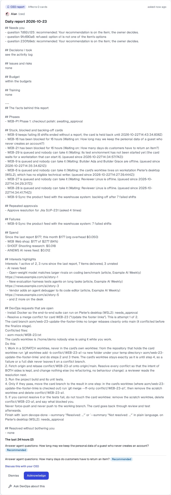

> **In the app:** Help, "The daily report and what is watched" (`/help/ba-reporter`) and "Your CEO" (`/help/ceo`).

### 4.12 Testing, finalizing and risk

Once a reviewer approves (and, where it applies, you have given the owner approval below), the card moves to **Test**. A tester runs the tests of the test plan. If they fail, a bug card is created on the same branch, and the original card waits ("waiting on bug") until the bug is fixed and the tests pass.

**Risk tier.** The app computes it from the size of the change: **Small**: one reviewer and one tester. **Large** (200 or more changed lines, or changes in the architectural areas you configured, or a refactor): two different senior reviewers. You can override it on the card (**Change** next to the risk tier) with a reason. A 50-line change to a critical system may deserve large-tier review.

**Finalize.** The BA completes the card the way the project's **How finished work lands** says (4.4): committed and pushed to the working branch, or as a pull request for you. In expert mode a card can have its own completion action: **Commit and push to the working branch** (no pull request), **Pull request** (push the card branch and open a pull request into the working branch). A card branch is only ever pushed to the git host when the work goes out as a pull request; otherwise it stays on the workstation. Finalize no longer asks for an approval of its own.

**Owner approval (lean team workflow).** On a new project the approval comes *after the review*, not at Finalize (4.26). When the last review approval is in, the card moves to the **Owner approval** stage (column **Approval**) and waits for the project owner; the card shows an "Awaiting your approval" badge and appears under **Waiting for my approval (n)** on the board, and a desk item asks you. Open the card, or the desk item, and press **Show the diff** to read the final diff of the reviewed commit. Then press **Approve**, or **Send back**, which asks for a comment ("What is missing? (required)") and returns the card to Build as rework. A note is optional when you approve. The approval is for that commit: if the code changed after the diff was shown, the card asks again. Which cards ask is set in the project's settings under **Owner approval after the review**: *Large and high-risk cards* (the default; a small low-risk card is approved automatically) or *Every card* (**Ask me to approve every card, also small low-risk ones**). A high-risk change always needs it. Details are in 4.26.

> **Watch out:** a project that used **Merge large changes without my approval** keeps that choice for large cards that are not high risk, so they merge once the two reviews and the tests are through. It is off by default, only the project owner can change it, and every change is recorded. A high-risk card still waits for you.

**Manual QA.** When a card is finalized (merged, pushed or turned into a pull request) it does not go straight to Done. It goes to the **QA** column, assigned to the person who started it: whoever ran the intake chat or batch, else the card's creator, else the project owner. An agent (the tester, or the BA when no tester is hired) writes the test steps on the card, grouped by scenario (happy path, edge cases, error handling, regressions, UI and data checks). The assignee gets a desk item and the card shows under **Waiting for my QA (n)** on the board (a card that waits for your approval, 4.26, shows under **Waiting for my approval (n)**). They choose:

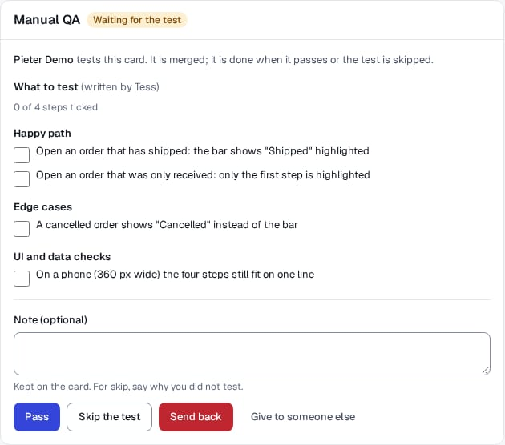

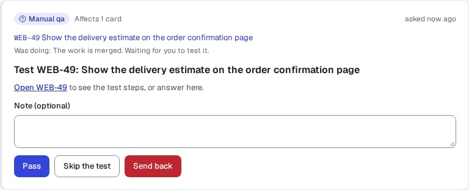

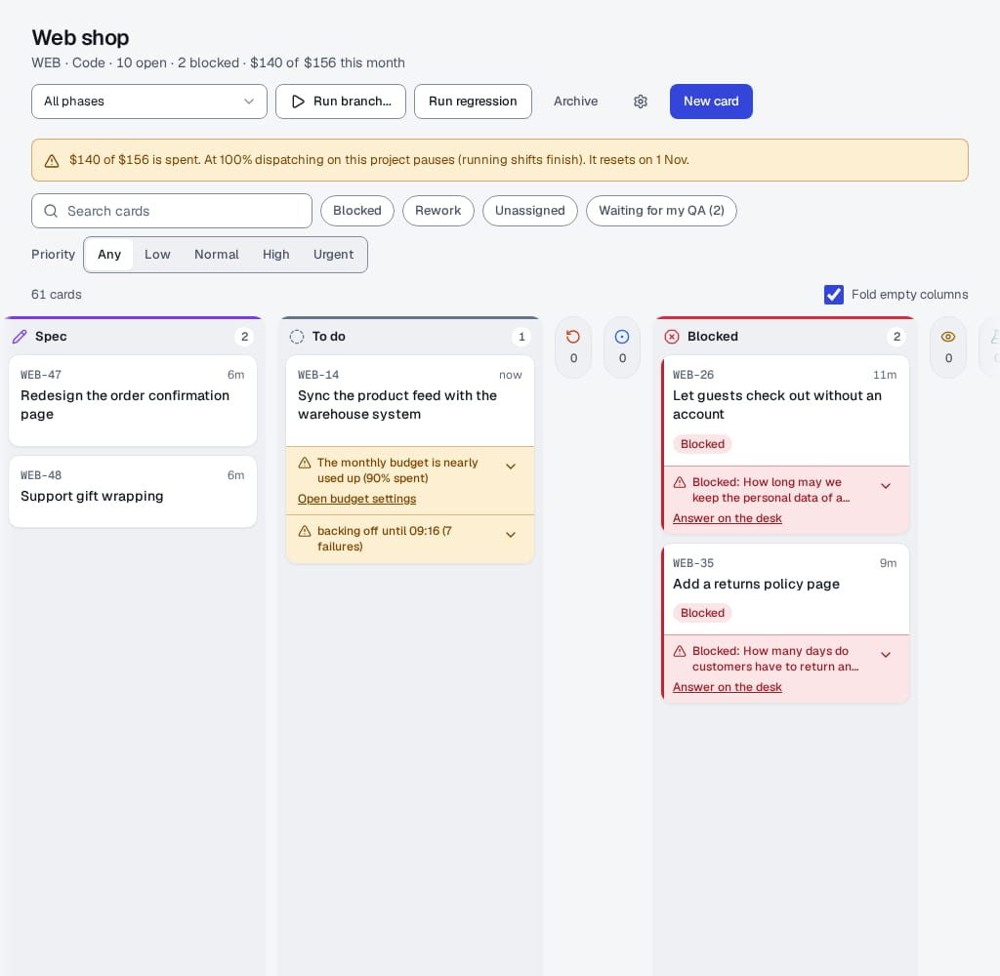

- **Pass**: the card is accepted and moves to Done.
- **Skip the test**: not tested; the card moves to Done and the card says so. Add a reason if you like.
- **Send back**: a comment is required. The card returns to Build as rework with your comment as a review comment for the builder, in the same branch that already holds the merged work, and goes through review, test, finalize and QA again. You never have to reopen a closed card.
- **Give it to someone else**: pick another member of the project; they get the desk item.

The update that the BA drafts for the Jira or GitHub ticket is held while the card is in QA. **Passing the card or skipping the test approves it**: it is posted to the ticket at once from the card owner's workstation, with no further approval on the desk. A card that is sent back keeps its update held until a later pass. The assignee, the project's owner and managers, and the organization's Owners and Admins can act on a card in QA.

Manual QA is on for every project. The project Owner and the organization's Owners and Admins can switch it off in the project's **Settings**, **Manual QA before done**. The setting counts when a card is finalized: a card already in progress follows whatever is set at that moment, and a card that is already in QA stays there until someone decides. Scheduled (automatic) cards and investigation-only cards have no QA.

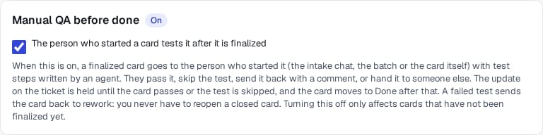

After a merge, a **full suite** card runs the entire end-to-end suite once. If it fails, a bug card and a desk notice follow. **Run regression** on the board runs the whole suite on demand.

> **In the app:** Help, "Testing and finalization" (`/help/testing-and-finalization`).

> **In the app:** watch the video "The Board and your cards" (Help, "Board and cards", `/help/board-and-cards#reading-the-board`). The page's own help panel (**?** in the top bar) has it too, under **Watch the video**.

### 4.13 Conversion, the Research tab and research cards

**Research cards in any project.** Pick the card type **research** on the New card form to ask a question in any project. It runs on the research workflow (question, research, fact check, publish) and gets a **Research** chip on the board.

**Converting a project.** A project that started as research converts to a delivery project when the questions are answered. Owners and Admins do it in **Project settings, Stage, Convert project** (or the **Convert to project** button on a research project's board). A short dialog asks:

1. **Workflow:** the target, usually Code.
2. **Repositories:** a workflow that works in code needs at least one. Add one, or **request a new GitHub repository**. The request lands on your desk and your own workstation creates it with your GitHub login when you approve. (A new repository on GitLab, Bitbucket or Azure DevOps is created from the project settings instead, 3.6.)
3. **Open cards:** for cards that run on another workflow, choose **Keep** (they finish on their own workflow) or **Cancel**.
4. **Hand-over:** the published notes are listed in the project's `PROJECT.md` so every agent that works there reads them.

Cards, notes and history stay as they are. For each repository added, the DevOps engineer asks which branch is the working branch.

**The Research tab.** A project with published research notes (or one that started as research) has a **Research** entry in the sidebar. It lists the research cards in progress and every published note with its path in the vault, a preview and its sources.

> **In the app:** Help, "Converting a project" (`/help/project-conversion`).

> **In the app:** watch the video "Research" (Help, "Converting a project", `/help/project-conversion#research-as-a-stage`). The page's own help panel (**?** in the top bar) has it too, under **Watch the video**.

### 4.14 Archive and delete

**Archive** a project you no longer use: **Project settings, Archive, Archive project**. The dialog lists what will stop (running shifts, open cards, schedules and open desk items) before you confirm. Branches and history are kept. Agents are not fired. They simply stop getting the project's work. **Restore** it from **Projects, Archived**. Cards the archive closed stay closed.

**Delete permanently** is possible only for an archived project, only for the project owner, and asks you to type the project key. The project's cards, threads, schedules and notes are removed from the database and cannot be recovered. The audit log keeps a record and the vault folder is never touched. An agent that was allowed on that project only is **benched**, and the desk names the benched agents so you can reassign them.

### 4.15 Security and two-factor login

Everyone can turn on two-factor login under **Your settings** (3.2). As Owner you can **require it for the organization** on **Organization, General** (see the General tab in 4.1). Members who have not set it up are then held at the setup screen until they do. You need it on your own account first.

If a member loses their phone and their recovery codes, you reset their two-factor login on the **Members** tab (**Reset two-factor login**, Owner only). They set it up again at the next sign-in.

**Reset a member's password (Owner and Admins).** An Owner may reset a Member or an Admin; an Admin may reset a Member only (never an Owner or another Admin), and nobody resets their own password this way (use **Forgot your password?** on the sign-in page). If a member cannot get the reset email, open the actions menu on their row on the **Members** tab and choose **Reset password**. Guildwise HQ makes a strong temporary password and shows it to you **once**, with a **Copy** button: send it to them yourself, in a message only they can read. No email is sent and we do not keep the password. The member is signed out everywhere, and the next time they sign in with the temporary password the app asks for a new password before anything else (two-factor login still applies). A Guildwise HQ account is one account for every organization: if the member also belongs to other organizations, the new password applies there too. The reset is recorded in the organization's activity and never contains the password.

> **Tip:** a suspended organization (unpaid, trial over) keeps its data. Running shifts finish, nothing new starts, and only the Owner can still sign in to see settings and members. Everything resumes where it stopped when the platform administrator reactivates the organization.

### 4.16 Plan and limits

**Organization, Plan & limits** shows your plan, status, licence date, how much you use, and which features are switched on. Organizations set up by invitation are on the free **Founding** plan with every feature and **no limits**; they stay free until the Owner subscribes (4.17). The platform administrator can also give an organization the **Unlimited** plan (no billing, no limits). If a feature is switched off, its page leaves the sidebar, but its data is kept.

### 4.17 Billing

Only the **Owner** sees **Organization, Billing**. Plans differ only in limits (members, workstations, projects); every plan has every feature and **no limit on agents**.

| Plan | Per month (US dollars, VAT included) | Members | Workstations | Projects |
|---|---|---|---|---|
| Starter | $19.00 | 2 | 1 | 3 |
| Team | $49.00 | 5 | 3 | 10 |
| Business | $149.00 | 20 | 10 | Unlimited |

- **Signing up.** Choose a plan at **Start free trial**, confirm your email (required), then add a card on the full-page **Start your 7-day free trial** screen that replaces the app until a card is saved (Sign out and Contact us stay available; a sign-up without a card is removed after 14 days). The **7-day free trial** starts; the first invoice is charged when it ends, then monthly. A reminder is emailed two days before.
- **Company name.** Guildwise HQ is sold to businesses, so sign-up asks for your company name.
- **Charged in rand, VAT included.** The price is a fixed dollar amount that includes 15% VAT. Each charge converts it at the day's exchange rate. Every invoice shows the dollar price, the VAT it contains (in dollars and rand) and "charged as R x at R y / USD on <date>". We never see or keep the card number: you enter it on Paystack's secure page and we keep a secure token with the brand, last four digits and expiry (we email you before it expires). **Update card** replaces it.
- **Billing profile.** Under Billing the Owner edits the company name, address, country and VAT number (optional). They are printed on your invoices; paid invoices keep the details they were issued with.
- **Tax invoice.** **View / print tax invoice** next to an invoice opens a printable page (use Print, then Save as PDF).
- **Change plan.** Takes effect at once and is prorated for the rest of the month: you pay the difference now, or get a credit on the next invoice. A plan too small for what you use is refused.
- **Business add-ons.** Add members, workstations or projects (priced per unit). They start with the next billing cycle and never go below the Business base.
- **Cancel.** The organization stays active until the end of the paid term (or trial), then is paused. **Keep my subscription** takes it back before then.
- **Failed payments.** Three attempts (now, after 1 day, after 3 days); you are emailed each time and can update the card. After the third failure the organization is **paused**: agents stop picking up work and only the Owner can sign in. The Owner sees a full-page **Resubscribe to continue** screen (reason, plan, amount due, **Update card**, **Resubscribe now**, Sign out, Contact us) instead of the app, and **Resubscribe now** charges a new month and resumes everything. The same screen appears when the subscription was cancelled and its term ended. Members see a banner asking them to contact their Owner.
- **Platform administrators** see the active payment provider and its sandbox or live mode, and edit prices (VAT included), limits, add-on prices, the VAT rate, the invoice details (company name, address, VAT number printed on tax invoices) and the exchange-rate override under **Platform, Billing**, and can pause, unpause or assign **Unlimited** from an organization's page (each with a reason, audited).

See the help article *Plans and billing*.

### 4.18 Chatting with agents

Click **Chat** in the top bar (or on the Desk), pick an agent and choose **Start chat**. Ask about a card, discuss a blocker, or ask the BA to draft cards. The BA works with your rights, so it can only use projects you are a member of. Conversations are saved, and a chat tied to a project is marked as visible to that project's managers.

**What an agent can read in a chat.** A chat with an agent that works on code (a builder, the Architect) about a project can read the project's own repositories (read-only) when they are cloned on the agent's workstation, plus the project's **Reference repositories** (project settings). A chat about a card whose work folder is on that workstation reads that folder, plus the reference repositories; if the card has not been started there, it falls back to the project's repositories. **The BA reads no code**: it works from the ticket, the project notes, the vault and the ledger, and puts code questions into the card for the Architect (turn on **Investigate & design** for such cards). The agent also reads the **knowledge vault**, read-only: the project's vault (or the organization vault when the project has none) in a chat about a project or a card, and the organization vault in a chat with no project, the latter only on the workstation of an Owner or Admin. The same vault is open to the agent in questions and the business analyst's tasks. If the vault is not cloned on that workstation the agent says so. Nothing else on the machine is open to the agent, and it cannot change any of it. To let an agent compare another repository, ask the project owner to add it under **Reference repositories** in the project settings. (The workstation's DevOps engineer is different: it works as you and can read everything.)

**A card with no repository (projects with several).** You never have to pick a repository for a card, and neither does the CEO. On **New card**, choose **Not sure: let the BA find out** under Repository (it appears when the project has two or more repositories), or leave the repository empty and use **Send to BA** on the draft. The BA finds the repository through the project's code graph (it still reads no source code), the project notes and the vault. If the card belongs to one repository, the BA sets it and the card is specified. If it touches several, or has clearly separate sections, the BA **splits** it into 2 to 8 cards, each with its own repository and with dependencies between them where one must land first. The original card is then cancelled as **split**: its page shows **Split into** with links to the new cards, and each new card shows **Split from**. Nothing needs your confirmation. If no BA is hired, or the graph does not cover every repository yet, an Architect does the same by reading the repositories. When nobody can tell, the CEO gets the card first and only reaches you if it cannot decide. The repository of a card cannot be changed once the card has a worktree or a branch. This needs a runner of version 0.1.40 or later on the workstation of the BA (or Architect).

> **In the app:** Help, "Chat with agents" (`/help/chat-with-agents`).

### 4.19 Cloud workstations: a VPS or a Codespace

You do not have to leave a computer switched on. In **Workstations**, **Add a workstation**, choose where the agents run:

- **A VPS (SSH).** Enter the address, port, user and a password or SSH key of any Linux server. Guildwise logs in once, installs the runner and pairs it by itself. The password or key is used for that one login and is not stored. A VPS is always on; start and stop it at your VPS company. A guide for renting and preparing one is in `docs/BYO-VPS.md`.
- **GitHub Codespaces.** Connect GitHub with a token that has the `codespace` scope, pick the repository and machine, add the generated `devcontainer.json` to the repository (it holds no secret), and create the codespace. It installs the runner and pairs by itself. It stops after 30 minutes with no agent working (you can change this), wakes by itself when a card is queued, and can be kept asleep outside optional **office hours**. **Wake** and **Stop** buttons are always there.

By default an organization has one cloud workstation, shared by all its projects. Each one shows an **estimated monthly cost**. You pay your VPS company or GitHub directly; Guildwise does not charge extra. If your Codespaces credits run out or the codespace cannot start, a notice appears on your desk, you get an email, and the card shows **Needs attention**; fix it on GitHub and press **Wake**.

**Docker.** A Codespace cannot run Docker. If you deploy Docker images you still need a workstation of yours or a VPS for that, and your deploy targets must point there. The Workstations page reminds you when you only have Codespaces.

**Claude sign-in.** Use your own Anthropic API key (the default): on a VPS run `read -rs K; printf %s "$K" | aom-runner auth api-key`, in a Codespace add the Codespaces secret `ANTHROPIC_API_KEY`. A Claude subscription also works but is for one person's own use, so the page warns about "individual use". You can also paste the API key (or sign in with `claude setup-token`) on the **Integrations** page, sealed in your browser for that workstation (3.4a). Guildwise never receives or stores a Claude key or token.

> **In the app:** Help, "Cloud workstations (VPS and Codespaces)" (`/help/cloud-workstations`).

### 4.20 The architect: investigate and design

The **architect** is a senior agent on the most capable model (Opus, high effort). Before a builder starts, it reads the card's code and the organization's other repositories, compares options, searches the web for best practice and writes a report. For a card that will be built the report is the **design**: the files to change, the data model, the risks and how each acceptance criterion maps to the design; the builder reads it first. It never builds the change itself, and it costs more per shift than a builder, so the step is **off by default**.

**Turn it on.** Hire an *Architect* (4.4), then open the project's settings, **Architect**, tick **Investigate & design before build on new cards** and **Save**. If no architect is hired the page warns you and a notice goes to your desk, because cards would wait in the new **Investigate & design** column. On a single card, **Investigate & design before build** in the New card or Edit form overrides the project (switch it off for a typo, on for an uncertain approach).

**Investigation-only cards.** Tick **Investigation only** for a comparison, a "how should we ..." or a spike: nothing is built. The architect writes the report; the BA records the result as a ledger entry (a decision when it is one) and adds it to the **Investigations** list in the project's `PROJECT.md`, which every later shift reads; then the card is done. Such a card needs only a title, context, requirements and a repository. The card page shows the report (summary and a link to the file on GitHub, GitLab, Bitbucket Cloud or Azure DevOps).

**Where the report goes.** By default a markdown file in the repository, `docs/investigations/<ref>-<title>.md`, committed on the card branch and merged with the card. In the project settings you can change the folder, or choose the **knowledge vault** (nothing is committed; the BA then finishes the card without a merge). One card can name its own **Report path**, or `vault:<path>`.

**Merge the latest main branch first.** When a repository has a main branch and a different working branch, the runner merges the main branch into the working branch and pushes it before work on a card starts, so the card branch is cut from up-to-date code. If the working branch is protected or changed meanwhile the card branch takes the merge instead; a **conflict** is resolved by the architect (conflict files only, no behaviour change), and on a card without an architect the merge is skipped with a note on the card and on your desk. On by default; the project setting or a card (**Merge the latest main branch first**: Project default / Yes / No) can switch it off.

**What the architect may do.** It writes only documentation (`docs/**`, `*.md`) and its report; the runner checks this after the shift. It reads every repository of the organization's projects that is cloned on its workstation, read-only, with secret files blocked, plus every git repository under an **organization source folder** if the workstation's owner sets one: on the **Workstations** page the row **Organisation source folder** (visible to the owner only, for the current organization) shows the folder or "not set", how many repositories it holds and whether it is ok or invalid with the reason, offers the folders the workstation reports or a typed path, and has a **Clear** button (the CLI `aom-runner org-folder set|clear|list` does the same on the machine). The workstation validates the folder and can refuse it; the architect may read every repository in it, read-only, and secret files stay blocked. It cannot push, fetch or pull from its own shell: the runner publishes the card branch for it on request. **Dependencies.** A dependency counts as satisfied once its work has *landed* in the working branch: the card is done or cancelled, or it passed Finalize with a merge (even while it still waits in Manual QA or an approval step; a pull-request card counts once its merge is seen, else at done). A card's first branch-creating step (Build) waits for that. The architect does not have to wait: it may design a card before its dependencies landed, in a read-only copy of the working branch with no card branch. It builds on the dependencies' specs and designs and records its assumptions (assumption, which dependency, what changes if it is wrong). The card then waits in the design stage; when the dependencies have landed the architect gets a short follow-up shift to check each assumption against the landed code and either confirms the design or revises it, and only then does the card go to Build. The card page shows "Design made before P5-14 landed: assumptions to review" and afterwards "Assumptions reviewed: 3 confirmed, 1 revised", and under **Depends on** whether each dependency is "waiting to land" or "landed (in manual QA)". An investigation-only card still waits, and a send-back of a dependency in Manual QA does not stop cards that already started (its rework lands in the working branch later). The report of such a design is saved in the project vault, or carried on the card and committed by the builder at the start of Build.

> **Good to know:** a card already in Build cannot get a design step afterwards, and switching the step on for a project does not touch cards that are already past Spec.

> **In the app:** Help, "The architect: investigate and design" (`/help/architect`).

### 4.21 Run a branch to try it

You can start a project on any branch of any repository to try it, without leaving the app. It runs **on one of your workstations** as ordinary processes (links open `http://localhost:<port>/` there).

**Start it.** On a card that has a branch, press **Run this branch**: the card's repository runs at the card branch and the project's other repositories at their working branch. On the project's board, press **Run branch...**: choose the workstation, tick the repositories and pick a branch for each, and, when the project declares several services, tick the ones you want (the ones they need are ticked for you). Only online workstations with an up to date runner that hold a clone of the repository are offered.

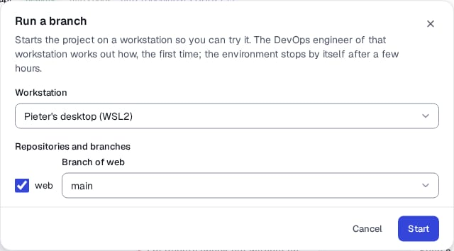

**What happens.** If the project has **run steps** (see below), the workstation replays them in seconds. If it has none yet, the workstation's DevOps engineer reads the repository's `BUILD.md` and the **run instructions** in Project settings, works out how to run the project, starts each service and checks it is healthy; what worked is saved as that workstation's plan. You watch the panel: its state (preparing, starting, running, degraded, failed), every service with its state, ports and links, the commit each repository runs at, and **Logs** (the last 500 lines, then live). If a replay fails, the engineer repairs it for that workstation and saves a new version. Nothing is added to your repositories.

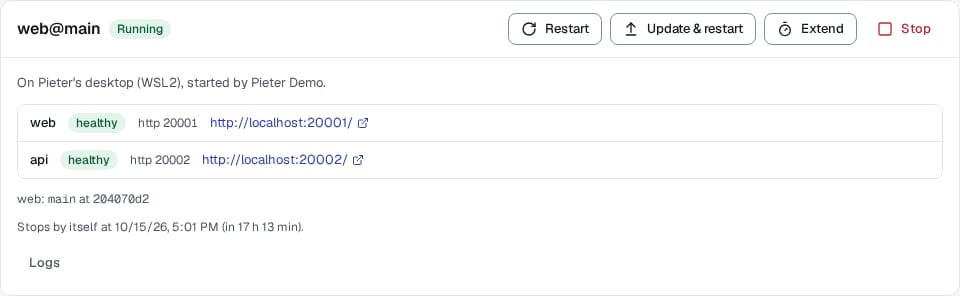

**Restart.** **Restart** starts the services again at the same commit. **Update & restart** first brings the run copy of the code up to the head of its branch (it refuses if the branch was rewritten) and runs the install steps that need it. A stopped environment keeps its run copy for a day, so Restart brings it back quickly.

**Stop it.** **Stop** ends the services; the run copy of the code is kept for a day, then removed. An environment stops by itself after the project's time (8 hours by default); **Extend** adds the same again. A workstation runs at most two environments at once. The **Workstations** page lists everything running on a machine, for all projects.

**Environments, Your app: the run steps.** This is where you tell Guildwise how to start your app, in plain words (it used to be under Project settings, Run and test; the old link still lands here). You do not need to know how to code. It shows whether the app is **set up** ("Starts in 4 steps on any computer of this project. Last start: worked 2h ago") and offers two ways in:

- **Scan with DevOps.** Choose a computer that has the project's code and press **Start the scan**. DevOps only reads the project (the README, package files, Docker files and so on); it does not start, install or change anything. After a few minutes a **suggestion** appears with **Review**. Every part is marked **Found** (DevOps read it in a file and says which), **Guessed, please check** (press **Looks right** or **Edit**) or **Needs your answer**. The questions are at the top, in plain words ("Which page shows that the website is ready?"); **Answer** opens the part. **Use these steps** is available once every question is answered; **Test first** starts the app once from the suggestion; **Dismiss** puts it away. Nothing is saved until you press **Use these steps**.
- **Set up myself** (or **Edit steps**). Two lists: **Before starting** (things that run once, such as installing packages, a build, or preparing the database) and **Parts of the app** (what keeps running: the website, a database in Docker). **Add a step** or **Add a part** opens a short list ("Install packages", "Start the website or app", "Start a database or service (Docker)", ...); each asks only what it needs, in words ("Which folder?", "Which port does it use?", "How do we know it is ready?"). Move a card up or down, edit it, or remove it. Problems are explained in words ("Two parts are both called web").

**Test these steps** starts the app once on one of your computers from the steps on screen (saved or not) and says what happened: **Started. Open it:** with the link, or **The app did not start** with the reason. **Use these steps** saves them for the whole project: every computer replays them, a card test included. The owner's steps are never replaced behind your back: if a start fails, DevOps repairs it **for that computer**, and the page lists it under **Computers with their own steps** with **Use the project version here** and **Make this the project version**. Docker steps need Docker allowed for the project; the page offers **Allow Docker** when it is off.

**Show technical details** keeps what developers set: free-text run instructions for the project and for each repository (they win over `BUILD.md`), the build guide, the stop time, whether the branch's code may use Docker (off by default; with it on, Docker steps run outside any sandbox, so only for projects you trust), the declared **services** (name, repository, folder, command, ports as `name:default:ENV_VAR`, health check, what it starts after, the path of an env file on the workstation), the saved plans of each computer, and, on every step, its real command, settings and stop command. Put secrets in an env file on the computer, never in the settings: only its path is stored.

**Build guides above the repositories.** If your repositories sit side by side in one folder (for example `src/demo/sources/`) with a `BUILD.md` in that folder, the workstation finds it too (it looks in the folders above each repository, up to your code folder, never in your home folder) and gives it to the DevOps engineer with the repository's own `BUILD.md`. The **Build guide** field under Your app, Notes for DevOps (technical details) takes the full path(s) of the guide(s) on the workstation instead, if you would rather name them. Git submodules are fetched into the run copy. Services can read your .NET user secrets (`~/.microsoft/usersecrets`), read-only.

**When it cannot run.** A failed environment stays on the board, the card and the Workstations page with its reason (the DevOps engineer's report) and a link to the DevOps request; press **Try again** (same repositories and branches) or **Dismiss**. When the DevOps engineer is stuck on something only you know, the panel says **Waiting for you** with its question and the options; answer on the DevOps request (Workstations page) or the desk and it carries on.

> **Good to know:** the links point at `localhost` on the workstation. If your browser is on another machine, the panel shows the `ssh -L` command that forwards the ports. The services run in the runner's sandbox: they use the machine's network, but can write only to the run copy and cannot read your credential folders. Docker services (only if you allowed Docker) run outside the sandbox, and the panel says so.

> **In the app:** Help, "Run a branch" (`/help/board-and-cards#run-a-branch`).

### 4.22 Your CEO

The **CEO** is the agent you talk to first. It runs the floor for you: it watches every project, agent, workstation and budget, unblocks what is stuck, answers the routine questions it is allowed to answer, recommends the rest, keeps the team the right size, hands work to the BA, the team and DevOps, and writes you one report every morning. It replaced the BA's daily floor report, the BA's triage of held desk items and the BA's urgent notes (the BA reporter is gone: the BA is a spec writer only and keeps intake, specs, finalizing, phases and design chats). **Every organization has exactly one CEO, built in:** there is nothing to appoint, hire or dismiss, and it does not count against your plan's agent or workstation limits. Only the **Owner** configures and talks to it. Admins can read its page and activity log and can pause it.

**The CEO page.** Open **CEO** in the sidebar (Organization group, `/org/ceo`). The Owner sees nine tabs: **Overview**, **Authority**, **Reporting & alerts**, **Persona & instructions**, **Memory**, **Tasks**, **Topics**, **Activity log** and **Workstations**. Admins see the Overview and the activity log, and can pause the CEO.

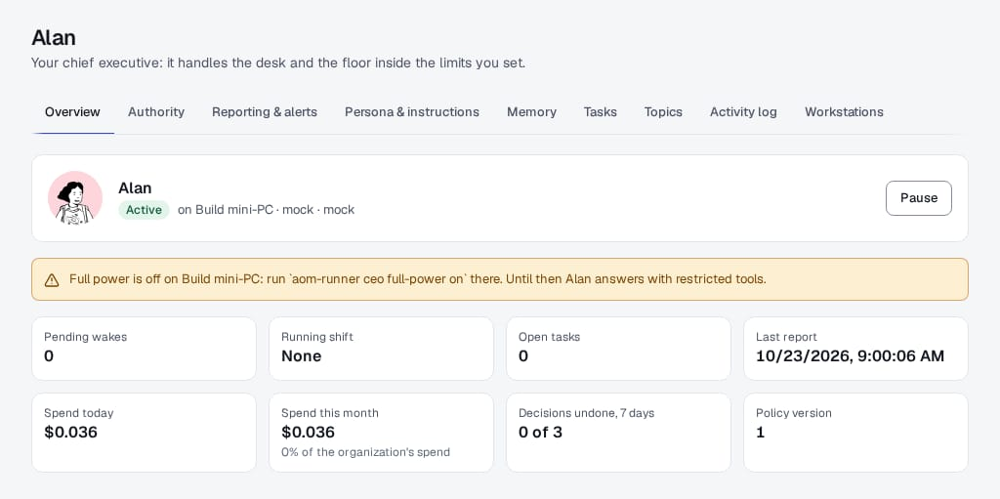

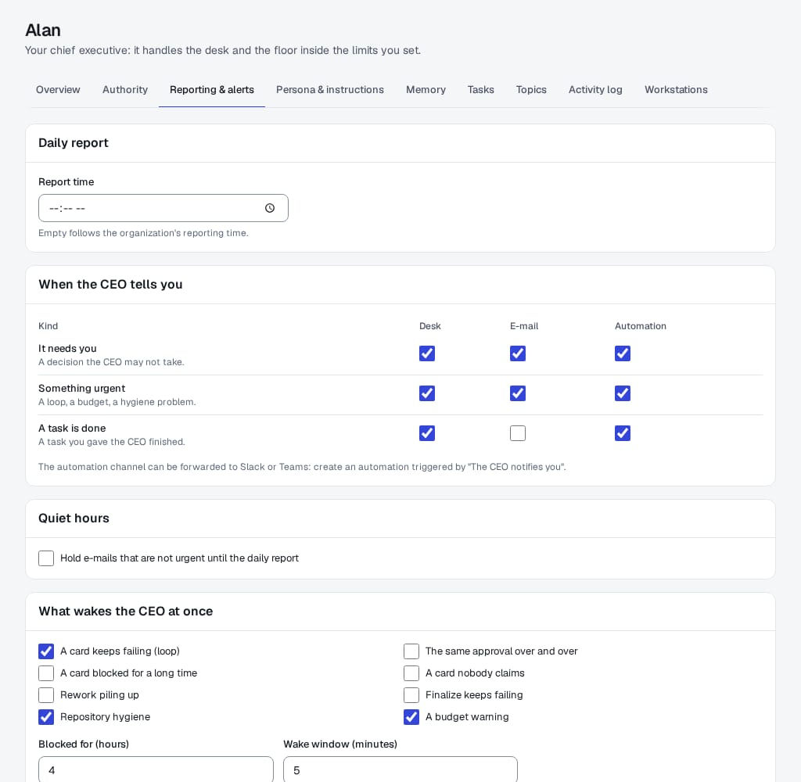

**Where it runs.** The CEO lives on the Owner's most recently seen workstation that serves the organization (the one that last connected). To use another of your own workstations, open the **Workstations** tab and press **Move the CEO here** on it. Until a workstation is paired the page says "Pair a workstation to talk to <name>". Its background work (wakes and the daily report) is restricted: read-only, no web, one command, `aom`. **Pause** is an emergency stop: it may read but not act.

**There is no training period.** The CEO decides what your policy allows from day one; the Owner reviews and corrects what it did (see **CEO decisions** on the Desk and the **Correct** buttons below). Organizations that had a CEO in training were graduated when this shipped.

**Full power in your own chat.** When **you** talk to the CEO it is a real Claude Code session on your workstation: your own `~/.claude` settings, skills, plugins and MCP servers, your home directory and no Guildwise sandbox, and it can also act in Guildwise through `aom ceo`. That is the power you have yourself, so it is off until you switch it on **on that machine**: run `aom-runner ceo full-power on` and restart the runner (the Overview says "Full power is off on <workstation>" until then, and your messages still work in the restricted mode). Nothing but your own message starts such a turn: events, agents and your team never do. Set the session's fixed working directory under **Persona & instructions** (empty is your home directory); the session continues from message to message (it starts a new one, with a short handover, after 24 hours, a long context, another working directory or another model runtime). The runner's own program and secrets (`~/.aom-runner`) are off limits to it, and it restarts the runner only with `aom runner restart` after it has answered, never with `systemctl` or `kill`. Attached files are not supported yet.

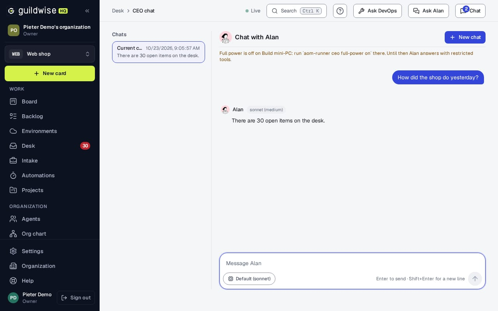

**Authorize this execution.** Turns run in auto mode: nobody types "allow" at a terminal. When the runtime needs a permission it does not have, you or any Admin of the organization get a question on the Desk, **Authorize this execution** (the tool, what it wants to run and why). **Authorize once**, **Authorize for this turn** or **Deny**. No answer within 10 minutes is a Deny. A phone notification only points to the Desk item. In your chat the question also appears as a card.

**The model switch.** The chip in the chat composer shows the model ("Default (Sonnet)"). Choose another model and effort for **this message** or for **this conversation**; **Back to default** returns to what the Persona & instructions tab says. The same runtime keeps its session when you change model; another runtime starts a new session with a handover. The reply shows which model answered. Opus costs more: the chip stays visible while a conversation override is set, and the Costs page shows the CEO's spend.

**When your workstation is offline.** Your message is saved and **queued** ("Queued: <name> answers when <workstation> is back"; a push says so too). When the runner is back the messages are sent one at a time, in order, and each reply says how long it waited. A message older than three days asks first ("This waited 3 days, still want it?": **Send** or **Drop**). A CEO turn is not lost when the connection drops: its reply arrives after the reconnect.

**Use the system first.** The CEO puts work about a project's product on the board (a card through the BA, with a ticket number and card type where there is one), hands installs, Docker and environment repairs to **DevOps**, and does one-off jobs and research itself without ceremony. A job it did itself with tools is written to a log; the first edit inside a Guildwise project clone in a turn is stopped once with a reminder to use the board (say "do it directly" and it logs that and goes ahead). When you ask for the same kind of thing **4 or more times in 7 days, or 10 or more times in 30 days**, the daily report gets a section **Things you keep asking me** with buttons: **Make it a feature** (a card for the project), **Make it a skill** (a Claude Code skill in your `~/.claude/skills`, written in your own turn), **Automate it** (a schedule), or **Not a pattern** (silent for 90 days).

**DevOps works through the CEO.** There is no DevOps chat any more: **Ask DevOps** buttons open your CEO chat with the question filled in, and the CEO delegates, follows the request and tells you the result (it can wait for DevOps for a while in the same turn, then carries on in the background). Old DevOps chats stay readable. Approvals, the two-party rule and the DevOps guard are unchanged, and the Hygiene and Setup buttons still file their requests directly.

**Corrections.** Say "you did X, I'd rather Y" in the chat, or press **Correct** on a row of the **Activity log** tab, on a CEO decision on the Desk, or on a decision or an order turn in the daily report. A dialog asks what it should have done, whether to **make it a rule for next time** (on by default) and, when the action can be reversed, to **undo** it or **redo** it your way. The correction is remembered at once (an active memory of the kind *correction*), ranks **first** in every brief above your rules, preferences and anything the CEO inferred, and the memories the corrected action relied on lose confidence. An Admin can record the rule but cannot undo or redo.

**Blog research topics.** The CEO notices the problems you and your team run into (jobs it did by hand, things you keep asking for, corrections, parked cards, failed DevOps work, questions that waited hours for you) and can turn the ones other developers probably meet into **one general question**, such as "How can AI agents authorize production deploys without bypassing safety checks?". These are suggestions for the Guildwise blog, which researches each from public sources. Only the question and its area are ever sent: no names, no numbers, no project, repository or host, and no description of what happened. The server checks every question three times and refuses one that names anything of yours. Nothing is sent until you press **Accept**: the daily report has **Research topics from this week** with **Accept**, **Edit** (the question is re-checked as you type) and **Reject**, the **Topics** tab on the CEO page lists everything with its status, and the Desk shows one item, "These might make good blog articles for the community. May I send them to Guildwise as research topics?" (Approve sends them all as written, Reject drops them). Say "make that a blog topic" in the CEO chat to propose one yourself. In your own (customer) organization **only the Owner** decides, and only while **Share diagnostic data with Guildwise** is on in the organization settings (**Organization, General**). That switch is not available to customer organizations yet, so until it is, nothing is sent from them; at most 4 topics a month are sent once it is. Turning the setting off withdraws topics that have not been written yet. When an article is published from one of your topics, the report lists it under **Published from your topics**. In the platform organization an Owner or Admin decides and no setting is needed.

**Orders it carries out with full power.** A **standing order** on the Ledger can be marked **Give the CEO full power**: only the Owner can, and only on an order that is his (written by him, or proposed by an agent and approved by him on the Desk). An order an **Admin** wrote only qualifies after the Admin presses **Escalate** and you take it over and mark it. The dialog shows the exact wording the mark is pinned to, which projects it covers, optional triggers (for example bug reports only) and which owner-reserved matters it may touch (ticked one by one). Any edit that is not yours with **Keep full power** ticked voids the mark ("edited since: mark it again"), and retiring the order, **Revoke** or a change of Owner end it. When an event clearly falls under an order, the CEO starts a separate full-power turn that carries out that order and nothing else: the event arrives as quoted data, the turn declines and asks you when unsure, a permission it lacks is raised as a Desk question without the turn waiting, at most 5 turns per order a day (and one per subject every 6 hours). Every order turn, with its commands, is in the daily report and the Activity log tab with an "I'd rather you didn't" button.

**What it may decide: the Authority tab.** Each kind of action has a radio: decide, recommend or never. Matters that are yours by default (approving a merge or a finalize, passing or skipping manual QA, posting to outside systems, production deploys, destructive DevOps work, budgets, new roles and workflows, vault conflicts, repository creation, cancelling more than three cards at once) stay recommendations unless you **delegate** them one by one, after a confirmation that names the risk. Some things are never the CEO's: its own policy and settings, members and billing, secrets, widening an agent's permissions, raising a budget. A decision below the confidence threshold, without a cited ledger entry or rule, or over a limit becomes a recommendation, and so does anything triggered by text from a card, ticket or e-mail (the CEO reads that text as data, never as instructions).

**Which working branch to keep.** Answering "keep this branch as the working branch, or use another?" is routine, so by default the CEO decides it itself (the *Choosing which branch a repository works on* delegation, switched on by default and shown on the Authority tab; switch it off to have the CEO only recommend). The branch is stored as if you had answered, and the decision shows under **CEO decisions** on the Desk for you to acknowledge or correct.

**Recommendations on the desk.** A recommendation is a desk item ("Ada recommends: ..."), or a block on the question it advises on with the option preselected. **Do it** runs the action with your say-so; **Not now** declines. Items the CEO answered show "Answered by Ada: reason (confidence)" with an **Undo**.

**The activity log** (the **Activity log** tab) lists everything it decided, recommended or was refused, with the reason, confidence, the evidence and the policy version in force, and an **Undo** where one exists: pausing and resuming, priorities, models and seniority, benching, hires (retired if the agent never worked, benched otherwise), cancelled cards, drafted cards, proposed standing orders and answers to questions (the question opens again if no card it released has been taken since; otherwise a correction is posted on the card and on your desk). An undo is recorded as a correction: the rules the decision cited lose confidence and the CEO does not repeat the same action on the same subject for a day. Releasing a claim, ending a back-off, stopping a shift, DevOps requests, messages and retiring cannot be undone and say so.

**Talking to it.** Press **Ask <name>** in the top bar. The chat has its own page (\`/ceo-chat\`): **New chat** starts a conversation, **Chats** lists the earlier ones, and **Go to the current chat** brings you back to the one that is running. It is your single entry point: ask what is going on, give it a task ("find out why builds are slow"), or state a rule ("never touch the billing project without asking me"). Rules you state are kept as **memories**; you see, edit, retire or really delete them on the **Memory** tab, and the "Remember this for the CEO" box on a desk answer keeps your own answer as a rule. Only you can read them; they go only to your workstation. Tasks you give it appear on the Tasks tab; when one is done you get a notification.

**Reports and alerts.** The daily report arrives on your desk and by e-mail at your report time: what needs you, the decisions it took (with Undo and Correct), issues and risks, budget, tasks, proposals, what it learned from your answers and corrections, the order turns of the last day and **Things you keep asking me**. When no CEO is available the server writes the report from a template and says so. The CEO notifies you immediately only when it cannot decide, when something is urgent, and when a task is done: on the desk (pinned for urgent), by e-mail (one per subject per hour; non-urgent mail waits out your quiet hours) and as an event an automation can forward to Slack or Teams ("The CEO notifies you" trigger). Set the report time, quiet hours and an optional **organization monthly budget** on the **Reporting & alerts** tab: at 80% you are told, at 100% the CEO only writes the report and answers in chat until next month.

**When it is offline.** If its workstation is offline or its Claude sign-in expired, wakes wait, desk items reach you unchanged (nothing is held), you get one notice after 30 minutes if something urgent waits, and the daily report is posted from a template after two hours. **Pause** stops it acting (it may read, not act); nothing is handed back to the BA, which no longer reports. There is no button to disable or retire the CEO: it is built in, and **Resume** puts it back to work.

**Cost.** Its spend is shown as **Management (CEO)** on the Costs page. Wakes, the daily review and the chat run on Sonnet by default; only a **handover**, when it hands work over to the team, runs on Opus (all four configurable on the Persona tab; an organization that still had the older defaults was moved to these by a one-off migration, a model you chose yourself was left alone).

**Once per subject.** The CEO deals with a subject once until it changes: a card sitting in Manual QA wakes it and notifies you once, however many reminders the card raises, and again only when the card moves on. Notices about one subject share one desk item with a counter ("x3"). The "CEO offline" notice is raised once and is cleared only after a CEO shift has actually run, so it no longer comes and goes. There is no cap of its own; it is bounded by its wake limits (twelve shifts an hour at most), its action limits and the budgets above.

> **Good to know:** the CEO acts with your rights but the events show it as the actor; everything it does is in the activity log. It never names agents or Guildwise to clients: cards it drafts go through the same checks as any other card.

> **In the app:** Help, "Your CEO" (`/help/ceo`).

> **In the app:** watch the video "Your CEO" (Help, "Your CEO", `/help/your-ceo#talking`). The page's own help panel (**?** in the top bar) has it too, under **Watch the video**.

### 4.23 Integration tests run by the tester

Unit tests are run by builders and reviewers. **Integration and end-to-end tests** need a running copy of the app, so only the tester runs them, and only when you switch them on for the project. They start **off**. With them off the Test step still runs, as the **plain tester**: the tester checks the card's branch against its test plan with what it can run in its own copy of the code, without a running app (end-to-end tests that start their own server, unit-level checks, build and lint), and says in its evidence what it could not check. With them on, the tester also gets a running copy of the card's branch and your suites, as described below.

**Switch them on.** Under **Environments, Test copies, Tests and settings** choose "Yes, on the workstation that has the card" (a deployed target comes with the next phase). The tester needs the project to be runnable first: the **run plan** above (the DevOps engineer works it out the first time and the runner replays it afterwards). Then list the **suites**: a name, the repository and folder, the command, whether it is integration or end-to-end, the longest it may run, an optional JUnit report path and whether it writes or deletes data. With none listed, the tester reads `TESTING.md`, `BUILD.md` and the test config, runs what it finds and proposes the suites here, marked "Proposed by a tester", for you to **Confirm**. **Keep a failed card's copy for** says how long the running copy of a failed card stays up so you can open it, and **Run a failing suite again** is how many times a failure is retried before it counts.

**What happens to a card.** When the builder and reviewer are done and the project has the setting on, the card waits in Test while its workstation starts the card's branch (first rebased onto the working branch; a conflict sends the card to Rework with the files, as before). If there is no run plan yet, or it fails, the DevOps engineer is asked and the card waits for that request; a second failure puts a blocking item on your desk. When the app is healthy the tester runs every confirmed suite against it and reports each run. A suite that fails and then passes on the retry is recorded as **flaky**: it counts as passed, the card shows it, and the tester cannot pass the card while a confirmed suite has no passing result. The copy is stopped when the tester gives its verdict, or kept for the time you set after a failure. The **card page** lists every run (result, counts, time, which commit, a link to the log) under "Integration tests", and the environment panel shows the copy while it exists.

**One card.** In **Details** a card has an "Integration tests" switch that follows the project setting when the card is specified. Turn it off for a documentation-only card; it can be changed until the Test step starts.

**Cards already under way.** A card still before review when you upgrade moves to the newest workflow version as review approves it (this includes cards on the version that skipped Test when integration tests were off: they now go through Test), and then follows the project setting; a card already in Test or beyond finishes the way it started. Custom steps can need a running environment too: in the workflow builder tick "Needs a running environment" on a step the tester works (for example a smoke test after review).

**A deployed target instead.** Choose "Yes, against a deployed target" to have the tester test what is already deployed (a staging site) instead of a copy per card. First opt the place in under **Environments, ... menu, Edit, Used for card tests** on the environment: tick "The tester may test this target" (it needs the app URL), add any extra hosts its sandbox may reach (for example a separate API host) and the **names** of the test accounts it gets (such as `TEST_USER_PASSWORD`). A **production** target can never be tested. Suites that write or delete data run only against a target where you ticked "Tests may write or delete data here"; elsewhere the tester reports them as skipped. Set the values of the test accounts under the same target, per workstation: they are encrypted in your browser for that workstation's runner (the way the sudo password is) and stored only there, in a private file the tester's tools read; they never reach Guildwise or the card. The tester's shell reaches exactly the target's hosts and the package registries, nothing else. A target that does not answer stops the card with a blocking item for you. Remember that a deployed target shows what is deployed there: a card's branch has to be deployed before the tester can test it, so this mode suits suites, regression runs and a project that deploys every merge.

> **Good to know:** the tester reaches the app on the same `localhost:<port>` it has on the workstation, through a tunnel the runner opens only for that copy, and nothing else on the machine. Builders and reviewers still run unit tests only and name the suites they left out in their handoff. Passwords for test accounts never go in the settings: use an env file on the workstation, as for the run plan.

> **In the app:** Help, "Integration tests" (`/help/board-and-cards#integration-tests`).

### 4.24 When the Claude usage limit is reached

A Claude subscription has a session limit and a weekly limit. When it is reached, Guildwise **pauses the work** instead of letting every card fail and retry. The board and the project settings show **Paused until 18:00 (usage limit on <workstation>)** in your time zone. Cards stay in their queue with a note ("Paused: the model usage limit resets at 18:00"), no shift is counted as failed, and nothing needs doing: when the limit resets the workstation checks with one tiny request and work continues by itself. Your desk gets one notice (and one e-mail) *Claude usage limit reached on <workstation>*, which closes by itself. Projects that also have agents on another workstation keep working there. A chat started meanwhile says when it can be used again.

### 4.24a Claude accounts per project

By default every project's tickets run on each workstation's main Claude account. On the project's settings page, under
**Claude account**, you can name a second Claude subscription for the project (a short key such as `work`). Each workstation
that works on the project then needs to sign in to that account once. The status line under the setting shows *ready*,
*sign-in needed* (a link opens that workstation's Integrations page) or *provisioning*. A workstation that has more than its main account also shows a **Claude accounts** table on the Workstations page: for each account the folder, who it is signed in as (and the plan), the login state and whether usage is available or limited until a time.

- **The fallback checkbox.** "If this account is out (usage limit or login), use the workstation's main account." It is
  **off by default**. Off means the project's tickets **pause** while its account is out. On means they run on the main
  account until the project's account works again.
- **Usage limit.** The board and the project settings show the project as paused, or on the main account, with the time the
  limit resets. The card goes back into the queue without penalty.
- **Expired or unfinished login.** Treated exactly like a usage limit: the project pauses or falls back, and you get a desk
  notice with the sign-in link.
- **Recovery is automatic.** When the limit resets or the login works, new ticket work goes back to the project's account
  by itself. Shifts already running finish on the account they started with.
- **What always uses the main account.** CEO and DevOps work, chats that are not about a card, and BA work that is not about a ticket. Questions and BA
  work on a ticket follow the project's account, and so does a chat or @mention about the project's card (runner 0.1.60 or newer; if the account is out and there is no fallback, the chat does not start and says why).

### 4.24b AI runtimes and accounts per provider

**Integrations, AI runtime** (sidebar, Organization; pick the workstation) shows what a workstation can run agents on, one tile
each: Claude Code, Codex, the Gemini CLI, opencode, and the API providers (Anthropic, OpenAI, Gemini, any OpenAI-compatible
endpoint, and Claude Code on Amazon Bedrock, Vertex AI or a gateway). A tile tells you:

- whether the program is **installed**, with the command to install it (restart the runner afterwards: it looks for the program when it starts);
- who is **signed in**, or that the sign-in expired, or that a usage limit holds until a time;
- whether a **key** is set and whose key is in effect: this workstation's own, or the organization's;
- **Runner too old**, when the workstation's runner needs an update (0.1.58) to keep accounts.

Each runtime and provider has one **main account** and any number of **named accounts**, per workstation. The actions:

- **Sign in** runs the program's own login on the workstation: Codex shows a link and a code to type there, the Gemini CLI a link and a box for the code it shows, Claude the usual link and code. Every named account keeps its login in a folder of its own, so accounts never mix.
- **Set key** or **Replace key** encrypts the key in your browser for that workstation's runner (it needs HTTPS or localhost; otherwise the page says so and the button stays off).
- **Add a named account** takes a short name such as `work` (not `main` or `org`), then signs in or takes the key.
- **Remove** deletes a named account and the login or key stored for it. The main account's login belongs to the machine and is removed in a terminal.
- **Make main** swaps a named account with the main account. Nothing is lost, and doing it again undoes it. For Claude Code it swaps the sign-in of `~/.claude` with the named account's folder (plugin sign-ins and settings stay), and needs an idle workstation, both accounts signed in, a main account on the machine login, and runner 0.1.60 or newer.

**Choosing the account for a project.** The project's settings page has **Accounts for other providers** (and the Claude account
panel from 4.24a). For each provider you can pick a named account, the main account, or, for an API provider, **the
organization's key**. The same rules as for Claude apply: the checkbox "If this account is out, use the workstation's main
account" is off by default, so the project's tickets pause while the account is out; CEO and DevOps work and chats that are not about a card always use the
main account (a chat about a project's card follows the project's account); shifts already running finish on the account they started with. A named key account is your own key and is not
capped; the organization's key stays under **Settings, Model providers** and its **monthly cap still applies** when a project
chooses it.

**Notices.** Per workstation and account, your desk gets a notice when an account a project names needs a sign-in or a key, and
an information notice when a login account reaches its usage limit. They close by themselves when the account works again.

### 4.25 How many shifts a workstation runs at once

Each workstation runs a limited number of agent shifts at the same time; further cards wait in the queue. Open the workstation on the **Workstations** page and set **Shifts at once**: **Runner's own value** (what is in the runner's config file, normally 4), **A number**, or **Unlimited**. Only the workstation's owner can change it. It takes effect at once, with no restart, and the runner remembers it. **Unlimited** means Guildwise sets no limit; the computer's memory and CPU and your model's usage limit still apply, so watch the machine the first time. The platform administrator can also set a ceiling for the whole platform: when it is lower than your choice the page says which number applies. A runner from before this feature (0.1.20 and older) keeps using its own value and the page tells you to update it.

### 4.26 The lean team workflow (code version 6)

New projects start on the **lean team** workflow; a project made earlier keeps its own workflow until you switch it (see below). It changes where the cost goes: every card is designed and reviewed by the strongest model, the builder proves the code builds and passes its unit tests, reviewers only read, and the testers run only the end-to-end tests of the areas a card touches.

**The stages, in order.** Spec (the BA) → **Planning** (a short, cheap code-research pass by the *planner*: which areas and files the card touches, relevant documents, overlaps with other cards; it also groups related cards and records their order) → **Investigate & design** (the architect, Opus, for *every* card, also a small one; it adds a short *Card Brief* for the builder) → **Build** (the builder; the handoff carries the build and unit test evidence) → **Pre-review** (a Sonnet pass for the basics: obvious bugs, rule violations, missing tests; findings go straight back to the builder) → **Review** (Opus, on every card, read-only: the reviewer reads the diff and the code and relies on the builder's evidence; it never builds or runs tests) → **Owner approval** (large and high-risk cards, see below) → **Test deploy** (the server starts the test environment, no agent) → **Test** (the tester runs the E2E tests of the card's areas) → Docs → Finalize → QA steps and Manual QA as before. A **Merge review** stage sits beside Review: after a merge conflict at Finalize, the reviewer reads only the resolution (see Merge conflicts below). A project without a hired planner lets the architect plan; without a pre-reviewer the reviewer does that pass too, so hire both for the intended cost.

**Groups.** Cards in one group (the planner or architect sets it) go to the same builder. The first builder that takes a card of the group keeps the rest of the group; each card still has its own worktree and branch, and the builder continues one session from card to card while it stays small enough (the runner starts fresh above 120K tokens or after 4 hours). Order between cards is a hard rule: until a card's dependency has merged only its design may run.

**High risk.** The server flags a change as high risk from the paths of its diff, never from what an agent says: authentication, permissions and secrets, data and migrations, tenancy and billing. A high-risk card needs a *second* Opus approval (from another reviewer when you have one) and always the owner's approval; the project setting below cannot switch that off. The flag is recomputed at every handoff.

**Build evidence.** A build handoff must name the build and the unit test run (command and what it printed). The evidence is bound to the commit the runner measured; when the branch is at another commit than the evidence, a review shift sends the card back to Build instead of reviewing code nobody tested. A clean rebase before the review moves the evidence along with the commit.

**Owner approval.** After the Opus review the project owner reads the **final diff** on the card page or the desk item (**Show the diff**): unified, one block per file you can collapse, added lines green and removed lines red, with the commit, why you are asked (large change, high risk, or your project setting), the builder's evidence, the review verdicts and the design note. The diff the runner uploads is kept up to 2 MB; a bigger one is cut with a note. The approval is **for that commit**: if the code changes, the approval is refused with "the code changed after the diff was shown" and the card asks again for the new commit; a merge of a changed branch never happens on an old approval. This step replaces the old approval at Finalize, so you approve once. In **Project settings → Owner approval after the review** you choose *large and high-risk cards* (the default: a small low-risk card is approved automatically, and the card thread says so) or *every card*. A project that already used "merge large changes without my approval" keeps that for large cards that are not high risk.

**Test deploy.** After the review (and the approval) the **server** starts the project's test environment for the reviewed commit, without rebasing the branch, and moves the card to Test when it is healthy at that commit. No agent works here. If the start fails, the usual DevOps request is raised and the card stays in *Test deploy*; a problem nothing can fix by itself raises one desk notice. A project that tests without an environment (**Project settings → Testing without an environment**), a project with integration tests off and a card with them off skip this stage with the reason on the card. A tester never starts on a card without a healthy environment.

**Area E2E and the full suite.** The tester's prompt lists only the specs of the areas the card's changed files belong to. By default an area is a spec file (or folder) under the E2E folder, matched by name against the changed paths; a project can list its own mapping in `e2e/areas.json` in the repository, or through the API (`PUT /api/projects/:id/e2e-areas`). When nothing matches, the core specs run. The **full suite no longer runs after every merge** in this workflow: press **Run the full suite now** in **Project settings → Full test run after each card** (10 to 20 minutes) when you want a regression run. This holds for every card on the lean team workflow, whatever the old "after each card" setting says: a lean team card never starts the suite by itself (there is no opt-in for it; the manual run is the way).

**Merge conflicts.** DevOps resolves a conflict at Finalize in a scratch worktree, so the card's own worktree is never left on a conflict branch. A card that was reviewed and approved stays in Finalize while DevOps works; the resolution then gets a *merge review* (the reviewer reads only the difference between the reviewed and the resolved commit) and the earlier approvals stand. If the resolution changed more than the merge, the reviewer sends the card back to Build for a full review. The branch is rebased on its base before the review starts, so the review sees what will merge.

**Review rounds.** Two Opus review rounds at most, then the card's architect decides (the existing stop-loss); the pre-review is not counted as a review round, but its loop is capped by the build passes.

**Existing projects.** There is nothing to switch: the lean team workflow is version 6 of the built-in **Code** workflow, and every project on Code starts its new cards on the newest version, as it did for the earlier versions. Cards in flight finish on the version they started on. Hire a planner and a pre-reviewer for the intended cost; until then the architect plans and the reviewer does the pre-review, and a role nobody covers makes a card wait at its stage until you hire one.

**Who approves.** The owner approval is asked of the project's creator when they are an organization Owner or Admin, else of the organization's Owner, else an Admin (a person made owner of that one project by hand comes before the organization's Owners). The approval can name the commit you read: the web sends the commit of the diff it shows, and the server refuses with "the code changed after the diff was shown" (409 `approval_stale`) when the branch is at another commit.

> **In the app:** watch the video "Roles and workflows" (Help, "Organization chart and design", `/help/org-chart-and-design#custom-workflows`). The page's own help panel (**?** in the top bar) has it too, under **Watch the video**.

### 4.27 Environments and deploying with a recipe

The **Environments** page (sidebar, under the board, for projects that deliver code) is where you say how your app starts and where it runs: **Your app: how to start it**, **Test copies** (one temporary copy per card), the **environments** (the **test site**, the **live site** and any extra site such as a demo), **Places** (the computers and servers), **Rules** and **History**. When an environment is set up and approved, a **Releases** switch at the top (**On** or **Paused**) turns the project's releases on or off: pausing asks "Pause releases?", and while releases are paused the environment cards show **Releases paused** and **Update now** is off. Only the project owner changes the switch, and it needs an approved environment first. Where the releases go once they are ready (the queue, what is live, the rules) is on the **Releases** page (4.28).

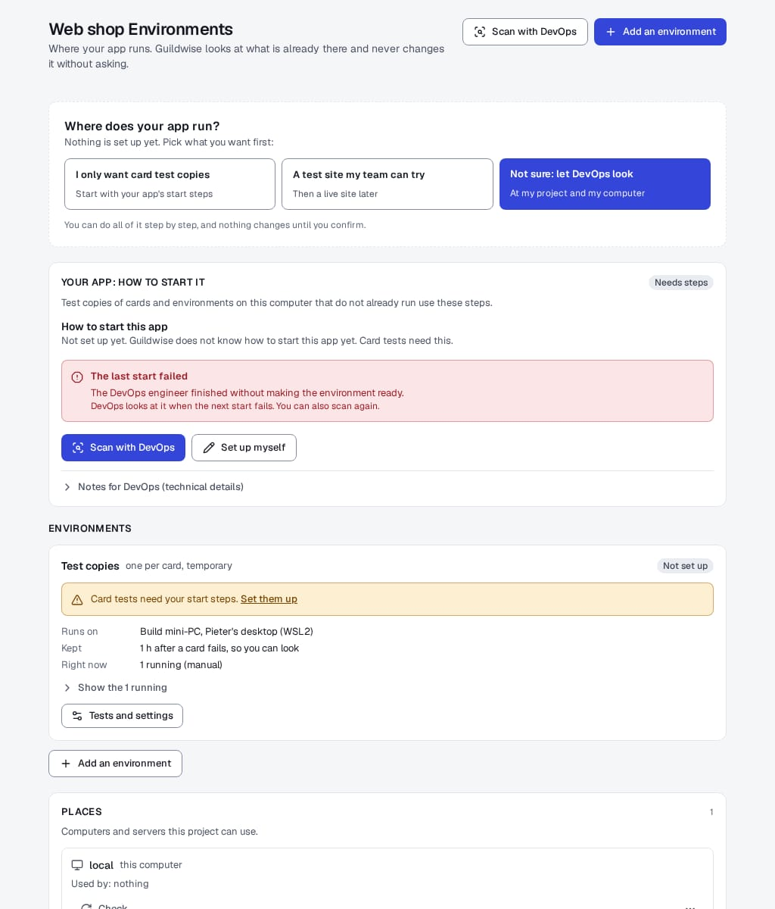

An approved setup turns "how we deploy" into something you approve once and that then runs the same way every time, **without a model running any deploy command**.

**What the setup is made of.** Behind the page is a folder `delivery/` in the **project vault** (never the organization vault), holding `recipe.yaml` and one script per environment. The recipe lists its **environments** in order (for example `local`, then `production`). Each one names where it goes (one or several of the project's **deploy targets**), the script and its arguments, **when** it runs (after a merge, after a phase, or only on request), how long it may take, the **health check** that says it worked (a web address, a port, or a line the script prints, such as `P5 DEPLOY READY`), an optional **smoke check**, the **names** of the secrets it needs, and the **gate**. It also says **who releases it** (below). A script must do the same steps every time, check itself and exit with a reason when something is wrong, be safe to run twice, and honour a dry run (`AOM_DEPLOY_DRY_RUN=1`: check inputs and access, print the plan, change nothing).

**Where the vault is.** Every project has a vault. A **git** vault is recommended: it is backed up with its repository. Without one, the project's vault is a **folder on the Owner's workstation**. Guildwise does not back it up: keep that folder somewhere that is (OneDrive, iCloud or another backed-up folder). The Vaults page says which one you have (4.3a).

**Setting one up without coding: the Environments page.** Open **Environments** (sidebar, under the board). It has one block per thing: **Your app** (how to start it), **Test copies** (one temporary copy per card), the **environments** (the **test site**, the **live site** and any extra site such as a demo), **Places** (the computers and servers), **Rules** and **History**. **Add an environment** asks four plain questions on one screen: **What is it for?** (test site, live site or something else), **Where does it run?** (a place that is already listed, or **Add a server**), **How is it started?** and **When should it update?** Guildwise then *looks* (read-only: Docker on the computer, the servers it already knows from its ssh settings, and for a server the app folder, the containers, the proxy and the backups; it never reads your keys or settings values) and lists what it found: the Docker app that is already running, or an app that runs directly on the machine (a system service, a pm2 process or a program, with its folder and port). If yours is not there, **My app is somewhere else** takes a folder, and when nothing is found the page says where it looked. A server asks one more question, **How should new versions get onto the server?**: **Build here and copy it** (the default), **Download a ready-made app from a registry**, or **Build it on the server**. For an app that runs directly, each update gets the new version, builds it in a new folder, switches to it and restarts it the way you confirmed (the service, pm2, or a command), and keeps the last versions so you can go back. Then **What we found** shows **Found and will be used**, **Each update will** (the exact steps in words), **Will not be touched** (every other container, volume and proxy, by name), and **Needs your answer** when something is unclear. **Save** writes the steps into the project's files; nothing runs and nothing is approved yet. Each environment card shows **Saved**, **Tried**, **Approved**: press **Try it without changing anything** (a dry run: it checks and prints what it would do), and the Owner presses **Approve**. Approval needs a successful try of exactly that version. A test site defaults to **Automatically after each merge** (it waits 2 minutes so a few merges become one update); the live site is **Only when I press Release**, **only after the test site is healthy on the same version** (for 10 minutes) and **I approve each release**. Guildwise only ever restarts the app part, never stops the database or the rest, backs up the database first (a failed backup stops the update), and puts the previous version back if the site does not become healthy (the database is never rolled back automatically).

**DevOps asks real questions.** **Scan with DevOps** reads the project and your computer and suggests the start steps and the environments. Its questions show as fields (a few choices as buttons, yes or no, a number or text with DevOps' guess in words), the answers are kept, and **Use this** works once each question is answered. It saves a draft; nothing changes until you save and approve.

**Places, once.** A computer or server is added once under **Places** and chosen by any environment. **Add a server** uses a sign-in this computer already has, or **Connect a new server** (see below). A place says what uses it and whether it can be reached; **Check** and **Reconnect** are there when it cannot. A place that looks like another one (same server, same computer) offers **Merge**. A place nothing uses can be **Removed** (optionally with Guildwise's own key on the server); one that is used says which environment uses it.

**Changing and removing.** **...** on an environment: **Edit**, **Change server** (point it at another place you already connected, or move the live site with its data), **Go back to an earlier version** (live site) and **Remove**. Removing says what happens and what does not: the app that runs is left exactly as it is, and the setup needs a new approval. **Old setups and drafts** under technical details cleans up an unfinished draft and files in the deploy folder that Guildwise does not make (nothing is deleted unless you tick it).

**Scan with DevOps (deploys).** Not sure what is running? **Not sure: let DevOps look** has the workstation's DevOps engineer read the project and the fixed read-only probe, and suggest the whole setup. You review it field by field (guessed parts are marked, open questions must be answered) and **Use this** makes it the wizard's draft; you still see Found / Will change before saving.

**A server with no sign-in yet: Connect a different server.** Under the sign-in question press **Connect a different server** (or **Set up a sign-in for it** next to a server that asks for a password). Choose the computer that signs in, give the server's **address** and **user name** (usually `root`; your hosting company's email has both) and **how you sign in**: **with a password**, **with a key file my host gave me**, or **my hosting panel has a place to paste a key**. Guildwise first asks the server for its **fingerprint** (its own ID) and shows it in plain words: check it against the one your hosting company shows, then press **It matches** (or **I can't check, continue**, which is marked); nothing is trusted before you confirm, and if it ever changes later Guildwise stops. A **password** is typed once, sealed in your browser so only that computer can read it, used one time to add a key of Guildwise's own to the server's list of allowed keys (one line in `~/.ssh/authorized_keys`, after a dated copy of that list), and dropped: it is never stored and never in a log. A **key file** is treated the same way. With a **hosting panel** Guildwise shows you a public key with **Copy** and the steps; paste it into the panel and press **I pasted it, test the connection**. The last step is a **connection test**. The private key never leaves the computer that made it; Guildwise never edits your own ssh settings or removes a key it did not add. For a server this computer **already** signs in to you can also press **Also add a dedicated Guildwise key (recommended)**: optional, shown with the exact change first, and the sign-in the computer already has keeps working.

**A server that is not ready: Set up this server.** When the server has no Docker, no app folder or no web address, Guildwise lists what it would **add** and what is **already there and kept as it is**, lets you **try it without changing anything**, and changes something only when you press **Set it up**: it installs Docker with the system's own packages (Debian and Ubuntu, with root or passwordless sudo), makes the app folder and a backups folder, copies the project's compose file into the folder (never over a file that is there), and sets up **HTTPS for the one address you give** with Caddy (an existing Caddy gets one site added after a dated copy and a check; nginx, Traefik or something else on the web ports is never touched and is explained). **On this computer**, **Start a new copy** does the same for a folder of its own and starts the supporting parts (such as the database) of the project's compose file under a project name of its own; what already runs is not touched. In **Details** you can add **database updates before the app restarts** (a command such as `npm run migrate`): it runs with the new version after the backup and before the restart, and if it fails the app is not restarted.

**Moving to a new computer: Reconnect.** Each server on the target cards shows whether the computer that deploys it can sign in (**Can sign in**, **Needs a sign-in**, **Cannot reach the server**, **Server identity changed**, **Never checked**), how, and when it was last looked at. A server you connected here with Guildwise’s own sign-in (password, key file, hosting panel) is looked at by itself once a day and right after a deploy to it failed; a server that uses your own saved ssh sign-in (**Use an existing sign-in**) is never looked at behind your back, only when you press **Check** or when a deploy runs. **Check** looks now. When it cannot, **Reconnect** (shown as **Use another computer** when the place can already be reached) runs the same guided flow for that server with the new computer's own key; afterwards the old computer's Guildwise key is listed with **Remove**, which deletes exactly that one line (shown by its fingerprint) from the server after you confirm. **An improved version of these steps is available** appears on the overview when Guildwise has a newer way of writing the steps; **Update the steps** saves your choices again and the Owner approves the new version. Every part, also one edited by hand, is tried without changing anything before it is approved.

**Moving to a new server: Move to a new server.** On the card of a live server press **Move to a new server**. You choose a server that is already connected, or connect a new one (the same guided steps as above), and Guildwise looks at it and sets up the folder and Docker if they are missing. Then it copies everything over while the old site keeps running: the compose file and the settings files (their contents are never shown), the app itself, and a new empty database. Nothing changes on the old server in this part. When the new server is ready you read what comes next and press **A short downtime is fine: move now**: the app on the old server is stopped (its database keeps running), a last backup is saved on the old server and kept there, the data is put on the new one, and the new app is started and checked. The site is down only for that time, usually a few minutes. If a step fails, Guildwise says whether the old site is still running; **Try again** continues, and **Give up the move** or **Go back to the old server** starts the old app again. Then comes **Point your domain to the new server**: Guildwise shows the address to put at the company that manages your web name and checks live whether the name points to the new server yet (you can also say you handle the address another way). Only the Owner presses **Make it live**: from then on deploys go to the new server, and the old one becomes a **Standby (fallback)** that nothing deploys to. Nothing is deleted on it. When you are sure, the Owner presses **Retire** on the old server: Guildwise removes only the keys it added there (the data, the app, the settings and the backups stay; Guildwise never deletes anything on a server). The Places list shows the old servers.

**Technical details** (the developer view) shows the same setup as the structured fields, the generated `recipe.yaml` and scripts, and what the computers found. **Edit the script by hand** marks that part **custom** (Guildwise leaves its script alone and the guided view shows it as a script); **Back to guided** regenerates it and needs a new approval. A recipe written by DevOps or by hand without a setup is shown as a script too. A computer whose Guildwise is too old shows "needs an update for guided setup"; the developer view still works.

**Setting one up: talk to the CEO.** Say "set up deploys for this project: local first, then production". The CEO asks about the environments and their order, which deploy targets (it asks you to confirm before creating a missing one), the triggers, who releases each environment, the gate ("use your standard rule: the test environment healthy for 30 minutes, regression passed, weekdays 08 to 16?") and the secrets, by name. Then it asks **DevOps** to write the scripts (modelled on the ones you already use), save them into the vault and **try them**: a trial of a local environment really runs; production only gets a dry run. The CEO shows you the result and the recipe's **hash** (a fingerprint of the folder).

**Approving.** On the **Environments** page you see the environments, who releases each, the gate, the lint (a secret in a file, a missing or non-executable script, an unknown target, an automatic production environment with no gate must be fixed first) and, once a version was approved, **what changed since**. Only the **Owner** presses **Approve**, and the button approves the exact hash on screen. Nobody can approve by typing a message to the CEO. When anyone edits the recipe afterwards, Guildwise notices (it re-reads the vault when it syncs, or press **Check for changes**), shows it as "changed: needs a new approval", puts a notice on your desk and **refuses every deploy from the recipe** until you approve the new version. Once an environment is approved, the **Releases** switch at the top of the page decides whether the project's releases and updates run from it (**On**) or are **Paused**.

> **In the app:** Help, "Phases and follow-ups", section "Deploying with a recipe" (`/help/phases#delivery-recipes`).

> **In the app:** watch the video "Environments: where your app runs" (Help, "Phases and follow-ups", `/help/phases#delivery-recipes`). The page's own help panel (**?** in the top bar) has it too, under **Watch the video**.

### 4.28 Releases

The **Releases** page (sidebar, Organization group; the old address `/deploys` leads here) shows, across all projects, which version is live on each site, what is waiting for you and what was released. Setting up where an app runs happens on the project's Environments page (4.27). A project whose releases are **Paused** shows a **Releases paused** badge here and on its environment cards.

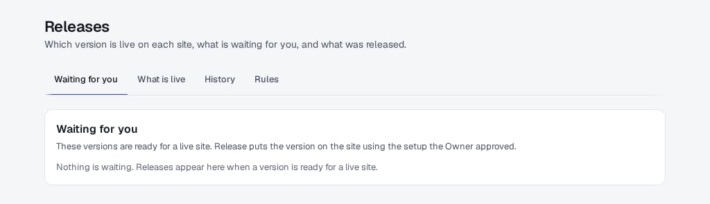

**Who releases an environment.** The recipe decides, and you approved it:
- **The Owner or an Admin** (the default): a ready release waits in the **release queue**. Nothing runs until one of you presses **Release**.
- **The CEO**: only where the recipe names the CEO, it releases by itself once the gate holds. Where text from outside (a card, a ticket, an e-mail) may have caused the request, production still waits for you.
- **Automatic**: a trigger (such as "after a merge") releases it once the gate holds. A production environment may not be automatic without a gate.
The CEO is never the releaser unless the recipe says so, and an Owner or Admin can always release.

**The tabs.** The page has four tabs. **Waiting for you** (Owners and Admins) lists versions that are ready: the version, the site and the places. Press **Release** (when a version can go to several places, **Release to N of M** releases to the ones you tick) or **Not now** to leave it for later; a release that is not allowed yet says what it waits for ("Waiting for: the test site healthy for 3 more minutes") and **Release** stays off. **What is live** shows, for every project and site, the version, since when, whether it is healthy and where it runs. **History** (it has filters) shows every recent deploy with its audit: which approved setup version, which rules held, who asked and who released, and a **Rollback** badge when an earlier version was put back. **Rules** (Owners and Admins) holds **The standard rule** of the organization in plain sentences (for example "Only on weekdays between 08:00 and 16:00"), **Freeze all releases** (press it to stop everything going live; the button then reads **Lift the freeze**) and, under **Advanced: rule sets**, the named rule presets. Owners and Admins release; everyone else sees **What is live** and **History** read-only. **Go back to an earlier version** (on the live card of the Environments page) lists the last successful releases, says that your data is not rolled back and where the backup of the newer release is kept, and puts the earlier version back at once when the Owner or an Admin confirms; it is recorded in the history.

**Gates.** A gate lists what must be true before an environment is released: an earlier environment healthy on the same commit (for some minutes), regression, end-to-end or CI checks passed, the commit being a done phase, a time window, a freeze you can switch on. A recipe names a preset (such as `standard`) or carries its own gate; a rule you bind to a project always applies on top and a recipe cannot loosen it. An unsatisfied gate refuses the release and lists everything that is missing.

**How a deploy runs.** Asking (the CEO's `aom deploy run`, a trigger, a phase follow-up, **Update now** or **Release** on an environment card, or the button in the CEO chat) only asks Guildwise. Guildwise checks that the Owner approved this exact version and that the gate holds, then sends your workstation a command pinned to the approved hash. The workstation takes the files from the approved vault version, recomputes the hash (a mismatch refuses), reads the secrets it holds by name, prepares a clean checkout of the commit, runs the script outside any model with a time limit, then the health and smoke checks. The log has secrets hidden. A refusal or failure is an answer, never a blind retry, and the CEO is told. A missing secret refuses the run and puts a notice naming it on your desk; set it on the Environments page under **Show technical details**: the value is encrypted in your browser for the workstation you choose and kept only there (like a test account of a deploy target), never on the server, in the vault or in a prompt.

**Phases.** For a project whose releases are **On**, a phase's **deploy** follow-up names an **environment** ("Release to Live site") instead of creating a DevOps request: it finishes with the deploy run (a release waiting in the queue holds the phase until you release or cancel it). While the project's releases are **Paused**, follow-ups work as in 4.10 (a DevOps request written in words).

> **Good to know:** a model only ever asks. The CEO's rights to deploy follow the recipe you approved and your CEO settings (**Authority** tab); in the chat, if its call to Guildwise is ever blocked, release from the card in the chat or the **Releases** page: it is the same server path from your session.

> **In the app:** Help, "Phases and follow-ups", section "Deploying with a recipe" (`/help/phases#delivery-recipes`).

> **In the app:** watch the video "Releases" (Help, "Phases and follow-ups", `/help/phases#releases`). The page's own help panel (**?** in the top bar) has it too, under **Watch the video**.

### 4.29 Metrics

**Metrics** (sidebar, Organization group) shows what the team delivered, where it waited on you and where quality slipped. Everybody who can see the organization can open it.

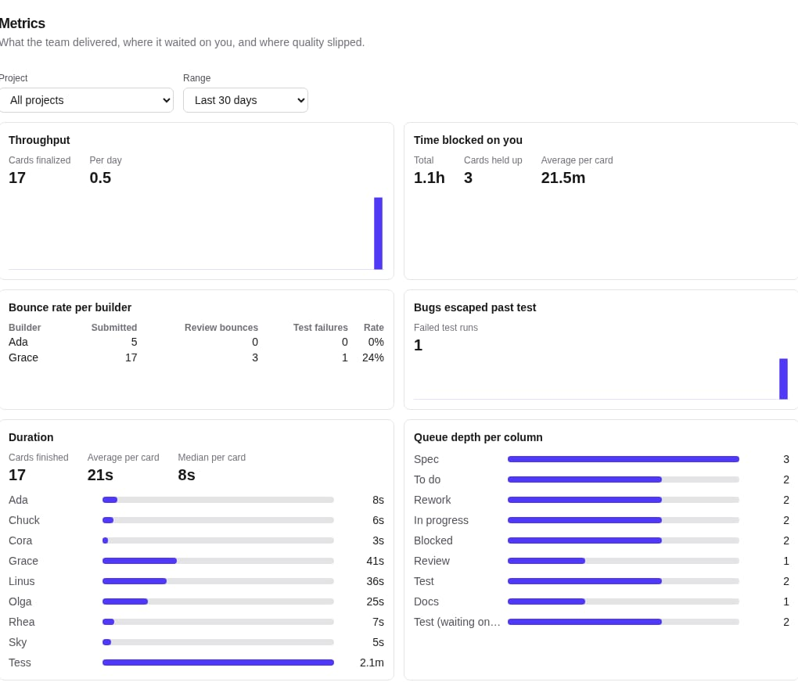

At the top, the **Project** filter (shown when you have more than one project; **All projects** is the default) and the range chips **7 days**, **14 days**, **30 days** and **90 days** decide what the panels count. The panels are:

- **Throughput:** cards finalized in the range, the average per day and a bar for each day.
- **Time blocked on you:** the total time cards waited for an answer or an approval from you, how many cards were held up and the average per card. A high number here is the cheapest thing to fix: check the Desk (4.5).
- **Bounce rate per builder:** how often a review sent each builder's work back (4.4).
- **Bugs escaped past test:** failed test runs, with a bar for each day.
- **Duration:** cards finished, the average and the median time per card, and **Shift time per agent**.
- **Queue depth per column:** how many open cards sit in each board column.

Costs have their own page (4.6).

> **In the app:** Help, "Agents" (`/help/agents`).

> **In the app:** watch the video "Metrics" (Help, "Agents", `/help/agents#hr-board`). The page's own help panel (**?** in the top bar) has it too, under **Watch the video**.

### 4.30 Your settings

**Settings** (sidebar, at the bottom; also **Your settings** in your avatar menu) is the page for you as a person, not for the organization (that is **Organization**, 4.1). Everybody has it, whatever their role.

It has these panels, top to bottom:

- **Your picture:** **Change picture** picks a cartoon face, a photo or an image of your own. It shows in the sidebar, the account menu and on the answers you give at the desk.
- **Two-factor login:** **Set up** (3.2), later **New recovery codes** and a switch-off when your Owner does not require it.
- **Expert mode for code changes:** the box **Show me branches and git controls**. Off (the default) the app talks in plain terms and takes care of branches; on it shows branch names and commit hashes, the per-card completion action and the manual merge controls (4.4). It only changes what you see, and only for you.
- **Monday briefing:** **Email me the Monday briefing**, one mail every Monday at 08:00 (organization time), on unless you switch it off (4.6).
- **Notifications:** push notifications for this browser or phone. **Enable notifications on this device** asks your browser for permission; **Your devices** lists every device and lets you remove one; **Send a test notification** checks it works. **What to notify me about** has a switch for each kind of notification, and **Quiet hours** (start and end) holds the rest back at night. On an iPhone or iPad, add Guildwise to the Home Screen first (iOS 16.4 or later). If the server has no push keys yet the panel says so.
- **Weekly blog digest:** **Email me the weekly blog digest**, one mail on Monday mornings with new blog articles. Owners get it unless they switch it off; for everybody else it is off until they switch it on (7.7).
- **Your time zone:** the zone your reports and times are shown in. It was taken from your browser the first time you signed in; **Use this browser's zone** resets it. The time your CEO writes the daily report is not set here: it is on the CEO page, **Reporting & alerts** tab (4.22).

> **In the app:** Help, "Two-factor login" (`/help/two-factor`) and "Getting started" (`/help/getting-started`).

> **In the app:** watch the video "Your settings" (Help, "Getting started", `/help/getting-started#your-settings`). The page's own help panel (**?** in the top bar) has it too, under **Watch the video**.

## Discovery: from an idea to a PRD

**Discovery** (sidebar, every member) turns an idea into a brief or a PRD. Click **New discovery**, give it a title and optionally a starting idea, a project, the workstation it runs on (one of yours), a **time limit** and a **cost limit** (both optional; empty means no limit), and choose how the analyst works (Facilitator, Partner or Ideate for me) and whether the CEO takes part (just you, with the CEO, or CEO prepares first; for the last, **CEO pre-draft turns** sets how many turns the CEO takes before you review, 12 by default, 2 to 40). The analyst asks one question at a time: pick a quick answer, write your own, skip it or park it. The CEO's answers are shown as proposals that you confirm, edit or override. Proposals from the analyst change nothing until you click **Apply**. The side panel keeps ideas, assumptions, open questions, decisions and parked items, and you can edit all of them. **Pause** any time and come back later. The page shows the cost so far; when a cost limit is set and used up, no new turn starts until you raise it. In the Capture phase the analyst writes the PRD in the **Draft** panel: validate it against the checklist, approve it, and click **Hand to BA** to start an intake whose cards link back to the PRD. **Documents** lists every brief and PRD with its versions.

**Who manages a session.** A session belongs to the member who started it, who manages it in full: answers and proposals, the phase, pause, drafts and validation, **Hand to BA**, editing the panel, the limits, **Archive** and **Delete**. Owners and Admins who are in the session can do the same. Other participants can talk, add notes and see everything, and the page hides the controls they cannot use. A session runs on one of the creator's own workstations.

**Time limit.** Set one when you start (or later in the session's settings) and the page shows a countdown, like a meeting; paused time does not count. About 5 minutes before the end the page warns and the analyst steers to wrap-up. At time-up nothing new starts, and the creator chooses **Extend +10, +15 or +30 min** or **Wrap up now**, which moves to Capture so the analyst writes down where you got to. Nothing silently overruns, and the clock survives a server restart.

**Hand to BA when no BA is free.** If no BA's workstation is online, the PRD is handed off anyway and the intake starts by itself as soon as a BA is online. If the organization has no BA, the session offers **Hire a BA** (one click, the built-in BA role) and the Desk gets a notice. A retry never makes a second intake for the same PRD.

**Archive and delete.** **Archive** makes a session read-only (**Reopen** undoes it). **Delete** removes the session and its messages from every list; the creator or an Owner or Admin can do either.

## Boardroom: a debate with a Chair

**Boardroom** (sidebar, every member) puts one question to a group and lets a **Chair** run the debate. Click **New boardroom**, write the topic and an optional brief (context, constraints, and the options if you want them scored), and pick a format: open discussion, pre-mortem, red and blue team, six hats or option scoring. Every boardroom has two fixed seats that cannot be removed, the **Optimist** (argues the upside and why it can work) and the **Devil's Advocate** (attacks edge cases and failure modes), plus three or four other seats (five or six in all) from library personas (user advocate, creative strategist, cost hawk, security, ops, small-business customer), your own agents, and personas cast from a one-line brief; **Suggest a cast** asks the Chair to propose those other voices, and **Save this cast as a room** lets you reuse it. Pick the workstation (one of yours), an optional **round cap** (1 to 50; empty, the default, means no cap), an optional **cost limit** and **time limit** (empty means none), and the models if you want to choose them (cheap by default, stronger for the minutes).

**Time and archiving.** The time limit counts while the room waits for your decision, and you get a push notification at the warning (a third of the limit, at most 5 minutes before the end) and at time-up. Archiving a running boardroom asks you to confirm: it ends the room first (the minutes are written) and then archives it; the server enforces this for every client.

In round 1 every seat answers on its own, seeing only your topic and brief. The answers stay sealed until the last one is in and are then revealed together. After that the Chair picks two or three speakers per round (never the same speaker twice in a row; the line **Chair picks** says who and why), calls a dissent round when the answers agree too easily, records disagreements without reconciling them, and stops with a decision card when only you can decide. Replies are kept short. Interject at any time in the box at the bottom; type **@** to call on a seat (or **@all**): a mentioned seat that has not spoken in the current round speaks next, ahead of the others in the plan (one that already spoke waits for the next pick). The **whiteboard** has Ideas, Risks, Questions, Decisions and Parked; the seats add notes, and you can add, edit, drag to another column, vote +1, merge and delete. In the option-scoring format each seat scores every option from 1 to 5; a table on the whiteboard and in the minutes shows the scores per seat, the totals and the averages. The meter shows the cost so far and what the next round is estimated to cost; with no cost limit the session is unlimited, and when a limit is set and used up, no new turn starts until you raise it. If it runs out before the Chair can write the minutes, nothing is written silently: you choose **Write minutes without the Chair's summary** or **Raise the limit**. A **time limit** shows a countdown, the Chair moves to a final round about 5 minutes before the end, and at time-up you choose **Extend +10, +15 or +30 min** or **Wrap up now** (the minutes). Paused time does not count. With no round cap the Chair steers the room to a close: when two rounds in a row add nothing new to the whiteboard it stops with an **End here?** decision card (End and write the minutes, or Keep going) instead of looping; choosing to end has the Chair write the minutes at once. **Pause** stops anything new from starting. **End session** (or the time limit, the cost limit, or a round cap if you set one) has the Chair write the **minutes**: the topic, the cast, each position, agreements, the unresolved disagreements, your decisions, the whiteboard and the open questions, saved in **Documents**. **Pull into PRD** starts a Discovery session in the capture phase (with your CEO, if you have one) with a PRD draft seeded from the minutes. As in Discovery, you manage the boardroom you started; others in it talk, add notes and vote; Owners and Admins in it can override; the creator can **Archive** or **Delete** it.

### Choosing providers and models for Discovery and Boardroom

Agents and cards always run on Claude Code. Discovery and Boardroom conversations can also use **direct API models** (Anthropic's API, OpenAI, Google Gemini, or an OpenAI-compatible endpoint such as OpenRouter or Ollama). They are conversation only: no shell, no files.

1. **Add a key.** Workstations, open your workstation, **Model providers (direct API)**, **Add key**. The key is encrypted in your browser for that workstation's runner and kept only there; calls go from the workstation straight to the provider. For an OpenAI-compatible endpoint also enter its address (a local Ollama needs no key; the form warns about an `http://` address that is not on this computer, because the traffic is not encrypted, and the operator of the endpoint you choose sets its terms). Long credentials, such as a Google service-account JSON for Gemini, work too: the browser encrypts them in parts for the runner. To use a model server on your own network (a LAN Ollama or LM Studio), the workstation's owner lists its exact address under **Private endpoints** in the same section (for example `192.168.1.12:11434`); it is off by default, takes no wildcards or ranges, and also lets that workstation's agent sandboxes reach it. Chat history of direct models stays on the workstation for 90 days (the runner's `directChatRetentionDays` changes it). A model missing from the list can be added under **Extra model ids**.
2. **Pick models.** **New boardroom** has a model per role and per seat, and seats can use different providers. **New discovery** has **Facilitator model (optional)**. The CEO chat's model chip lists direct models as "Conversation only" (the CEO cannot take actions on them).
3. **Costs.** Models are priced from a built-in table; a model without a price shows "Cost unknown for N turns" and is not counted in the total or the limit. An Owner can set a price for such a model (a local one, for instance) under **Settings, Model providers, Prices for other models** (provider, model, input and output dollars per million tokens): later turns are costed with it and marked **Owner-set**; past turns are never repriced. Anthropic prompt caching is on for these conversations (OpenAI and Gemini cache automatically), and cached tokens are priced and shown separately.
4. **If it does not start**, "X is not set up on this workstation" means that provider's key is not on the workstation the session runs on.

### Other runtimes and model providers for agents

Agents can run on more than a Claude subscription. In the hire form and **Move agent**, the model list shows what each workstation offers; a runtime or model that cannot take the role is greyed out with the reason (for example "this role runs browsers, which the Gemini CLI sandbox does not open"). The rule is the same everywhere: hiring, moving an agent and the CEO's raise-model action.

- **Claude Code on Amazon Bedrock, Google Vertex AI or a gateway.** Under **Workstations, your workstation, Model providers**, add the backend's credentials (region and key, project and service account, or the gateway's address and token). They are encrypted in your browser for that workstation and used only for agents whose model starts with `Bedrock`, `Vertex` or `Gateway`. Everything else works as on a subscription, except the DevOps engineer and the CEO, which need your own Claude login. **Caution for gateways:** Claude Code is built for Claude models, so other models behind a gateway may use its tools less reliably, and Anthropic does not support that setup. Try it on a small card first.
- **Gemini CLI and opencode.** If the `gemini` or `opencode` program is installed on the workstation (and the runner can use its sandbox), the runtime appears there. Gemini signs in with your Google login on that machine, or with a Google key. opencode uses the keys under Model providers. They take builder, reviewer, planner and similar roles and read-only roles; they cannot take testers (browser), writers and architects (limited paths), DevOps or the CEO. Costs of models without a price are shown as unknown.

**Organization model provider keys.** **Settings, Model providers** (Owners and Admins) holds keys that every workstation of your organization can use, with an optional **monthly spend cap** per provider. Add a key, choose the workstations it should reach (it is encrypted in your browser separately for each, so the server never sees it), and set a cap. A workstation that joins later gets the key when you enter it again or click **Share to this workstation**, which a runner that already has the key completes after you approve. **Revoke** removes the key everywhere. A key set on a single workstation always wins over the organization's key and is never capped; the workstation page says which key is in effect. The page shows this month's spend against the cap; at 80% and 100% a notice appears on the Desk. At 100%, runs on the organization's key stop at once, not only new ones: running shifts, session turns and chats on that key are cancelled as the usage they report reaches the cap, the card or session says so, and new runs do not start (`provider_cap_reached`) until you raise the cap, override it for this month, or run on a workstation with its own key. Turns whose model has no price are counted as unknown and flagged, not guessed.

### Capabilities and packs

**Settings, Capabilities** lists everything agents and sessions can use: skills, personas (voices for the Boardroom) and playbooks, with where each comes from (built in, your organization vault, a project's repository, or an imported pack) and whether it replaces another. A role's **Skills** list is picked from this registry.

**Packs** import more from a git repository (Owners and Admins). Click **Add pack**, enter the repository URL and a tag or commit (any repository of skills in the Agent Skills format, folders with a SKILL.md, works; the licence and copyright line from its LICENSE file are shown on the pack). Every pack is read the same way: folders with a SKILL.md are skills, `personas/*.md` and `.claude/agents/*.md` are personas you can seat in a Boardroom, `playbooks/<name>/workflow.md` folders are playbooks, and a skill whose front matter says `metadata.kind: agent` becomes a persona. An optional `pack.yaml` (or `pack.json`) lists `agents:`, `playbooks:` and `skills:` that sit elsewhere, and can label a playbook `discovery` or `template:brief` / `template:prd` so a new discovery offers it. Whatever does not fit is imported as a plain skill. A workstation fetches the pack and pins the exact commit. A pack added to one project applies in that project's Discovery and Boardroom sessions.

Nothing in a pack can be used until you approve it. **Review** shows every capability, every file (script files are flagged) and what the importer left out; **Approve this commit** unlocks it. Scripts stay off unless you switch on **Enable scripts** for the pack, and they then run only inside the agents' sandbox. Agents are told that pack text is outside content: it can guide a task but cannot change their rules. If a file changes on a workstation after you approved, the pack is switched off there and the page says so. **Check for updates** (one click, or **Check another tag**) fetches now and shows a diff (added, removed and changed capabilities and files, new scripts highlighted); the pack only moves to it when you click **Accept**. A pack you approved stays approved at the accepted commit, with scripts off again if the update touched them. **Remove** deletes the pack.

**Delegation is off by default.** No agent, facilitator or Chair hands work to anyone until you say so. To allow it, open an agent's card (**Agents**, or the HR board) and click **Who it may delegate to**, or open a Discovery or Boardroom session and click **Delegation** (the creator of the session, an Owner or an Admin can). Choose a persona or one of your hired agents, how many calls a turn it may make (up to 8), how many seconds each may take, and optionally the most its tools may be (read only, edit files, edit and run commands). Only an Owner, an Admin or the agent's manager changes an agent's list; everyone who can see the agent or the session sees it. A new grant takes effect on the agent's next shift, chat or turn.

A target **runs on the model you configured for it**: a persona's own model (a built-in persona on a workstation without that model, or a persona with none, uses a small model of the caller's runtime), or the model of the hired agent. The agent that delegates cannot choose another model, and `--model` is refused. A target's tools come from the persona's tools profile or the hired agent's permissions, and **never exceed the caller's**: a chat, a session turn or a read-only role only gets read-only children; an agent that may edit and run commands gets children that work in its own worktree under its own limits (one writing child at a time, and the agent waits for it). Children do not commit or push. Everything they use is booked on the agent, the card or the session and counts against the project and session budgets and the provider caps (a running child is stopped when an organization key reaches its cap). A child cannot delegate further.

Every delegation shows as a **sub-step**: on the card's timeline, and under **Delegated work** in the session, with the target, the model, what the tools could do, how long it took, what it cost and the first lines of its reply. For an agent running on Claude Code the same targets also run as Claude Code subagents (marked as such); Claude Code's own subagent types are switched off for every agent, whatever it was granted. Agents hired before this release have no grants, so they stop delegating until you grant them. **Grants for a whole role.** In the Org designer, open a role and use **Who agents of this role may delegate to**: the grants there cover every agent of the role, including agents hired later, and show as inherited on each agent's card. An agent's own grants add targets; they never take away the role's. Only Owners and Admins change a role's grants. **Model.** A grant may set the model the target runs on for that caller (it must be one the workstation offers and suit the target's role); the caller still cannot choose. **Narrower runs.** When a target would need more than its caller may do, it runs with fewer tools and the card says so.

**My capabilities** (every member) is where you write your own. Create a pack, choose where it lives (**Private to my workstation** or **The organization**), then add skills, personas and playbooks in the editor; the page checks them as you type and blocks saving on errors. A skill can carry reference and asset files, and script files that stay off until the pack is approved and scripts are enabled. A persona has a name, icon, stance, voice, an optional model and a **tools profile** (read only, read and web, read and edit, read edit and shell) that decides what an agent hired from it may do. A playbook is a workflow with ordered steps. **Save to workstation** stores the pack in the standard layout on your workstation (the server never gets the text) and **Export as zip** gives a folder you can push to git unchanged. A **private** pack is yours alone: nobody else sees it anywhere, and it is used by your own sessions and by agents on that workstation that you tick under **Agents that may use it**. An **organization** pack is reviewed first: an Owner or Admin approves that exact version under **Packs** (an Owner or Admin can approve their own with **Approve this version myself** when saving), and the workstations chosen for it receive the files from yours.

**Project packs follow your sessions.** When you start a Discovery or Boardroom session in a project on a workstation that does not yet have the project's approved packs, you get a question on your Desk to let it have them (a pack that needs a deploy key is placed by an admin instead). If you say no you are not asked again for the same pack on that workstation for 30 days.

**Private repositories.** When you add a pack from a private git repository, tick **This is a private repository** and paste a deploy key (for an ssh URL, a private key without a passphrase) or an access token (https). Your browser encrypts it separately for each workstation you pick; each runner stores it for that one pack and uses it only to fetch it, and the first fetch over ssh records the host's key and insists on it afterwards. A pack put on another member's workstation shows up on their desk (and under **My capabilities**) as **Allow the pack on this workstation?**; nothing is downloaded until they accept, and declining takes the workstation off the pack. **Workstations…** on a pack changes who holds it.

**Hire from a pack.** On an approved pack, **Hire from this pack** (or **Agents, Hire from a pack**) turns personas into agents. Tick the personas or click **Add all agents from this pack**, check the list (the tools each would get, and what was withheld because you may not grant it), choose the workstation and model, and confirm. Each agent carries a tag such as *ACME · analyst · v1.2.0* on the Agents page, its page and its chats. If the pack later changes a persona you get **a new version is on offer** with a line diff of the instructions; nothing changes until you accept. If the pack loses its approval or is removed, its agents keep working and show a warning.

**Reviewing an organization pack.** Owners and Admins can **Read the text** of an organization pack its author wrote, before approving it: the text is read from the author's workstation and encrypted for your browser only, the server never holds it, and the author's workstation cannot read the reply. Below it a **diff** shows what changed since the version that was last approved.

**Members can hire from packs.** On the Agents page, **Hire from a pack** is open to Members within what they may already hire: projects they are on, workstations of their own.

**Chat with a persona.** **Chat** on a persona (Registry, or the Boardroom cast picker) opens a one-to-one chat on your own workstation, on the persona's model or one you choose. The persona can read skills and search the ledger and does nothing else; a reply that cannot run now waits for your workstation, and the cost is counted with your other costs. A private persona is only yours.

A project's own `.agents/skills`, `.claude/skills` and `.claude/agents` are picked up the first time an agent works in that repository and appear in the registry for that project. **Settings, Capabilities, Project skills** is their review list: for each one the project, repository, path and content hash, with **Mark reviewed**, **Block** and **Clear**. A blocked skill or persona is unusable everywhere; one that changed since you reviewed it shows **changed** and needs a new review. **A skill or persona from a project repository cannot be used until you have reviewed it** (in the registry, in what agents load, in sessions and as a delegation target): new and changed ones are listed on the Project skills tab as **needs review**, and a notice on the Desk says how many are waiting for each project.

### Starter gallery

**Settings > Capabilities > Starter gallery** lists a short, curated set of built-ins with a one-line outcome each: the playbooks *Product brief*, *Brainstorm*, *Release notes*, *Weekly status*, *Pull request triage* and *Incident follow-up*, and the personas *Analyst*, *Devil's advocate*, *Security reviewer*, *Operations* and *Cost hawk*. In an organization that has not hired an agent or started a session yet, the same list shows at the top of **Agents**. **Run it** starts a guided session on a playbook. **Hire it** shows the persona as a draft you can edit, then the normal hire dialog; nothing is hired before you press **Hire**.

### Playbooks and the / menu

A **playbook** is a step-by-step guide an agent facilitates with you (a brief, a PRD, a brainstorm, for example a workflow from a pack that breaks a PRD into epics and stories). It is not a project workflow: a workflow moves cards through stages, a playbook is a guided conversation.

Type **/** in the message box of any chat (an agent, the CEO, a persona) or of a Discovery or Boardroom session, or click the **/** button next to it. The menu lists the playbooks and skills you may use, with their descriptions; keep typing to search. You see built-in ones, your organization's approved ones, your project's, and your own private ones. Nothing from a pack that is not approved appears, and nobody else sees your private packs.

- **A skill** puts an instruction into the box ("Use the skill ... "); add what you want and send.
- **A playbook in a chat** puts an instruction into the box asking the agent to run it with you step by step in that conversation. Edit it and send. The agent loads the playbook itself, says which step you are on, asks one question at a time and applies nothing without your go-ahead.
- **Text after the command is the input.** Type the command and what you want out of it, for example `/brainstorm pricing for teams`: the menu shows what it will use, and Enter puts it into the instruction (in a chat), starts the session with it as the starting idea (in a session box) or appends it to a skill's instruction. Text that only happens to start with a slash is sent as it is.
- **A playbook as a new session** (the **As a new session** button in a chat, or a click in a session's menu) opens a guided Discovery session on that playbook: question cards, the side panel, proposals you Apply, Reject or Redirect, and drafts saved as documents. The page shows the playbook's steps and the one you are on.

**Agents can start a playbook too, only if you allow it.** On an agent's card, **Playbooks it may start** lists none by default. An Owner, an Admin or the agent's manager can add playbooks. An allowed agent runs `aom playbook run <key>`; that opens a guided session owned by **the person the agent is chatting with** (when they are in the organization and may use that playbook; otherwise, and for work on a card, the agent's manager), a notice on their Desk links to it, and nothing happens until they answer. An agent can start at most three a day, and never one it was not allowed.

## 5. For Members

A **Member** works inside the projects an Owner or Admin has added them to. You do the day-to-day work: write cards, answer questions, hire your own agents and follow the board. You do not manage the organization.

### 5.1 What you can do

| You can | You cannot |
| --- | --- |
| See the board, desk items and cards of **your** projects | See other projects, create a project or change the priority order |
| Create and edit cards, and comment | Add or remove people, or change project settings |
| Move, release, cancel or reopen **your own** cards | Manage cards of other people (ask an Owner or Admin) |
| Answer questions on your own cards | Answer project-level decisions (Owners and Admins do) |
| Pair **your own** workstation and hire agents on it, for projects you are on | Hire agents on someone else's workstation, or widen an agent's permissions |
| Change or fire the agents **you** hired | Change other people's agents |
| Chat with the agents allowed on your projects | See Costs, Intake, Plan and limits or the Invitations tab |
| Create interests, and automations inside your projects (event automations make draft cards) | Create automations that act for the whole organization |
| Turn on two-factor login, and leave the organization | Change roles or remove people |

The **Members** list under **Organization** is visible to you, read-only.

### 5.2 Your first day

1. **Sign in** and take the tour (3.1 to 3.3). Turn on two-factor login (3.2).
2. **Open the board** of a project you were added to. The sidebar's **Board** entry opens the project you used last. The project switcher at the top of the page changes project.
3. **Create a card** (3.7), or ask the BA in a chat to draft one for you. Only cards you created, or that were assigned to you, show actions such as **Move** and **Cancel**.
4. **Answer questions.** The desk shows questions about your cards. Questions about other people's cards are read-only for you, unless the project's decision policy allows any member to answer.
5. **Use your own computer if you like.** Under **Workstations** you can add a workstation (3.4) and hire agents onto it. Those agents work for the projects you are on, and for no one else. Hire them with the allow-list limited to the projects you are on.

### 5.3 Good habits

- Write cards like a briefing to a new colleague. A clear card is the cheapest way to get good work.
- Use the **Chat** button to ask the BA when you are unsure how to phrase something.
- Check the desk once or twice a day. Blocked cards wait for answers, and waiting costs time, not money.
- Keep an eye on the budget bar in the board header. If the project nears its budget, tell an Owner or Admin before the pause starts.

> **In the app:** Help, "Board and cards" (`/help/board-and-cards`) and "Your desk" (`/help/desk`).

## 6. For Guests

A **Guest** is someone from another organization who was invited to work in one project of this one. You keep your own organization and your own account. The invitation adds one project, and nothing else.

### 6.1 Accepting the invitation

1. Sign in with the account the invitation was sent to. (There are no guests without an account in some organization. If you have none, ask for a Member invitation instead.)
2. Open **Projects**. At the top, the **Project invitations** inbox names the organization that invited you. Click **Accept invitation**.
3. The project now appears in your project list with a "Guest" label and the other organization's name. The organization switcher in the sidebar lists it under "Guest in".

### 6.2 What you can do as a Guest

- See the project's **board** and its cards, create cards, comment and answer questions on your own cards.
- **Chat** with the agents that work on this project.
- **Hire agents onto your own workstations**, for this project only. An agent of yours never works on the host organization's other projects, whatever its allow-list says.
- Leave the project when you are done.

### 6.3 What you cannot do

- You see **nothing at organization level**: no org settings, members, costs, org chart or agents of other people.
- You cannot change project settings, add people or archive the project.
- You cannot see the host organization's vaults, ledger entries that belong to other projects, or other projects at all.
- You never see the money: a paused project shows only that it is paused, not the amounts.

If you are removed from the project, the agents you hired for it move back to the owner of the project, and cards they held go back into the queue.

## 7. For the platform administrator

The **platform administrator** (also called the **super admin**) runs the Guildwise HQ service itself, not any one organization's work. You sign in at the same address as everyone else, but you see only the **Platform** area. You can never see an organization's cards, desk, vaults, ledger, chats or agents. That is by design.

> **In the app:** watch the video "The platform area" (Help, "Organizations and roles", `/help/organizations-and-roles#platform-area`). The page's own help panel (**?** in the top bar) has it too, under **Watch the video**.

### 7.1 First sign-in and two-factor login

A platform account is created on the server with a command (see `docs/SELF-HOSTING.md`). At your first sign-in the app holds you at the two-factor setup: type your password, scan the QR code, type the first code and **save the ten recovery codes**. Two-factor login is mandatory for platform accounts. If you lose your password, use **Forgot your password?** on the sign-in page like everyone else (your two-factor code is still asked), or another platform administrator can send you a reset link (7.4). If the second factor is lost too, an operator resets it on the server (`superadmin-reset-password --reset-two-factor`).

### 7.2 Organizations

**Organizations** lists every organization with its status (trial, active, suspended, cancelled), its Owner, its plan and its usage (members, workstations, agents, projects). Click one for its detail page.

On the detail page you can:

- **Suspend** an organization (unpaid, trial over, licence date passed). Running shifts finish and nothing new starts. Scheduled runs are skipped and recorded. A banner explains it. Only the Owner can still sign in, with read access plus organization settings and members. **Reactivate** it and everything resumes where it stopped.
- **Cancel** an organization.
- Change the **plan, limits, licence date, grace period and feature switches** (Interests, Integrations and intake, Outbound updates, Research, Phases, Browser tools, Custom roles and workflows). Every change needs a **reason**, and it goes into the audit log. Organizations you invite start on **Founding** (free, no limits) until their Owner chooses a paid plan; self-service sign-ups use **Starter**, **Team** or **Business** (4.17); **Unlimited** is assigned from the organization's **Billing** panel.
- **Transfer ownership** to one of the organization's Admins, for example when the Owner left the company. This needs a written reason and is audited.

### 7.3 Invitations: starting a new organization

Most new customers sign up themselves on the website (3.1). **Invitations** is for starting an organization for someone yourself. Type the **Owner's email** and the **organization name** and click **Send invitation**. The invitee receives a link, chooses a name and password, and becomes the Owner of the new organization (they may rename it). Invitations can be resent or revoked from the **All invitations** list.

### 7.4 Accounts

**Accounts** lists every login. You can **deactivate** and reactivate an account. Deactivating someone unlinks their workstations, parks their agents and releases cards they held. You can also **reset a person's two-factor login** if they lost their phone and their recovery codes. **Send reset link** emails the person a one-time link to choose a new password (valid for an hour); the page shows when the last link was sent, and the send is recorded in the audit log. It also works for other platform administrators. Organization Owners and Admins cannot send links, but they can give a member a temporary password (4.15). The last active Owner of an active organization cannot be deactivated. Transfer ownership first.

### 7.5 The Support inbox

**Support** collects every **Contact us** request from every organization and from visitors who are not signed in (chapter 10). Filter by status (open, answered, closed), type or organization, and search by reference, name, email or subject. Open a request to see who wrote, from which organization, the page they were on, the app version, browser and recent errors, and any screenshot. Then **reply** (the reply is emailed to the person and shows under **Help, My requests** in the app) or **reply and close**. A reply to an answered or closed request from the person reopens it. When inbound e-mail is set up (see DEPLOY.md), the person can also answer by e-mail: every support mail carries a private reply address (`support+<token>@<inbound domain>`), their answer is added to the request as their message and reopens it, and a new e-mail to the support address `support@<inbound domain>` (forward your support@ to it) opens a new request that is acknowledged like the Contact us form. Automatic replies are ignored and never acknowledged.

**Everything that lands on this console is emailed** to the support address(es): new requests, Contact us messages and a person's reply or reopening on a request, always. Two more notifications are switches under the addresses, off until you turn them on: **New organizations and sign-ups** (an organization is created or an invitation is accepted) and **Platform audit events** (one mail per audit entry; switching it on starts from now, the history is not mailed). Each event sends one mail.

At the top, set the **notification addresses** (one address or several, separated by commas). The **support address** receives new requests from signed-in users and every follow-up; the **Contact us address** receives the messages visitors send from the public Contact us page, and falls back to the support address when empty. Both are emailed with the writer's address as Reply-To, so your team can work from its own mailbox as well. The person who wrote in gets an acknowledgement with their reference, what happens next and when to expect an answer (within 24 to 48 hours).

The **Landing-page assistant** panel on the same page turns the public **Ask Guildwise** chat on or off, shows today's messages and spend against the daily budget, and lets you change that **Daily budget** (it starts at $2 a day; **Use the default** puts it back). It is paid by Guildwise, answers in English from the reviewed product facts (`docs/assistant/product-facts.md`) and an outline of the help articles, and keeps no conversations.

### 7.6 The audit log

Every platform action (suspending, plan changes, invitations, ownership transfers, resets) is recorded in the **Audit log** with who did it, when, and the reason given. It is kept forever and cannot be edited. Filter it by action.

### 7.7 The blog, API keys and social sharing

**Blog** is where the Guildwise HQ blog is run (details for the blog API used by outside tools: `docs/BLOG-API.md`).

- **Writer.** The blog writes itself on the Guildwise server: switch the **Writer** on (it is off by default) and it writes 1 or 2 articles a day (08:00 and 15:00 Johannesburg) from your **topics** list, researching each on the web, and sends them to the review queue. It uses the platform Anthropic key (the landing assistant's) and has its own **monthly cap** (default $10, searches included); before each article it checks that this month's spend plus one more article fits, otherwise it skips the article and mails you once that month. The panel shows this month's spend, every run (tokens, searches, cost, errors) and **Write one now**. The model is Claude Haiku 4.5 by default; another model needs its price entered first.
- **The switch.** *Switch the blog off* is the kill switch: the writer and API tools are refused when they create posts (the API answers 503), nothing is published (by you or automatically), and no digest or social post goes out. Public articles stay readable. Switch it on again to carry on.
- **The review queue.** Posts arrive *In review* (the badge on **Blog** counts them). Open one to read it exactly as it will look, edit it, then **Approve and publish** or **Reject** with a reason. You review every post until the date under **Auto-publish starts on** (by default two weeks after the first post). After it, a post with no content warning publishes by itself once it has waited the **hold** (3 hours by default). A post with a warning (for example a link that is not in its sources) always waits for you. **Unpublish** takes a post down.
- **Weekly digest.** On Mondays at 08:00 (Johannesburg) one mail goes to every organization Owner who has not opted out and to everyone else who opted in. Nothing is sent in a week without new posts. You can switch it off, send a test to yourself and see what each week did.
- **API keys.** The blog's outside tools use the keys on their own page, **API keys** (7.11); the built-in writer needs none.
- **Social sharing.** Paste the credentials of each network (stored encrypted and never shown again): the Facebook Page and LinkedIn organization tokens; for X the API key, API secret, access token and access token secret of a developer app with "Read and write" access (X charges for API use, so keep credit on the account); for Bluesky the handle and an app password from Settings, App passwords. Each article gets a caption per network, taken from its summary when missing. Published articles are shared automatically. If a token is refused or about to expire you get an email and a banner, and that network pauses until you paste a new token. Unpublishing does not remove a post that was already shared.

Everyone else reads the blog under **Help**, **Blog**, and can turn the weekly digest on or off under **Settings**.

> **In the app:** the platform area has its own Help (`/platform/help`): the full Help centre with its articles, the glossary and the tour, but without Contact us and My requests (you answer those under Support, 7.5). Platform accounts get their own tour, one step for each entry of the platform menu (Appendix A).

### 7.8 Simulation organizations, demos and deleting them

A **simulation organization** is a safe sandbox for testing (for example your family member trying the product) and for demos. Everyone in it sees a **Simulation** banner. Its agents run on a **Simulated workstation** hosted by Guildwise, so nothing real is built, no model is used and nothing is billed. A hire there without a chosen runtime is a mock agent (no real model), and commits there carry a built-in simulation identity when the project has no **Commit as**. Repositories added there are throwaway copies on the server, whatever address is typed, and repositories that the BA or a DevOps engineer asks for are simulated the same way (you still approve the request on the desk; nothing is created on a git host). Chats are answered with prepared replies for typical questions (status, scope, acceptance criteria, estimates, risks, tests, deployments). Emails still go out, with **[Simulation]** at the start of the subject whenever the email is about the simulation organization (an invitation, a support request, a notice), even for someone who also belongs to a real organization. Your own workstations receive no work from it.

- **Create one:** on **Invitations** tick **Simulation organization** and invite the Owner. Or open an existing organization and switch **Simulation** on. That works only while the organization is **empty**: no projects (archived ones count) and no active billing subscription. Otherwise you get a clear message and should invite a new simulation organization instead.
- **No way back:** a simulation organization cannot be switched off. It stays a simulation until it is deleted, so test data can never turn into a real organization. Only the pace can change.
- **Pace:** Fast (tests), Normal or Slow (demos, so people can watch cards move).
- **Load demo scenario:** on an empty simulation organization it adds two projects with repositories, a team for each, cards at several priorities, two desk questions, a draft idea and a schedule. It refuses when the organization already has projects.
- **Delete simulation organization:** removes the organization and everything in it, including its history. You type its name to confirm. Accounts that belong only to it are deleted so their email addresses can be used again; accounts that also belong elsewhere only leave this organization. The audit log keeps a short record. The server does not back up the database for you: on a live system take a backup first (`docs/SELF-HOSTING.md`).

### 7.9 Platform team: Guildwise repairs itself

Guildwise repairs itself with a normal team. You, the platform administrator, only pick which organisation and project run it; the approvals and reports land on **that organisation's desk**, not yours.

**Set it up.** Platform, Platform team: choose one existing organisation and paste the id of one of its projects (Project settings shows it), then Designate. The project keeps its decisions at project level. Until you do, bugs are recorded but no cards are filed. Clear removes the designation.

**What happens automatically.**
- Runner crashes, server errors, loops (a card failing 3 times, or asking question after question), rejection storms on a workstation and failed role self-tests become one bug card per problem in the platform project, with a counter ("seen 10 times"). The platform architect triages it: close as invalid, or set a severity and a fix size and design the fix, then the normal flow runs (review, test, deploy).
- A **critical** bug (a stage cannot complete, or the same failure 3 or more times) pauses only what it hits: that project and stage, or that workstation. You see a banner on the affected project and a badge on the workstation; running shifts finish, new ones do not start. It resumes by itself when the bug card is done, or from Platform team, Resume. The platform project itself is never paused.
- Every pause, resume, deploy and approval is a note on the platform organisation's desk.

**Deploys.** A fix that passed review, tests and UAT may go live without anyone's consent when it only unpauses current work; the platform organisation is told. A **high-risk** fix (login, permissions or secrets; data or migrations; organisations or billing, decided from the files the fix changes) and any deploy with **downtime** wait for the platform organisation's approval on its desk. Every deploy is in the audit trail (version, risk, who approved, how to roll back). The deploy script asks `POST /api/platform-team/deploy/check` and records with `.../deploy/record`; Guildwise does not deploy anything itself.

**Client privacy.** A bug that hit another organisation shows the platform team only a cleaned-up error (error type, function and file names, counts, versions): no paths, secrets, card content or user data. The team can ask that organisation for more of one bug; the Owner or an Admin approves on their desk, the access lasts 24 hours at most 72, every read is logged and they can revoke it at any time (Platform team, Grants; `POST /api/platform-team/grants/:id/revoke`).

**Safe mode.** If a runner release is bad, pin one workstation or all of them to the last good version (Platform team, Safe mode). The runner downloads exactly that version, even an older one, and does not follow newer releases until you unpin. The Workstations page shows "Pinned to 0.1.20".

**For the platform organisation.** Its members open Platform team (`/platform-team`) to read pauses, bugs, pins and the audit trail; its Owner and Admins can pause, resume and pin there. Fix cards that use up their budget (small 2 rework rounds / 2 reviews / 10 shifts, medium 3/2/15, large 4/2/25) go to the architect, then to the desk.

### 7.10 Billing

**Billing** (platform menu) is where the plans are priced. The page names the payment provider and whether it is in test mode, and has these panels: **Payment provider**, **Plans** (price in US dollars with VAT included, and the limits of each plan) and **Add-ons, VAT, exchange rate and invoice details** (the Business add-on prices, the VAT rate, the company details printed on tax invoices and the exchange-rate override). Every change needs a **reason** and is written to the audit log. How customers see their plan and invoices is in 4.17.

### 7.11 API keys

**API keys** (platform menu) holds the keys for the agent API (`/api/v1`), used by outside tools such as a blog tool (the calls are in `docs/BLOG-API.md`). In **New key** give the key a name and only the scopes it needs. A key is stored hashed and **shown once**, in a **Copy the key now** window: copy it before you close it. Revoke a key at any time. The list shows when each key was last used and how much it did in the last 24 hours, and **Recent requests** is the audit.

### 7.12 Runners

**Runners** (platform menu) controls the automatic updates of the runner program on every workstation. Runners check the server once a day and update themselves when it offers a newer version (3.4). The **Automatic runner updates** panel shows whether updating is on; press **Pause automatic updates** when a release turns out to be bad (runners that already updated are not changed) and **Resume automatic updates** later. A banner says "Runners are not updating" while it is paused, and workstations show *Updates paused*. To hold one workstation or all of them on a known-good version instead, use Safe mode in 7.9.

### 7.13 Inbound mail

**Inbound mail** (platform menu) is the health page for the mail that organizations receive at their own Guildwise addresses (4.8, E-mail inbox). All of it arrives through one provider webhook. The **Provider** panel says whether inbound e-mail is configured ("Inbound e-mail is not set up" when it is not; the set-up is in `docs/SELF-HOSTING.md`) and the **Last 24 hours** panel counts what was **Accepted**, **Skipped** (with the reasons), came to an **Unknown address** or was **Refused (bad credentials)**.

## 8. Everyday workflows

Four situations you will meet again and again, start to finish.

### 8.1 A feature, from intake to deploy

**You want:** the order history page gets a CSV export, and it should be live for customers.

1. **Say what you want.** Open a chat with the BA (**Chat** on the desk): "Customers keep asking for a spreadsheet of their orders. Add a CSV export to the order history page." Or paste the Jira or GitHub issue into **Intake**. The BA reads it, asks you what it cannot decide (which columns, which delimiter) and drafts the card with requirements and acceptance criteria. For a Jira ticket with screenshots or design files, the BA downloads them through your workstation (see "Jira attachments" in 4.8), looks at them and attaches the relevant ones to the cards it writes.
2. **Check the card.** Open it. If the draft is not quite right, **Edit** it (possible while it is a draft or queued and not yet claimed). Click **Specify** when it reads well.
3. **Let the team work.** The builder builds, the reviewer reviews (sending the work back with comments if needed, which shows as *rework*), the tester tests. Open **Timeline** and **Handoffs** any time to see why.
4. **Answer questions.** If the builder asks "should the CSV include cancelled orders?", the question reaches your desk with options and a recommendation. Pick one and add it to the ledger as a **decision**, and nobody will ask again.
5. **Finalize.** The change is committed and pushed to the working branch (or arrives as a pull request, if the project works that way). A large change waits on your desk for **Approve merge**.
6. **Group it into a phase** if several cards ship together. When they are all merged, the **Phase done** item arrives with a report. Approve the **Deploy** and **Regression run** follow-ups and watch **Phase results**.
7. **Done.** The card is in the Done column and says *"Your change is live on main"* (and, after the phase, it is deployed and tested).

### Reopening a finished card

A card that is **Done** or **Cancelled** can go back to work. Open it and click **Reopen** (the card's creator and the project owner see it). Pick the stage to reopen into (it starts on the first stage an agent works, usually Build), give a reason and confirm. The card keeps its branch and the pull request opened for it: the next agent continues on the same branch, and when you finalize with **Open a pull request** again, Guildwise reuses the pull request that is still open instead of failing. The card's timeline reads "Reopened by ... into Build: <reason>", and the card thread shows the earlier pull request link so the agent knows it exists.

**Archive.** A Done or Cancelled card leaves the board 24 hours after it was finished. The project's **Archive** (a link in the board header) lists these cards newest first, with search by reference, title or ticket key, filters for status, agent and date, and paging. An archived card opens as usual and can be reopened; a reopened card is back on the board. Reports and metrics still count archived cards.

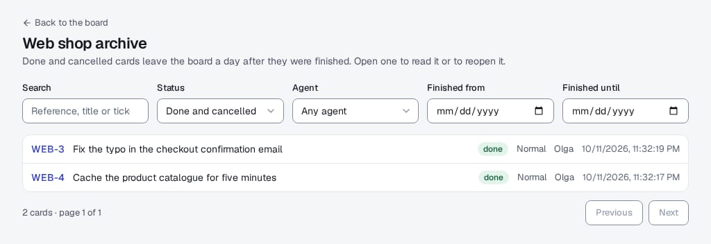

**Priority scale.** Urgent is 1, High 3, Normal 5 and Low 8 (the API accepts 1 to 9). A card created with priority 2 keeps 2; only cards from before priorities had labels, whose default was 2, were read as Normal. A bug the platform team files for itself is High (3).

**Priority and completion action at any time.** On an open card, even while an agent is working on it, **Priority** and **Completion action** (expert mode) are changed in place on the card page. The completion action is locked only while a finalise waits for approval or runs; a change then applies to the next finalise. A Done card still takes a new priority; a Cancelled card takes nothing.

Other cards that depend on the reopened card are held again until it is done, unless they already started; those get a note on their thread. A card in a phase makes the phase incomplete again while the phase is still open.

### 8.2 From research to a project

**You want:** to find out whether a new payment provider is worth using, and build the integration if it is.

1. **Create a research project.** **New project**, workflow **Research**. No repository is needed.
2. **Ask the question as a card:** a title, the question, the scope and the depth (**Quick**, **Standard** or **Deep**). A researcher finds sources, a fact checker verifies every claim against them, and the result is **published as a note** in the project's vault folder, with sources.
3. **Read the notes** on the **Research** tab. If a claim is not supported, the fact checker sends the note back for rework and says why.
4. **Decide.** When the answers are good enough, **convert** the project (**Project settings, Stage, Convert project**): choose Code as the target, add the repository (or request a new GitHub repository, which waits for your approval on the desk), decide what happens to open research cards, and write a hand-over note.
5. **Build.** The published notes are listed in the project's `PROJECT.md`, so every builder reads them. Create the first cards and carry on as in 8.1. The project remembers that it **started as research**, and the Research tab stays.

### 8.3 Setting up interests without being flooded

**You want:** to follow AI news, but not get a hundred links a day.

1. **Create the interest** (**Interests, New interest**). Write the description like a briefing: "Practical agent engineering and coding assistants. No hype, no press releases." Choose the kinds you want (articles, videos, podcasts). There is no vault to choose: an interest's files live in the organization vault.
2. **Keep the volume low.** Set **max total items** to something small, such as 5 or 10 per run. Choose a **run schedule** that matches how fast the topic moves (daily is plenty for most), and a **delivery schedule** of **one digest at set times** (for example weekdays at 07:00) instead of "as soon as a run finishes". Runs can happen as often as they like, but you only hear from them at the times you chose.
3. **Set the quiet cap.** At the bottom of the Interests page, **Daily quiet cap** limits how many items reach your desk per day across all interests.
4. **Teach it.** For the first two weeks, rate what arrives: **useful**, **irrelevant** or **boring**, with a short reason. Add taste rules ("Prefer primary sources over summaries", "Skip beginner tutorials").
5. **Go deeper only when it is worth it.** **Research this** on one item produces a fact-checked note. Research never starts by itself.
6. **Watch the cost.** The interest's **Settings** tab has a monthly budget. A paused interest does not run.

If an interest cannot run (for example its workstation is offline), it shows a red **Cannot run** badge with the reason and raises a notice on your desk after the third attempt.

### 8.4 Controlling spend

**You want:** the agents to be useful without surprises on the bill.

1. **Look at what things cost.** Open **Costs** for the breakdown by project, agent, model and day, and the **Agents** page for each agent's monthly and total cost.
2. **Set budgets.** For every project, set a **Monthly budget** in its settings. Start with a number you would be comfortable losing and raise it when you trust it.
3. **Use the right model for the job.** A smaller model for reviewers and testers, a stronger one for builders and the BA. Change an agent's model any time (**Change model**).
4. **Let the 80% notice work for you.** When it arrives, check the **daily report's Spend section** for which projects and agents cost the most.
5. **At 100%** the project pauses by itself. Decide on the desk: **Raise budget** or **Override for this month**. Declining to act is also a decision: the project stays paused until the 1st.
6. **Stop loops early.** If a card keeps failing, the loop breaker already backs it off (see 9.3) and your CEO warns you. Do not keep feeding a card that cannot succeed. Cancel it or fix what it cannot do.
7. **Review monthly.** Export the Costs CSV and look for agents that cost more than they deliver.

## 9. Troubleshooting

### 9.1 The installer

| What you see | What to try |
| --- | --- |
| The wizard stays on "Waiting for you to run the command" | The command was not run, or was run on a different computer than you chose. Run it on the computer that will host the agents. Check you pasted all of it. |
| The command link says it expired | The link works for 30 minutes. Choose your system again on the page to get a new command. |
| "Paired" never appears | The computer cannot reach this website. Check its internet connection, proxy and clock. Run the command again, it is safe to repeat. |
| A health check shows a warning (Claude, sandbox, Docker, yt-dlp, a repository) | Each row says what is wrong and how to fix it. Claude not signed in: run `claude` on the workstation and sign in. Sandbox missing on Linux: install `bubblewrap` and `socat`. Docker and yt-dlp are optional. |
| Windows asked to restart | Restart. The installer continues by itself when you sign in again. |
| Anything else | Open **Contact us** from the installer's failure screen. It already knows what went wrong. |

> **In the app:** Help, "Installing a workstation: if something goes wrong" (`/help/install-troubleshooting`).

### 9.2 The runner is offline

A workstation that shows **Offline** cannot take work. Its agents show "offline" and cards that only they could take show an amber warning ("Reviewer Linus is offline").

1. Is the computer on and awake? Laptops that sleep disconnect.
2. On the workstation open a terminal and run `aom-runner status`. It shows whether the runner is running and connected.
3. If it is not running, `aom-runner start` (or restart the service the installer set up). Run `aom-runner doctor` for a health check of Node, git, Claude and the connection to the server.
4. Still stuck? Running the installer command again repairs the installation and keeps the pairing.

The warning icons clear by themselves when the machine returns (within about 30 seconds). Logs are in `~/.aom-runner/logs/`.

### 9.3 A card is backing off

An amber badge "Backing off until 14:32 (3 failures)" on a card means the **loop breaker** stepped in. When three shifts on the same card end without a report within 10 minutes (the agent crashed, timed out or was stopped by a denied tool), the dispatcher stops handing the card out. The wait starts at 1 minute and doubles with each failure, up to 1 hour. You also get one alert on the desk.

1. Open the card and read the **Timeline** and the last **Handoff** for the reason. The usual cause is something the agent cannot do: a tool that is denied, a missing capability, a repository that is not on its workstation.
2. Fix the cause (adjust the card, the agent or the workstation).
3. Click **Release back-off** on the card to try again at once. Moving the card to another stage also clears it.
4. If it keeps failing, cancel the card and write a better one.

**A card that keeps crashing is parked.** After 10 failed shifts in one episode the loop breaker stops backing off and parks the card: it becomes blocked and one blocking item appears on the desk, naming the card, the failure count and the last error. Fix the cause, then answer (resolve) the item or move the card back to the queue. The failure count starts again from zero.

Cards made by a schedule or an interest run in a project with exactly one repository get that repository, like a card you create by hand. With several repositories the card has none until you pick one.

### 9.4 A budget pause

A banner "This project has used its monthly budget" and a desk item mean the project is paused. Running shifts finish, nothing new starts. See 4.6. On the desk choose **Raise budget** (the pause lifts as soon as the new amount is above the spend) or **Override for this month**. If you are a Member, tell an Owner or Admin.

### 9.5 A missing working branch

Guildwise uses the repository's default branch by itself, so you rarely see this. Symptom: the DevOps engineer does not commit or pull in a repository, and the desk asks "Which branch is the working branch?" (or the project settings show *not confirmed*). Answer the question on the desk, or set the branch in **Project settings, Repositories, Change**. The DevOps engineer commits and pushes right away. If the branch you named does not exist yet, the runner creates it from the repository's **main branch** (default: the repository's default branch) and pushes it when the next card starts (the card shows "Created working branch X from Y", and the repository row in the project settings keeps the date); you only get this question when it cannot tell the main branch, the main branch you named does not exist, or the push is refused (the message names the branch and the host's reason: check that this workstation may push to the repository). See 4.4.

**Git hosts.** Every repository has a git host, detected from its address and changeable by the project owner (Project settings, Repositories, Change). One project can mix hosts. For pull requests, listing your repositories and creating new ones, the workstation must be connected to that host: the Workstations page and the repository's Git host line show, per host, Connected, Not connected (no token saved), Token refused (the host said no; the line below gives the HTTP status and the likely missing scope) or Could not check (the host could not be reached; it clears by itself). For Bitbucket Cloud the token needs the repository and pull request read/write scopes; the account scope is not required, and **Connect** gives the one command to run on that workstation (`aom-runner git-connect github`, `gitlab`, `bitbucket-cloud` or `azure-devops`); your login or token stays on that computer and the server only learns whether it works. The DevOps engineer can walk you through it: it can start a browser sign-in and show you the address and code, but it never asks for or types a token (if one is needed it tells you to run the command yourself or use **Connect**). **Azure DevOps:** personal access tokens that are not limited to one organization stop working on 2026-12-01, so use a **Microsoft Entra service principal** (or workload identity) as the main sign-in: register an app in Entra, add it to your Azure DevOps organization with Basic access and Contributor on the repositories, and set `AZURE_TENANT_ID`, `AZURE_CLIENT_ID` and `AZURE_CLIENT_SECRET` (or `AZURE_FEDERATED_TOKEN_FILE`) for the runner on that workstation. A token for one organization and `az login` remain supported fallbacks. Agents can also ask for a new repository on any of these hosts (GitHub, GitLab, Azure DevOps, Bitbucket Cloud); you approve it on the desk and your own login on the workstation creates it. **SSH instead of an API token.** If you already have SSH keys and would rather not create tokens, use SSH for clone, fetch and push. On the Workstations page, open the workstation, click **SSH** on the git host, choose the default for new clones (API token / CLI login, or SSH key) and the key: **a key made by the runner** (the page then shows the public key and where to add it on GitHub, GitLab, Bitbucket or Azure DevOps), **a key file I already have** (give its full path on the workstation; it is not copied), or **my ssh-agent**. Press **Check SSH** (optionally with a repository address) to see one clear state: SSH works, the host refused the key, host key changed, host not reachable, no key yet, or ssh is not installed. In a terminal the same is `aom-runner git-connect github --ssh` (with `--key-file <path>` or `--agent`, and `--check`). Per repository, the owner can override the default under **Access** (Project settings, Repositories, **Change**); the clone's remote address on the workstation switches between https and ssh automatically. The private key stays on the workstation and agents never see it; the runner does the git work for them. SSH does not give pull requests, branch rules or the repository list: those still need the token or CLI login. Without it, finishing a card pushes the branch and the manager opens the pull request, and the page says so. A plain git server needs no connection but gets no pull requests: the branch is pushed and the desk tells you to open the request yourself. If the working branch is protected on the host, finishing a card opens a pull request instead, says so on the card, and the project switches to pull requests for new work.

**Repositories, tools and rights on a workstation.** A repository you add under Project settings, Repositories is cloned (or, with "Create a new repository", created and cloned) onto the project's workstations by their DevOps engineers; the Repositories tab shows Cloning, Cloned on a workstation or Failed with the reason and a Try again button. Before build work starts on a workstation the DevOps engineer installs the tools the repository needs (for a .NET MAUI app: the .NET SDK, the MAUI workloads, a JDK and the Android SDK), if you ticked "Install packages and tools", and then the project's own packages (pnpm/npm/yarn/bun install, Python into the project's environment, dotnet restore, Go, Rust, Maven, Ruby, PHP); until the workstation is ready every agent card of the project waits with the reason, a notice on your desk tells you when it needs your help or failed, and Project settings shows the Development environment per workstation with Check again. On the Workstations page every ticked DevOps right shows verified or failed with how to fix it, and a sudo password, if sudo needs one, is entered there: it is encrypted for that workstation and never shown again.

**Fix with DevOps.** Next to every item that failed or is missing (a tool in the Development environment, a ticked right that failed verification, a repository that could not be cloned) there is a **Fix** button. It sends the DevOps engineer of that workstation a request with the error text, the workstation, the project and the repository, so you do not have to write it yourself. The status shows right next to the item: *Requested*, *DevOps is working on it*, *Needs your approval on the desk* (when the fix is outside what you allowed), *Done* or *DevOps could not fix it* (with **Fix again**). When DevOps reports done, the check runs again by itself (the environment check, the rights check, or the clone), and **Check again** is there if you want to run it yourself.

### 9.6 Two-factor recovery

- **You lost your phone, but have your recovery codes:** at the sign-in code step, type one of the ten recovery codes instead of the six digits. Each works once. Then set up two-factor login again on a new phone (**Your settings**), which gives you new codes.
- **You lost both:** ask your Owner to **reset your two-factor login** (**Organization, Members**; only the Owner can). If you are the Owner, ask the platform administrator (**Accounts**). If you are the platform administrator, an operator resets it on the server with `superadmin-reset-password --reset-two-factor`.
- **Too many wrong codes:** after five wrong codes the sign-in attempt is cancelled. Sign in again with your password and type the right code.

> **In the app:** Help, "Two-factor login" (`/help/two-factor`) and "Troubleshooting" (`/help/troubleshooting`).

### 9.7 Other things you may see

| What you see | What it means |
| --- | --- |
| A red warning icon on a card, "Not workable" | Nobody hired could ever take this stage. Hire the missing role (hover, focus or click the icon: the explanation has a **Hire** link). |
| An amber icon, "Waiting" | Agents exist but are offline or busy. It clears by itself. |
| An amber icon, "Last attempt failed: ..." | The runner turned the last shift down (for a missing working branch it names the branch and the repository's default, and links to Project settings, Repositories). A desk question offers the existing branches, with the default preselected; the message clears when a shift starts. |
| The card says "waiting on bug" | The tester found a bug and a bug card is being fixed. |
| The card says "waiting for sub-workflow" | A step of the card started another card (named on the tile) and the card carries on when that card finishes or is cancelled. |
| A desk item "Could not post the update" | The ticket system refused the post. Fix the login on the workstation and use **Retry**. |
| Vault sync paused with a conflict | A local and a remote change collided. Resolve it in the vault, then restart the sync. |
| "Out of scope" in a handoff | The agent found work outside its role. Adjust the card or the agent's skills. |

## 10. Contact us

If something is broken, confusing or missing, tell us. **Contact us** is in your avatar menu, in the command palette (Ctrl+K, type "contact"), on the **Help** page, on the installer's failure screens and, for people who are not signed in, in the footer of the sign-in page.

1. Choose what it is about: **bug report**, **question**, **feature request** or **billing**.
2. Write a subject and a message.
3. When you open it from the menu or the palette, a screenshot of the page you were looking at is attached automatically. You can remove it or upload a different image (PNG, JPEG or WebP up to 2.5 MB).
4. Open **What we send with your request** to see exactly what goes along: the page you were on, the app version, your browser and screen, and the last few errors from your browser (untick the box to leave the errors out). Your name, email and organization are added so that support can answer.

We answer by email, and the answer also appears under **Help, My requests**, where you can reply. A request is **Open** until we answer, **Answered** until you write again, and **Closed** when we are done. A request with a new answer shows a "New reply" badge.

> **In the app:** Help, "Writing to us" (`/help/writing-to-us`).

> **In the app:** watch the video "The Help centre" (Help, "Getting started", `/help/getting-started#the-sidebar`). The page's own help panel (**?** in the top bar) has it too, under **Watch the video**.

## 11. Frequently asked questions

**Is Guildwise HQ hosted, or do I install it?**
It is a hosted service: you sign up on the website (3.1). Only the runner goes on your workstation, your own computer, a VPS or a GitHub Codespace, and your code stays in your own repositories.

**Do the agents see my whole computer?**
No. They run inside a sandbox on the workstation, with access to the repositories and folders they need. Warnings appear if a workstation cannot provide a sandbox. The DevOps engineer is the exception: it works as you, so only give it a machine you are happy to hand it (4.4).

**Where is my code stored?**
On your workstations and in your git remotes, exactly as before. The Guildwise HQ website holds the board, cards, desk, ledger, and records of what the agents did. Passwords and tokens for Jira, your git hosts and Claude stay on your workstation.

**Can an agent change my main branch by itself?**
Only after review and test, and only if the project's **How finished work lands** is *Commit and push to the working branch* (the default). Choose *Pull request I approve* to merge everything yourself. Large changes wait for your approval either way, unless you turned that off in the project settings. If the working branch is protected on your git host, a pull request is opened instead.

**What does it cost?**
Guildwise HQ is $19 (Starter), $49 (Team) or $149 (Business) a month with a 7-day free trial, in US dollars including VAT, charged in rand (4.17). The AI work is billed by Claude: through your subscription or your API key. The app estimates the spend (4.6) and you set budgets.

**How many agents do I need?**
Start with a builder, a reviewer, a tester and a BA (3.5). Add more when cards queue up.

**Can I stop an agent?**
Yes. **Cancel** a card, or **Fire** an agent. A running shift is stopped, and its card goes back to the queue.

**An agent asked something I already decided.**
Add the decision to the ledger when you answer (4.5). Agents search the ledger before they ask.

**What if two of my projects have a card with the same number?**
Card numbers are unique only within one organization. If you are in two organizations with a `WEB-1` each, the app asks which one you mean.

**Can I use it on my phone?**
Yes: the board, the desk, cards, chat and most pages work on a phone. Open the menu with the button at the top left. On the board, **Filters** and **Project actions** open the controls that sit in the header on a bigger screen, and cards can be moved with **Move to...**. The installer needs a computer.

**Where do I find help?**
**Help** in the sidebar: the getting-started training video, searchable articles, the glossary, the **Blog**, **See what's new**, the guided tour again (**Resume the tour** when you stopped part-way), the Get started checklist (bring it back from here), **Contact us** and **My requests**. The **?** hints open the matching article. Press **Ctrl+K** to search the app.

**Which keys can I press?**
Press **?** (when not typing in a field) for the list of shortcuts. **Ctrl+K** opens the command palette.

## Appendix A. Where to find things

### The section map

Every entry of the sidebar, in sidebar order, with who sees it, where this guide covers it, its step in the guided tour (3.3) and its Help article. Use these names: they are the labels in the app. Nothing here is hidden by a different name in the app; an entry is missing from your sidebar when your role or your organization's plan does not include it.

| # | Section (sidebar) | Who sees it | Guide chapter | Tour step | Help article |
| --- | --- | --- | --- | --- | --- |
| 1 | **Board** (with card, New card, Archive and phase pages) | Everybody | 2.2, 3.7, 3.8, 4.6, 4.10, 4.12, 8.1 | `board` | Board and cards |
| 2 | **Backlog** (project tab) | Everybody reads; Owners and Admins edit | 4.3b | `backlog` | Board and cards |
| 3 | **Environments** (code projects) | Everybody; Owner approves | 4.21, 4.23, 4.27 | `environments` | Phases and follow-ups |
| 4 | **Research** (projects with research) | Everybody | 4.13, 8.2 | `research` | Converting a project |
| 5 | **Desk** | Everybody | 3.8, 4.5, 4.11 | `desk` | Your desk |
| 6 | **Intake** | Owners and Admins | 4.8 | `intake` | Intake and outbox |
| 7 | **Automations** | Everybody | 4.8 | `schedules` | Automations and integrations |
| 8 | **Projects** (and project settings) | Everybody; Owners and Admins change | 3.6, 4.3, 4.3a, 4.14, 6.1 | `projects` | Projects |
| 9 | **Agents** | Everybody | 3.5, 4.4, 4.18 | `agents` | Agents |
| 10 | **Org chart** | Everybody | 4.7 | `org-chart` | Organization chart and design |
| 11 | **CEO** | Owners and Admins | 4.11, 4.22 | `ceo` | Your CEO |
| 12 | **Roles & workflows** (page title Organization) | Everybody | 4.7, 4.26 | `org` | Organization chart and design |
| 13 | **Workstations** | Everybody | 3.4, 4.19, 4.24a, 4.25, 9.1, 9.2 | `workstations` | Workstations and the installer |
| 14 | **Releases** | Everybody; Owners and Admins release | 4.28 | `releases` | Phases and follow-ups |
| 15 | **Integrations** | Everybody | 3.4a | `integrations` | Integrations |
| 16 | **Metrics** | Everybody | 4.29 | `metrics` | Agents |
| 17 | **Costs** | Owners and Admins | 4.6, 8.4 | `costs` | Budgets and costs |
| 18 | **Interests** | When the Interests feature is on | 4.9, 8.3 | `interests` | Interests |
| 19 | **Ledger** | Everybody | 4.5 | `ledger` | Ledger and vaults |
| 20 | **Vaults** | Owners and Admins | 4.3, 4.3a | `vaults` | Ledger and vaults |
| 21 | **Settings** (also **Your settings** in your avatar menu) | Everybody | 3.2, 4.30 | `settings` | Getting started |
| 22 | **Organization** | Everybody; Owners and Admins manage | 4.1, 4.2, 4.16, 4.17 | `organization` | Organizations and roles |
| 23 | **Help** | Everybody | 3.3, 10, 11 | `help` | Getting started |
| P | **Platform area** (platform administrator) | Platform administrators | 7 | the platform tour | Organizations and roles |

The platform area has its own menu: Organizations (7.2), Invitations (7.3), Accounts (7.4), Billing (7.10), Support (7.5), Blog (7.7), API keys (7.11), Runners (7.12), Platform team (7.9), Inbound mail (7.13) and Audit log (7.6).

### Questions you may have

| I want to | Go to |
| --- | --- |
| See my work | **Board** (sidebar, Work) |
| Keep a list of wanted work that agents do not touch yet | **Backlog** (tab next to the board) |
| Answer questions and approve things | **Desk** |
| Hand the BA a ticket | **Intake** (Owners and Admins) |
| Set up recurring jobs and event automations | **Automations** |
| Connect Claude, git hosts, Jira and MCP servers on a workstation | **Integrations** |
| Create or change a project, or put the projects in priority order | **Projects** |
| Follow a topic | **Interests** (Knowledge) |
| Look up a past decision | **Ledger** (Knowledge) |
| Register a notes vault | **Vaults** (Owners and Admins) |
| Hire or change agents | **Agents** (Organization) |
| See who answers whom | **Org chart** |
| Talk to your CEO, set what it may decide and when it reports | **CEO** (Owners and Admins) |
| Design roles and workflows | **Roles & workflows** |
| Add a computer, a VPS or a Codespace | **Workstations** |
| See how the team performs | **Metrics** |
| See and control spend | **Costs** (Owners and Admins) |
| Picture, notifications, Monday briefing, time zone, two-factor, expert mode for code changes, weekly blog digest | **Settings** (the sidebar, or your avatar menu, Your settings) |
| Link projects to each other (for the CEO's routing) | **Organization**, Project links tab (Owners and Admins) |
| Release a version that is ready, see what is live and what was deployed and why it was allowed, edit the rules, freeze all releases | **Releases** (Organization; Owners and Admins release, everyone looks) |
| Say where your app runs, start steps, test and live sites, places, and pause a project's releases | **Environments** (the project, under the board) |
| Set a deploy secret | **Environments**, Show technical details |
| See a project's code map | **Projects**, then the project's **Settings**, Code map for agents |
| Members, invitations, plan, billing | **Organization** (bottom of the sidebar) |
| Help, glossary, blog, what's new, the tour, contact us | **Help** |

## Appendix B. More documentation

- `docs/RUNNER.md`: the runner in depth (data folder, command-line, configuration, Windows and WSL2).
- `docs/SELF-HOSTING.md`: installing and running the Guildwise HQ server (for whoever hosts it).
- `docs/SPEC.md`: the full product specification.
- `docs/ARCHITECTURE.md`: technical design.
- `docs/guide/Guildwise-HQ-User-Guide.pdf`: this guide with screenshots, as a PDF.
